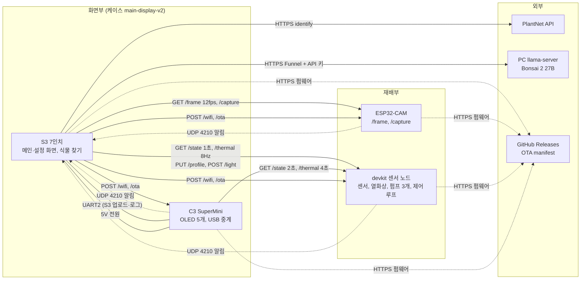
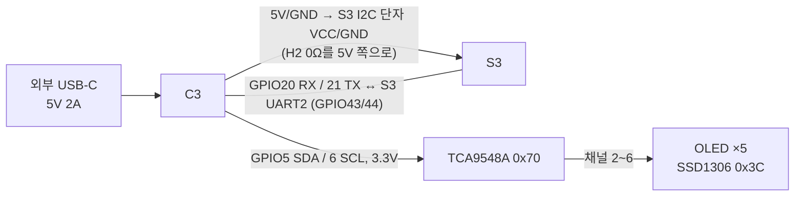
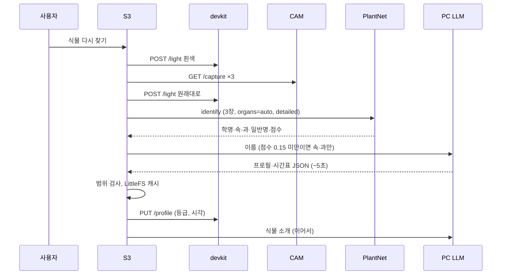

# AIplantRx v2 시스템 아키텍처

2026-11-13 기준입니다. PLAN.md(11-11), LLM_ARCHITECTURE.md, UI.md, LLM_SERVER.md, firmware/s3에 흩어진 내용을 지금 정해진 상태 하나로 모았습니다. 세 문서가 서로 다르게 적은 곳은 나중 결정(UI.md, LLM_ARCHITECTURE.md)과 실제로 만든 S3 펌웨어를 따랐습니다. 다른 점은 8장에 적어 두었습니다.

## 1. 한눈에 보기

핵심 흐름은 세 단계입니다.

1. **식별:** CAM 사진 3장 → PlantNet → 학명·속·과·점수
2. **프로필:** 그 이름 → PC LLM → 목표 환경과 시간표(JSON) → S3가 범위 검사
3. **제어:** devkit이 프로필로 펌프 3개(물·양액·pH)와 조명을 스스로 돌린다. S3나 Wi-Fi가 끊겨도 계속한다. 히터는 없다(11-13 결정). 온도는 재서 보여 주기만 한다.

원칙은 세 가지입니다.

- **시연 안정성 우선:** 어떤 경우에도 멈추지 않고 "실패", "못 찾음"을 띄우지 않는다. 막히면 기본 프로필로 간다.
- **제어는 devkit 안에서 끝낸다:** 다른 기기는 보여 주거나 목표값을 바꿀 뿐이고, 안전 장치는 devkit만 가진다.
- **비용 0원:** PlantNet 무료 등급, LLM은 학교 PC(창조데스크탑2), Tailscale 무료 요금제.

## 2. 하드웨어

### 2.1 보드

| 보드 | 칩·메모리 | 역할 | 펌웨어 |
| --- | --- | --- | --- |
| Waveshare ESP32-S3-Touch-LCD-7 | S3, 16MB 플래시, 8MB PSRAM, 800×480 RGB, GT911 터치 | 메인·설정 화면, 영상 2개, PlantNet·LLM 호출, 다른 기기에 지시 | firmware/s3, 동작 중 |
| ESP32-C3 SuperMini (TENSTAR) | C3, 4MB | OLED 5개 표시, 외부 USB-C 하나(전원 + C3/S3 업로드 + S3 로그) | 없음 |
| ESP32-CAM (AI-Thinker) | ESP32, 4MB, PSRAM 4MB, OV2640 | 카메라 전용: 화면용 QVGA, 식별용 UXGA | 없음 (smartfarm 것은 RTSP·MJPEG, 새로 만듦) |
| ESP32 devkit | ESP32 38핀 와이드(28.2 × 54.35, USB-C. WROOM인지 WROVER인지 확인 필요) | 센서, 열화상, 토양 RS485, 펌프 3개(LR7843 MOSFET 모듈), NeoPixel, 제어 루프, 안전 장치 | 없음 |

CAM과 devkit은 합치지 않습니다. CAM은 남는 핀 5개가 모두 부팅 관련 핀이고 카메라 부하로 이미 불안정해서 제어를 맡기지 않습니다.

### 2.2 화면부 배선 (S3 + C3, 한 케이스)

- S3 UART 선택 스위치는 UART2(C3 연결)에 둔다. S3 I2C 단자는 전원만 쓰고 SDA/SCL은 비운다. 그 버스의 CH422G가 0x30~0x3F에 응답해 OLED 0x3C와 부딪치기 때문이다.
- OLED 버스는 전부 3.3V. 5V 풀업 금지.
- H2 저항을 옮길 때 세 패드를 한꺼번에 잇지 않는다(3V3-5V 합선). 전원 넣기 전에 멀티미터로 확인.
- 화면부 전류는 평균 0.6~0.7A, 순간 1A 안팎으로 추정.
- TF 슬롯, RS485, CAN, Sensor AD 단자는 쓰지 않는다.

### 2.3 재배부 배선 (devkit, 핀 초안)

| 기능 | 부품 | 핀 |
| --- | --- | --- |
| I2C | SCD41(Adafruit 5190, 공기 온습도·CO2, 0x62), MLX90640(Adafruit 4407 55°, 열화상 32×24, 0x33) | SDA 21, SCL 22 |
| RS485 (Modbus RTU) | MAX485 수동 방향 모듈 → 토양 센서 DFRobot SEN0604(온도·수분·EC·pH) | UART2 RX 16, TX 17, DE+RE 묶어서 4 (WROVER면 UART 핀 바꿈) |
| 펌프 출력 | LR7843 MOSFET 절연 모듈(HW-532) × 3 → 물 / 양액 / pH 펌프 | 26 / 27 / 32 (25는 예비) |
| NeoPixel 링 24 | Adafruit 1586, 촬영 조명·상태 | 23 직결 |
| 수위 플로트 (권장) | 물통 빔 감지 | 34 (입력 전용, 외부 풀업) |
| CAM 중계 업로드 | ESP32-CAM U0R / U0T (각각 1kΩ 직렬) / IO0 / EN(RST 버튼 패드에 납땜) (각각 PC817C) | UART1 TX 18 / RX 19, IO0 25, EN 33 (25·33 HIGH = 옵토 켬 = CAM 핀 LOW) |

- **센서 노드 전원 (두 갈래):** devkit은 자기 USB-C로만 받는다(5V 충전기, A-to-C 케이블. C-to-C로는 안 켜지는 클론이 있음). devkit 3.3V 핀이 SCD41, MLX90640, MAX485를 먹인다(약 0.3~0.5A, 보드 VBUS 다이오드 1A 안). 12V 어댑터(3A 이상)는 케이스 안 5V 강압 모듈 2개(사용자 보유 17.5×12 고정 5V, CN3903 계열, 계속 1.6~1.8A)와 SEN0604, LR7843·펌프를 먹인다: **강압 1은 링 전용**(흰색 최대 1.44A, 밝기 제한 없음), **강압 2는 ESP32-CAM**(약 0.3A). devkit 5V 핀은 아무 데도 잇지 않는다. 그래서 USB 5V와 강압 5V가 만날 곳이 없고 역류 방지 다이오드가 필요 없다. **devkit GND와 12V −는 선 하나로 잇는다**(링 데이터와 RS485 신호의 기준). USB만 빠지면 devkit이 꺼지고 LR7843 입력이 떠서 펌프도 꺼진다. 12V만 빠지면 링, CAM, 토양 센서, 펌프 전원이 꺼진다. 12V 입력에 퓨즈(3~5A), 링 5V에 220~470µF를 권한다. 링을 계속 최대로 켜면 링(약 7W)과 강압 모듈이 뜨거워진다. 본체·디퓨저가 PLA라, 처음에 10분 켜 두고 온도를 확인한다.
- **NeoPixel:** 레벨 변환·직렬 저항·큰 커패시터 없이 23번 핀에 바로. 링(rev C)에 470Ω이 이미 있다. 깜빡이거나 색이 튀면 링 5V선에 다이오드 하나를 넣어 약 4.3V로 낮춘다.
- **MAX485:** devkit 3.3V로 쓴다(정격은 5V지만 선 2m, 센서 1개라 대개 된다). 5V로 돌리면 RO가 5V라 ESP32 RX(16)가 상하니, 올려야 하면 RO → RX에 1k/2k 분압. 120Ω 종단은 그대로 둔다.
- **펌프 출력 (LR7843 모듈):** 입력은 HIGH=켜짐, 옵토(EL817)로 절연. ESP32 3.3V로 켜진다. 입력이 떠 있거나 LOW면 게이트 4.7k 풀다운으로 꺼져 있어서, 리셋·부팅·OTA 중에도 펌프가 돌지 않는다(외부 풀다운 불필요). 게이트 전압이 모듈 전원의 절반이라 **펌프는 12V로 한다.** 5V 펌프는 개조 없이는 안 켜진다. 보드에 플라이백 다이오드가 없다(보드의 D1은 게이트 쪽). 원래는 펌프마다 펌프 단자에 다이오드를 단다(캐소드 +, 애노드 LOAD). **지금은 시간 관계로 생략하고, 그래서 펌프는 켜고 끄기만 하고 PWM은 쓰지 않는다**(PWM이면 스파이크를 1초에 수백 번 맞아 MOSFET이 상한다). 펌프를 끌 때 ESP32 재부팅이나 RS485 오류가 생기면 다이오드부터 단다.
- **모듈 자리:** LR7843 모듈 3개는 센서 노드 케이스 안에만 둔다. 바깥 연결은 모두 케이스 한 면(-Y)에 모은다: devkit USB-C, 12V 입력(KF301 2P), 펌프 1~3(KF301 2P 각각), RS485 센서(KF301 4P: V G A B). 단자는 벽 안쪽 포켓에 끼우고 핀에 선을 납땜한다. devkit에서는 신호선(26/27/32)과 GND만 모듈 신호단으로 간다. devkit GND와 12V −를 선 하나로 이으므로 모듈의 옵토 절연은 쓰지 않는 셈이지만 문제없다. SEN0604는 12V로 돌린다.
- **안전:** 펌프 1회 최대 가동, 하루 최대 물 양, 양액·pH 투입 후 잠금 시간. 이 값들은 펌웨어 상수이고 LLM이 바꾸지 못한다.
- **12V 예산 (어댑터 12V 2A):** 펌프 빼고 약 0.87A(링 최대 0.68, CAM 0.15, SEN0604 0.04). 그래서 펌웨어가 **펌프는 한 번에 하나만**, **링을 밝게 켠 촬영 중에는 펌프 정지**를 지킨다(상수). 펌프는 정격 0.8A 이하로 고른다. devkit은 USB-C로 따로 받아서 펌프 기동 때 12V가 출렁여도 영향이 없다.
- CAM은 강압 2의 5V와 GND를 받는다. 평소 통신은 Wi-Fi로 S3와 직접 하지만, OTA가 망가지면 케이스를 열지 않고 devkit을 거쳐 유선으로 올릴 수 있게 4가닥(U0R, U0T, IO0, EN)을 devkit에 잇는다. CAM(구형 ESP32)은 소프트웨어로 다운로드 모드에 못 들어가서 IO0 LOW + EN 리셋이 필요하다. 두 보드가 따로 켜지고 꺼지므로 IO0·EN은 PC817C로 당긴다(꺼진 devkit의 핀이 CAM EN을 약 0.6V로 붙잡아 CAM을 리셋 상태에 가두는 걸 막는다. 옵토 트랜지스터 C를 CAM 핀, E를 GND, LED는 devkit 핀 → 1kΩ). UART 두 선은 1kΩ 직렬로 꺼진 쪽으로 새는 전류를 막는다. IO0은 카메라 XCLK와 같은 핀이라 업로드 때만 당긴다. 중계 방식은 C3→S3와 같다: esptool `--before no-reset --after no-reset -b 115200`, devkit이 동기화를 보면 CAM을 다운로드 모드로 리셋하고 바이트를 넘기며, 끝나면 IO0을 놓고 다시 리셋한다. 이때 12V(CAM 전원)도 켜져 있어야 한다. 평소에는 devkit이 UART1로 CAM 로그를 받아 볼 수 있다. 화면부와 재배부는 Wi-Fi로만 이어져 GND를 공유하지 않는다.
- 부품 치수·출처: cases/sensor-node/research/parts_research.md. 케이스: cases/sensor-node(140 팬 자리에 거꾸로 매다는 상자).

### 2.4 PC (LLM 서버)

창조데스크탑2: i7-13700, RTX 5060 8GB. llama.cpp(PrismML 포크) + Ternary-Bonsai-2-27B, 0.0.0.0:8080, 슬롯 1, 컨텍스트 8192. 부팅 시 예약 작업으로 시작하고 죽으면 5초 뒤 다시 뜬다. 출력 약 55~59 tok/s, 프로필 1건 약 4~5초. 자세한 내용은 LLM_SERVER.md.

## 3. 네트워크

| 항목 | 정한 것 |
| --- | --- |
| 망 | 시연용 공유기나 핫스팟 하나(행사장 Wi-Fi는 기기 간 통신을 막는 일이 많음). 예비 인터넷으로 휴대폰 핫스팟 |
| 기기 간 | 전부 Wi-Fi HTTP/1.1. ESP-NOW 없음 |
| 주소 | DHCP. 모든 기기가 5초마다 UDP 4210 브로드캐스트 `{"role":"cam"/"node"/"oled"/"panel","name","ver","port"}`. S3와 C3가 듣고 기기 표를 만든다. mDNS는 개발용(aiplantrx-s3.local) |
| 연결 방식 | S3는 기기마다 연결 하나를 열어 두고 계속 쓴다(keep-alive). 서버는 응답에 Content-Length를 넣어야 한다 |
| 바깥 | S3 → PlantNet(HTTPS), S3 → PC llama-server(Tailscale Funnel HTTPS + Bearer 키). S3는 Tailscale에 붙지 않는다 |
| 시각 | 모든 기기 NTP(KST). devkit은 PUT /profile 때 S3가 보낸 시각도 받는다. RTC가 없어 시각을 모르면 켜진 뒤 센 시간으로 돈다 |

### 3.1 HTTP 인터페이스

| 기기 | 요청 | 내용 | 누가, 얼마나 |
| --- | --- | --- | --- |
| CAM | GET /frame | QVGA(320×240) JPEG | S3, 최대 12fps |
| CAM | GET /capture | UXGA(1600×1200) JPEG, 안 되면 SXGA | S3, 식물 찾기 때 3장 |
| devkit | GET /state | JSON: air_c, rh, co2, soil_pct, ec, ph, 잎 온도·열화상 최고·최저, light/water/nutr/ph_pump 상태, water_ml_today, next_nutr, events, 프로필과 등급. 히터 필드(heater, heater_min_today)는 없앤다 | S3 1초, C3 2초 |
| devkit | GET /thermal | 32×24 int16 리틀엔디언, 0.01°C, 1,536바이트 | S3 8Hz, C3 4초 |
| devkit | PUT /profile | 목표값, 시간표, 등급(llm/default), 현재 시각. NVS에 저장 | S3, 식물 찾은 뒤 |
| devkit | POST /pump | 펌프 수동 조작 {water/nutr/ph, 초}. 안전 상한 안에서만, 시간이 지나면 자동으로 끔 | S3 |
| devkit | POST /light | NeoPixel 흰색 / 원래대로 | S3, 촬영 때 |
| 모든 기기 | GET /info | 이름, 버전, 가동 시간, 재시작 이유 | S3, 점검 |
| 모든 기기 | POST /wifi | 새 SSID·비밀번호 저장 후 이동 | S3 "모든 기기에 적용" |
| 모든 기기 | POST /ota | {url, sha256, size}, 기기가 직접 받아 검증 | S3 "업데이트" |

S3에는 개발용 HTTP(/info, /perf, /screen.bmp, /tap, /swipe, /set, /reboot)가 있다(firmware/s3/README.md).

## 4. 소프트웨어

### 4.1 S3 (firmware/s3, 동작 중)

Arduino-ESP32 3.1.1(pioarduino), LVGL 8.4, ESP32_Display_Panel. 부팅 뒤에는 FreeRTOS 작업만 돈다.

| 작업 | 코어 | 하는 일 | 파일 |
| --- | --- | --- | --- |
| lvgl | 1 | 화면 그리기, 터치 10ms | lvgl_v8_port.cpp, ui/ |
| net | 0 | Wi-Fi, NTP, mDNS | net.cpp |
| disc | 0 | UDP 4210 듣기·알리기 | nodes.cpp |
| cam / jpeg | 0 | CAM /frame 받기와 디코딩을 겹쳐 돌림, 화면 버퍼 3개 | nodes.cpp |
| node | 0 | devkit /state, /thermal | nodes.cpp |
| llm | 0 | llama-server 요청(지금은 연결 시험만) | llm.cpp |
| dev, ser | 0 | 개발 도구 HTTP·시리얼, espota | devsrv.cpp |

- 화면: 메인(식물, 운영 상태 줄, 오늘 일정, AI 한마디, RGB·열화상 타일), 식물 확인 시트, 설정(visionOS 스타일). 테마 셋(유리·다크·라이트). UI.md.
- 저장: NVS(Wi-Fi, 테마, LLM 주소·키, PlantNet 키), LittleFS(학명별 프로필 캐시, 계획).
- 플래시: 앱 7.5MB × 2(OTA), spiffs 0.9MB, coredump 64KB. 앱은 4.19MB.
- 빌드 훅: gen_assets.py(한글·아이콘 폰트 자동 생성), patch_lvgl.py(LVGL 그리기 버그 4곳), patch_rgb_bounce.py.

아직 없는 것: 식물 찾기 흐름(촬영 → PlantNet → LLM → 검사 → PUT /profile), LLM 우선순위 줄, AI 한마디 생성, 이상 감지 규칙, 다른 기기 OTA·Wi-Fi 일괄 적용.

### 4.2 devkit (firmware/node, 센서 없이 동작 중)

2026-11-21 0.1.0: 공통 모듈, 센서 없는 /state, /thermal 503, PUT /profile(안전 범위, NVS), POST /pump·/light(안전 상한, 유량 미측정), CAM 중계(TCP 4000, /cam/*). USB로 한 번 올린 뒤 espota로 다시 올리고 롤백 확정까지 확인했다. 아래 표에서 센서, 제어 루프, 시연 모드는 아직 없다.

| 부분 | 내용 |
| --- | --- |
| 센서 | SCD41, MLX90640, 토양 Modbus, 플로트 |
| 제어 루프 | 물: 토양 수분이 최저값 아래면 조금 주고 스며들기 기다림(센서가 이상하면 주기·양으로). 양액: 시간표. pH: 범위 밖이면 한쪽 방향으로 조금 넣고 잠금. 조명: 시간표. 온도는 표시와 이상 감지만 |
| 권한 | LLM 프로필이면 정상 제어. 기본 프로필이면 물은 아주 마를 때만, 양액·pH 정지 |
| 안전 | 하드웨어 상수(1회 가동 상한, 하루 물 양 등), 리셋·부팅 중 펌프 꺼짐(모듈 게이트 풀다운), OTA 받기 전 출력 끔 |
| 기록 | 오늘 동작 기록(events)과 합계를 /state로 |
| 시연 모드 | 하루를 1분으로 줄이거나 "지금 주기" 버튼 |
| 공통 | Wi-Fi·설정 AP, UDP 알림, /info, /wifi, /ota와 롤백 |

### 4.3 CAM (firmware/cam, 동작 중)

/frame, /capture만 남긴다. 처음부터 UXGA로 초기화해 버퍼를 크게 잡고 /frame 때 QVGA로 낮췄다가 /capture 때 올린다. 2026-11-21 실물 확인: SXGA q12 사진이 0.6초에 나오고, 바로 다음 /frame이 QVGA로 돌아온다(smartfarm은 QVGA로 초기화해서 크기를 올리면 프레임이 안 나왔다). OTA 받는 동안 카메라를 멈춘다. 4MB라 min_spiffs 파티션. 처음 설치는 CAM-MB USB로 했고(CH340 오류 31 우회, firmware/cam/README.md), 그 뒤 espota로 다시 올렸다. devkit 중계(`pio run -e cam-wired`)는 4가닥을 납땜한 뒤 시험한다.

### 4.4 C3 (만들 것)

- OLED 5칸(UI.md 5장): 공기 온도(히터 표시는 뺄 것) / 습도·CO2 / 잎 온도·열화상 썸네일 / 흙 수분·물 / EC·pH·물약. 목표 막대, 범위 밖 깜빡임, 연결 끊김 표시, 1분마다 1픽셀 이동.
- 데이터는 devkit에서 직접 가져온다. S3가 재시작하거나 업데이트 중이어도 OLED는 계속 나온다.
- USB 중계: PC ↔ S3 UART. esptool 동기화를 보면 S3에 정해 둔 문자열을 보내고, S3 앱이 다운로드 모드로 재시작한다(`--before no-reset --after watchdog-reset`). C3의 USB로는 C3 로그를 내지 않는다.
  - 2026-11-21 시험(firmware/c3_hwtest의 중계, S3 `aipx-download` 명령): 4.2MB 앱을 460800으로 47초에 써서 해시 검증과 재시작까지 됐다(`pio run -e s3-relay -t upload`). C3는 esptool의 보드레이트 변경 요청을 읽어 UART 속도를 따라간다. USB 수신 버퍼는 16KB 블록 하나가 들어가야 한다(8KB면 넘침). esptool은 4.9 이상이어야 `--after watchdog_reset`이 있다.
  - 진입 방법: S3는 `RTC_CNTL_FORCE_DOWNLOAD_BOOT`를 켠 뒤 `esp_rom_software_reset_system()`(시스템 리셋)으로 재시작한다. `esp_restart()`(CPU만 리셋)일 때는 진입 직후 ROM이 SYNC에 끝까지 응답하지 않는 경우가 15번 중 2번 있었고(앱이 몇 분 돈 뒤), 그때는 S3 전원을 껐다 켜야 했다. 시스템 리셋으로 바꾼 뒤에는 5번 모두 들어갔다(앱 90초 뒤 4번, 4분 뒤 전체 업로드 1번, 2026-11-21). 표본이 작으니 쓰면서 계속 본다. RTC WDT로 시스템 리셋을 거는 방법은 WDT가 터지지 않아 실패했다.
  - C3 쪽 주의: Arduino 코어 3.1의 USB 시리얼은 `setTxTimeoutMs(0)`이면 PC가 포트를 닫았을 때 `write()`에서 멈춘다(재시도 횟수가 0에서 줄어 넘침). C3가 통째로 멈춰 OLED도 멎으므로 10ms를 준다.

### 4.5 PC

llama-server만 돈다. 새 프로그램은 만들지 않는다. 프롬프트와 JSON 스키마는 S3 펌웨어(prompts.h)에 있다. 2026-11-21부터 `--api-key-file C:\llm\api-keys.txt --no-webui`로 돌고, Tailscale Funnel이 https://2.tailb0610e.ts.net/v1/chat/completions 한 경로만 127.0.0.1:8080으로 넘긴다(다른 경로는 404, 키 없으면 401).

공개 Funnel 경로 측정(2026-11-22, S3는 tailnet 밖이라 공개 입구 103.84.155.x를 탄다):

| 항목 | 값 |
| --- | --- |
| 새 TLS 연결 | S3 3.5~7초, PC 0.5~6.8초(입구에 따라 다름). PSRAM 버퍼와 내부 RAM 버퍼의 차이 없음 |
| 열린 연결에서 요청 한 번 | 약 1초(입구와 학교 PC 사이 왕복) |
| 쉬는 연결 | 120초 뒤에도 그대로 쓸 수 있었다. S3는 110초 넘게 쉬면 닫고 새로 연다 |
| S3 연결 시험 | 새 연결 10.0초, 열린 연결 1.6초 |
| AI 한마디 스트림 | 새 연결 첫 글자 8.1초, 열린 연결 1.4~4.7초 |

이 PC(tailnet 안)에서는 같은 주소가 MagicDNS로 100.71.14.71에 바로 가서 0.3초다. PC에서 S3 경로를 재려면 `curl --resolve 2.tailb0610e.ts.net:443:103.84.155.153`. S3의 `GET /tlstest?host=...`(DNS·TCP·TLS 시간)와 `GET /llmstream`(스트림 한 번, 결과는 로그)으로 S3 쪽을 잰다.

## 5. 식물 찾기 흐름

모두 8~10초. 진행 시트는 사진 → 식물 확인 → 환경 계산 → 적용을 하나씩 체크합니다.

| 막힌 곳 | 동작 | 화면 |
| --- | --- | --- |
| PlantNet 404 | 한 번 다시 찍고, 또 404면 기본 프로필 | "가운데 오도록 다시 찍을게요" → "관엽식물로 보여요" |
| PlantNet 429·장애·인터넷 없음 | 기본 프로필 | "관엽식물로 보여요" |
| LLM 무응답(연결 3초, 전체 15초) | 캐시된 프로필 또는 기본 프로필 | 이름은 정상, 환경은 "기본 환경" |
| LLM 값 이상 | 범위로 자르고 빈 값은 기본값 | 정상 |
| devkit 끊김 | devkit은 마지막 프로필로 계속 | "연결 대기" |

범위(하드웨어 보호용, 사양 받으면 다시 정함): 온도 10~32°C, 토양 수분 10~80%, EC 0.3~3.0, pH 5.0~7.5, 빛 8~16시간, 물 1~21일·20~300ml, 물약 3~30일·0~20ml.

## 6. 설치·업데이트

| 상황 | 방법 |
| --- | --- |
| 개발 | espota(같은 Wi-Fi). S3는 `pio run -e s3-ota -t upload` |
| 현장 | `python tools/release.py <버전>`이 빌드하고 manifest.json(기기별 버전·주소·SHA-256·크기)과 함께 GitHub 릴리스를 만든다. S3는 부팅 1분 뒤와 6시간마다 releases/latest의 manifest를 확인하고, 자동 업데이트가 켜져 있으면 메인 화면을 10분 동안 아무도 만지지 않을 때 설치한다(설정 > 소프트웨어 업데이트에서 끄거나 바로 설치). 다른 기기는 S3가 POST /ota로 먼저 올리고(S3 2.1.0부터, 이미지는 S3를 거쳐 평문 HTTP로: INTERFACES.md 5), S3 자신은 마지막 |
| 복구 | OTA 칸 2개. 새 펌웨어는 부팅 뒤 2분 안에 UI가 돌고 Wi-Fi에 다시 붙어야 확정되고, 아니면(죽거나 Wi-Fi를 못 잡으면) 이전 펌웨어로 돌아간다 |
| 마지막 수단 | C3 USB(C3, S3 중계), 센서 노드 USB-C(devkit). CAM은 devkit의 Wi-Fi 중계(TCP 4000, `pio run -e cam-wired`)라 USB도 필요 없다. 중계도 안 되면 케이스를 열고 USB-UART(CAM은 CAM-MB) |
| Wi-Fi 바꾸기 | S3가 먼저 연결 확인 → 각 기기에 POST /wifi → S3 이동. 2분 넘게 못 붙은 기기는 설정 AP(AIPLANT-이름)로 바뀌고 S3가 붙어서 넣어 준다 |

## 7. 시연 대비

- 시연 10분 전 점검: 네트워크, PlantNet 남은 횟수, 각 기기 /info, 카메라, 센서, PC LLM, 실제 식별 1회.
- 리허설: 무작위 식물 15~20개, PC 끄기, 인터넷 끊기, 식물 아닌 것 찍기, devkit 끄기를 한 번씩.
- 촬영 조건: NeoPixel 흰색, 같은 거리, 단색 배경.

## 8. 문서끼리 다른 점과 이 문서의 선택

| 항목 | 예전 (PLAN.md) | 지금 (이 문서) | 근거 |
| --- | --- | --- | --- |
| 프로필 | 오프라인 표(EcoCrop·농사로·GBIF) | PC LLM + 기본 프로필 | LLM_ARCHITECTURE.md, S3에 LLM 설정 구현됨 |
| 제어 권한 | 3단계(종·속 / 그룹 / 기본) | 2단계(LLM / 기본) | LLM_ARCHITECTURE.md 6장 |
| 주소 | 보드마다 고정 IP | DHCP + UDP 4210 | UI.md 7장, S3 구현됨 |
| OLED 데이터 | S3 → C3 POST /screens | C3가 devkit에서 직접 | UI.md 5장 |
| 영상 속도 | /frame 초당 2~5장 | 최대 12fps | S3 실측 |
| 공통 엔드포인트 | 없음 | /info, /wifi, /ota | UI.md 8장 |
| 히터 | PTC 히터 12V 100W, 릴레이 | 없음. 온도는 표시만 | 11-13 결정 |
| 펌프 출력 | 릴레이 4개(3.3V 트리거), 핀마다 10kΩ 풀다운 | LR7843 MOSFET 절연 모듈 3개, 12V 펌프, 펌프마다 플라이백 다이오드 | 11-13 결정, parts_research.md D |
| 수동 조작 | POST /relay | POST /pump | 히터가 빠지고 출력이 펌프뿐 |
| 토양 센서 | 모델 미정 | DFRobot SEN0604(온도·수분·EC·pH). SEN0601은 pH가 없음 | 11-13 |
| RS485 | 자동 방향 모듈 | MAX485 수동형, DE/RE를 GPIO 4로 | 가진 모듈을 그대로 씀 |
| NeoPixel | 74AHCT125, 330Ω, 1000µF, 별도 5V | 23번 직결, 밝기 제한 | 11-13 결정 |
| 센서 노드 전원 | 12V 어댑터 + 5V 강압 1개 | 12V 어댑터 + 5V 강압 2개(링 전용 / 나머지). devkit USB-C는 업로드용 | 링을 최대 밝기로 쓰기로 함(11-14). 가진 강압 모듈이 계속 1.6~1.8A라 2개로 나눔 |

**아직 히터가 남아 있는 곳:** S3 펌웨어(main_screen.cpp 일정의 히터 줄과 상태 문구, settings_screen.cpp, nodes.h/nodes.cpp의 heater 필드, tools/fake_nodes.py), UI.md(색, 아이콘, 일정 4줄, 이상 감지 "히터가 효과 없음"), LLM_ARCHITECTURE.md(히터 제어 규칙과 권한 표). 이 문서와 맞추려면 고쳐야 한다.

PLAN.md의 "결정할 것"에 LLM 채택이 아직 미정으로 남아 있습니다. 이 문서는 채택한 것으로 보고 썼습니다. 오프라인 표로 돌아가면 4.5, 5장과 이 표의 첫 두 줄을 되돌리면 됩니다.

S3 USB 업로드 메모: README는 보드의 UART 스위치를 UART1에 두고 USB로 올리라고 하지만, 케이스 안에서는 C3 연결 때문에 UART2에 고정입니다. 케이스에 넣은 뒤에는 스위치를 바꿀 수 없으니 espota나 C3 중계로 올리게 됩니다. C3 중계는 2026-11-21에 동작을 확인했습니다(시스템 리셋으로 바꾼 뒤 진입 5번 중 5번, 4.4절). 평소에는 espota가 기본이고, 중계는 OTA가 안 될 때 씁니다.

## 9. 아직 모르는 것

**부품 사양:** 펌프 3개 모델(12V로, 양액·pH용이 연동 펌프인지, 전류), SEN0604 레지스터 표(pH 레지스터 주소·배율), devkit 모듈 종류(WROVER면 UART 핀 바꿈).

**실물 확인:**

1. CAM이 UXGA를 /capture로 주면서 /frame과 번갈아도 멈추지 않는지 (가장 먼저)
2. S3가 C3 중계로 다운로드 모드에 들어가는지: 들어가고 업로드도 된다(2026-11-21). 시스템 리셋으로 바꾼 뒤 진입 5번 중 5번(4.4절)
3. S3에서 UXGA 3장을 TLS로 PlantNet에 한 번에 올리는 동작(메모리)
4. C3 5V 핀과 VBUS 사이 다이오드 유무, H2 변경 뒤 I2C 단자 전압
5. 강압 모듈 2개의 무부하 출력이 5V인지(3.3V판과 겉모양이 같음). 링 흰색 최대 10분 뒤 링·디퓨저·강압 모듈 온도
6. LR7843 모듈을 12V, 3.3V 입력으로 켰을 때 펌프 도는 중 LOAD–(−) 전압이 수십 mV 이하인지(옵토 등급이 낮으면 게이트가 덜 열림. 그러면 입력 1k에 820Ω을 겹쳐 납땜)
7. MAX485를 3.3V로 SEN0604와 통신이 되는지

**결정:** PlantNet 프로젝트 all인지 useful인지, 현장 OTA를 자동으로 할지(S3가 주기적으로 manifest를 확인해 스스로 업데이트, 시연 모드에서는 끔) 화면에서 눌러야 하게 할지.

**정한 것 (2026-11-21):**

- 펌웨어는 공개 GitHub Releases(KimMgyo/AIplantRx, 레거시와 같은 저장소)에 올린다. 키는 NVS에 있어 펌웨어 안에 비밀이 없다. 이전 main은 legacy 브랜치로 옮겼고 이전 릴리스 12개(v0.1.0~v0.4.5)는 "[legacy]" 프리릴리스로 바꿨다(2026-11-21).
- LLM은 Tailscale Funnel로 연다. Funnel은 /v1/chat/completions 경로만 열고 llama-server에 API 키를 건다. ESP32용 Tailscale 클라이언트(microlink, 베타)도 검토했지만 넣지 않는다. 바깥과 통신하는 건 S3의 LLM 요청뿐이고, OTA는 기기가 직접 받으러 가는 방식이라 테일넷이 필요 없다. 게다가 microlink는 터널로 들어오는 TCP를 받지 못하고(나가는 TCP만), Arduino 빌드에 넣기 어렵고, 내부 RAM을 약 42KB 쓴다. 나중에 S3 상태를 PC로 보내고 싶어지면 S3에만 시험해 본다.

**키:** PlantNet 키 4개가 smartfarm/server/.env(PLANTNET_API_KEYS, git에 안 올라감)에 있고 2026-11-21에 모두 살아 있음(각 하루 500회). 첫 번째 키를 S3 NVS에 넣었다. 남은 횟수는 `GET https://my-api.plantnet.org/v2/quota/daily?api-key=…`로 확인한다. 하루 500회가 넘으면 S3가 다음 키로 넘어가게 할지는 식물 찾기를 만들 때 정한다. (LLM만 쓰면 농사로·Open Plantbook 키는 필요 없음)

## 10. 다음 작업 순서

1. **공통 모듈:** Wi-Fi·설정 AP, UDP 알림, /info, /wifi, /ota와 롤백. smartfarm nodeota.cpp를 가져온다. 이후 펌웨어는 무선으로 올린다.
2. **CAM:** /frame, /capture. UXGA 실물 확인이 여기서 끝난다.
3. **devkit:** 센서, /state·/thermal, 펌프 출력과 안전 장치, PUT /profile, 제어 루프.
4. **S3 식물 찾기:** PlantNet 키 받기 → PC에서 사진 파일로 PlantNet → LLM 프롬프트 맞추기 → S3 흐름과 결과 시트.
5. **C3:** OLED 5칸, 그다음 USB 중계.
6. **S3 나머지:** AI 한마디, 이상 감지, 다른 기기 OTA·Wi-Fi 일괄 적용.
7. 점검 스크립트와 리허설.
