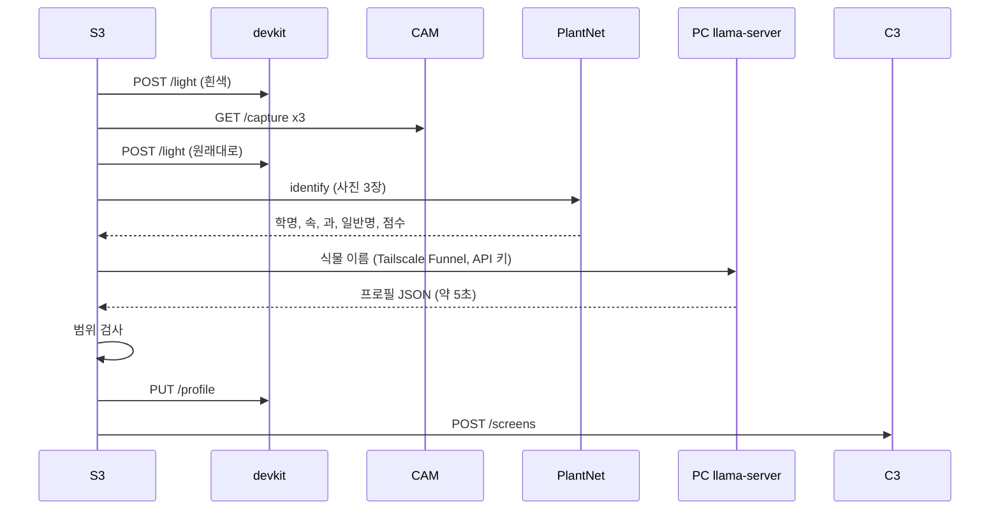

# AIplantRx v2: LLM 아키텍처 안

2026-11-11 제안입니다. 흐름은 세 단계입니다.

1. 카메라 사진으로 PlantNet이 식물 이름을 알아낸다.
2. 그 이름을 LLM에 보내 최적값(프로필)을 받는다.
3. devkit이 그 프로필로 히터와 펌프를 자동 조절한다.

PlantNet은 식별만, LLM은 프로필만 맡습니다. 두 곳 모두 S3가 직접 부릅니다. PC에는 새 프로그램을 만들지 않고, 이미 돌고 있는 llama-server(LLM_SERVER.md)를 그대로 씁니다.

## 1. 흐름

촬영 약 2초, PlantNet 2~3초, LLM 약 5초로 모두 합쳐 8~10초입니다. 그동안 S3 화면은 "식물 확인 중 → 환경 계산 중"으로 넘어갑니다.

## 2. PLAN.md에서 바뀌는 점

| 항목 | 내용 |
| --- | --- |
| S3 | PlantNet 직접 호출은 PLAN과 같음. LLM 호출과 범위 검사가 추가됨. 프롬프트와 JSON 스키마는 펌웨어에 넣음 |
| PC | llama-server에 API 키를 걸고 Tailscale Funnel로 공개. 새 서비스 없음 |
| CAM, devkit, C3 | 바뀌지 않음 |
| 빠지는 작업 | PLAN 4.2의 오프라인 프로필 표(EcoCrop, 농사로, Open Plantbook, GBIF 동의어)와 PLAN 10장 1번 작업 |
| 비용 | 0원 (PlantNet 무료 하루 500회, LLM은 PC, Tailscale 무료 요금제) |

S3는 Tailscale에 붙지 않습니다. Funnel 주소(https://2.tailb0610e.ts.net)는 일반 HTTPS라 S3가 인터넷만 되면 닿습니다.

## 3. LLM 요청

- 주소: `POST https://2.tailb0610e.ts.net/v1/chat/completions`, 헤더 `Authorization: Bearer <키>`
- 보내는 내용: PlantNet 응답의 학명, 속, 과, 일반명. 1위 점수가 낮으면(0.15 미만) 속과 과만 보내고 "이 속(과)의 대표적인 실내 재배 조건"을 묻는다.
- 받는 내용: 한국어 이름, 그룹, 낮·밤 온도, 습도, 토양 수분, EC, pH, 한 줄 팁(LLM_SERVER.md 시험 스키마)과 시간표 값. 시간표 값은 조명 켜는·끄는 시각(light_on, light_off, HH:MM), 물 주기와 양(water_interval_days, water_ml), 물약 주기와 양(nutrient_interval_days, nutrient_ml)이다. 화분 크기(약 1L)와 장치 구성을 프롬프트에 적는다.
- 2026-11-11 시험(시간표 값만 넣은 스키마, 응답 약 172토큰, 약 4초): 바질 06:00~18:00·1일마다 100ml·물약 7일마다 10ml, 에케베리아 08:00~18:00·14일마다 50ml·물약 30일마다 10ml, 토마토 06:00~18:00·1일마다 100ml·물약 3일마다 5ml. 한국어 이름은 바질·토마토는 맞았지만 Echeveria elegans를 "아스카라"로 틀리게 냈다.
- 설정: temperature 0.3, max_tokens 700, response_format json_schema, `chat_template_kwargs: {"enable_thinking": false}`. 서버를 `--reasoning-effort none`으로 띄워도 Bonsai 2 템플릿은 none을 받지 않아서, 요청마다 enable_thinking을 꺼야 한다(안 끄면 HTTP 500 "Unexpected reasoning effort none"). 2026-11-12 확인, 끄면 짧은 요청이 약 0.9초.
- 시간 제한: 연결 3초, 전체 15초.
- 응답은 JSON 안에 JSON 문자열이 든 형태라 S3에서 두 번 읽는다(ArduinoJson).

같은 식물을 다시 찍을 때를 위해 S3가 결과를 학명별로 LittleFS에 저장해 둔다(선택, 종당 약 300바이트). 저장된 식물은 LLM을 부르지 않아 바로 나오고, PC가 꺼져 있어도 프로필이 나온다.

## 4. 값 검사 (S3)

LLM 값은 그대로 devkit에 보내지 않고 아래 범위 안으로 자릅니다. 하드웨어를 지키기 위한 범위라 히터·펌프 사양을 받으면 다시 정합니다.

| 항목 | 허용 범위 |
| --- | --- |
| 낮·밤 온도 | 10~32°C |
| 토양 수분 | 10~80% |
| EC | 0.3~3.0 mS/cm |
| pH | 5.0~7.5 |
| 빛 시간 | 8~16시간 |
| 습도 | 20~95% (표시만) |
| 물 주기 / 양 | 1~21일 / 20~300ml |
| 물약 주기 / 양 | 3~30일 / 0~20ml |

- 최저값이 최고값보다 크면 서로 바꾼다.
- 빠지거나 숫자가 아닌 항목은 기본 프로필 값으로 채운다.
- 한국어 이름이 비면 PlantNet 일반명, 그것도 없으면 학명을 쓴다.

기본 프로필(열대 관엽): 낮 20~28°C, 밤 18~22°C, 습도 60~80%, 토양 수분 40~60%, EC 0.8~1.4, pH 5.5~6.5, 빛 12시간.

## 5. 실패해도 멈추지 않기

화면에는 "실패", "못 찾음" 같은 문구가 나오지 않습니다.

| 상황 | 동작 | 화면 |
| --- | --- | --- |
| PlantNet 404 (식물 아님) | 한 번 다시 찍고, 그래도 404면 기본 프로필 | "식물이 가운데 오도록 다시 찍을게요" → "관엽식물로 보여요" |
| PlantNet 429, 장애, 인터넷 없음 | 기본 프로필 | "관엽식물로 보여요" |
| PlantNet 점수 낮음 | 속·과로 LLM 요청 | "~종류로 보여요" |
| LLM 응답 없음 (PC 꺼짐, Funnel 장애, 15초 초과) | 이름은 PlantNet 결과, 프로필은 저장된 값 또는 기본 프로필 | 이름은 정상, 환경은 "기본 환경" |
| LLM 값이 이상함 | 4장 검사로 자르거나 채움 | 정상 |
| devkit WiFi 끊김 | devkit이 마지막 프로필로 계속 제어 | "연결 대기" |

시연장에는 휴대폰 핫스팟을 예비 인터넷으로 둡니다.

## 6. devkit 제어

LLM 값으로 시간표를 돌리는 항목과 센서를 보고 켜고 끄는 항목을 나눕니다.

| 장치 | 방식 | 쓰는 LLM 값 |
| --- | --- | --- |
| 조명 | 시간표: light_on에 켜고 light_off에 끈다 | light_on, light_off |
| 물약(양액 펌프) | 시간표: nutrient_interval_days마다 nutrient_ml | nutrient_interval_days, nutrient_ml |
| 물 펌프 | 센서: 토양 수분이 최저값 아래면 조금 주고 스며들기를 기다린다. 토양 센서 값이 이상하면 water_interval_days마다 water_ml로 바꾼다 | soil_moisture_pct, water_interval_days, water_ml |
| 히터 | 센서: 지금 구간(조명 켜진 동안 낮, 꺼진 동안 밤)의 최저 온도 아래면 켜고 중간값을 넘으면 끈다 | temp_day_c, temp_night_c |
| pH 펌프 | 센서: 범위를 벗어나면(용액 방향 한쪽만) 조금 넣고 잠근다 | soil_ph |

- 히터 최대 연속 가동 시간, 펌프 한 번 최대 가동 시간, 하루 최대 물 양은 하드웨어 안전값이라 LLM이 정하지 않는다.
- ml를 펌프 가동 시간으로 바꾸려면 펌프마다 ml/s를 처음에 잰다.
- 시간표를 돌리려면 devkit이 현재 시각을 알아야 한다. WiFi로 NTP를 받고, S3도 PUT /profile 때 시각을 함께 보낸다. devkit에는 RTC 배터리가 없어 WiFi 없이 재부팅되면 시각을 모르므로, 그때는 켜진 시점부터 센 시간으로 돌린다.
- 물약 7일, 물 14일 같은 주기는 시연 시간 안에 오지 않는다. 시연 모드에서는 하루를 1분으로 줄이거나 화면에 "다음 물약: 3일 뒤" 같은 예정 시각과 "지금 주기" 버튼을 둔다.

제어 권한은 둘로 나눕니다.

| 프로필 | 히터 | 물 펌프 | 양액·pH 펌프 |
| --- | --- | --- | --- |
| LLM 프로필 (저장된 값 포함) | 정상 제어 | 정상 제어 | 정상 제어 |
| 기본 프로필 | 10°C 아래에서만 | 토양 수분이 아주 낮을 때만 | 정지 |

S3가 PUT /profile에 어느 쪽인지 함께 보냅니다. 습도와 CO2는 조절 장치가 없어 표시만 합니다.

## 7. PC 설정

- C:\llm\start-llama.cmd에 `--api-key-file C:\llm\api-keys.txt --no-webui`를 더한다. 그러면 tailnet 안에서 보내는 요청도 키가 필요해진다.
- Tailscale 관리 콘솔에서 HTTPS 인증서와 Funnel을 허용한다(계정 설정이라 사용자 작업).
- `tailscale funnel --bg`로 443을 127.0.0.1:8080에 연결한다. 가능하면 /v1/chat/completions 경로만 공개한다(설정할 때 확인).
- 키는 S3의 NVS에 둔다. 키가 없는 요청은 401을 받는다.

## 8. 고려할 점

- 프롬프트를 바꾸려면 S3 펌웨어를 다시 올려야 한다. 모든 기기에 OTA를 넣으므로(UI.md 8장) 무선으로 S3만 올리면 된다. 그래도 프롬프트를 자주 고칠 것 같으면 PC에 프롬프트와 범위 검사만 맡는 작은 중계 프로그램을 두면 되지만, 지금은 넣지 않는다.
- llama-server는 요청을 하나씩 처리한다(슬롯 1). S3가 우선순위 줄을 세워 한 번에 하나만 보낸다.
- LLM을 화면 문장(식물 소개, AI 한마디, 이상 알림, 오늘의 기록)까지 넓히는 안과 기능별 입출력 크기는 UI.md 6장에 있다.
- 프롬프트는 S3에 넣기 전에 이 PC에서 사진 파일로 같은 요청(PlantNet → LLM)을 보내 맞춘다.

## 9. 작업 순서

1. PlantNet 키 받기. 이 PC에서 사진 파일로 PlantNet → LLM 흐름을 시험하고 프롬프트를 정한다.
2. PC: API 키, Funnel.
3. CAM /capture 실물 확인(PLAN과 같음, 가장 먼저 확인할 하드웨어).
4. S3: 촬영 → PlantNet → LLM → 검사 → devkit, 진행 화면.
5. devkit: 프로필 적용과 제어 루프.
6. 리허설: PC 끄기, 인터넷 끊기, 식물 아닌 것 찍기를 한 번씩 거친다.
