# 화면과 AI 기능 설계 (AIplantRx v2)

2026-11-11 안입니다. LLM_ARCHITECTURE.md의 흐름(카메라 → PlantNet → LLM 프로필 → devkit 제어) 위에 S3 화면 2개(메인, 설정), OLED 5개, LLM 확대 기능, WiFi 설정, 모든 기기 OTA를 정합니다.

목업은 `python ui/mockups/make_mockups.py`로 다시 그립니다. S3 화면은 ui/mockups/html의 HTML을 Chrome 헤드리스로 800×480 그대로 찍고, OLED는 128×64 1비트로 그린 뒤 3배 확대합니다. 값은 바질 예시입니다.

## 1. 디자인 방향과 규칙

### 1.1 방향

| 화면 | 따라 한 것 |
| --- | --- |
| 메인 | visionOS 창을 화면 전체로: 왼쪽 식물과 오늘의 자동 제어 일정·AI 한마디(목록판 색 판), 오른쪽 카메라 타일 둘 |
| 식물 확인 결과 | visionOS 시트: 닫기·완료 원형 버튼, 목록판 2열 목록 |
| 설정 | visionOS 설정을 그대로 따름(검색창만 뺌): 유리 창, 어두운 유리 사이드바(계정 머리, 빈 간격으로만 나눈 항목 묶음, 그라데이션 원 아이콘, 밝은 유리 알약 선택), 오른쪽 상세(가운데 굵은 제목과 오른쪽 닫기 버튼, 어둡게 파인 목록판, 굵은 흰 묶음 제목, 회색 값과 흰 꺾쇠) |

참고 자료: Apple iOS·iPadOS 27, macOS 27 UI Kit(Figma 커뮤니티), 100+ Apple iOS 27 Screens(Figma 커뮤니티), Settings-iOS·System-Settings·Settings-visionOS(github.com/zhrispineda, SwiftUI 재현). 설정 화면은 Settings-visionOS의 README 스크린샷(Assets/General@2x.png, Apps@2x.png, Settings.gif)과 코드(ContentView, CustomList, SettingsModel)를 기준으로 했습니다. 유리 테마 색은 정면으로 찍힌 창에서 픽셀을 뽑아 맞췄고(1.2), 다크·라이트 테마는 Apple 시스템 색을 씁니다. Figma 키트 파일은 열어 보지 않았습니다.

테마는 유리(기본), 다크, 라이트 셋입니다. 배치와 크기는 하나이고 색표만 바뀝니다. 다크·라이트는 반투명 없이 단색 판으로만 그립니다.

모든 화면은 800×480 패널 전체를 씁니다. visionOS의 창 테두리(바깥 여백, 둥근 모서리, 그림자)와 창 아래 막대는 쓰지 않고, 창 유리가 화면 바탕이 됩니다. 둥근 모서리는 화면 안의 판, 카메라 타일, 시트에만 있습니다.

S3(LVGL 8.4, GPU 없음)가 매번 그리는 것은 불투명한 판과 글자뿐입니다. 유리 테마의 유리 창, 창 그림자, 사이드바 색처럼 움직이지 않는 층은 화면마다 이미지 한 장으로 미리 굽고, 반투명이던 색은 그 바탕과 섞은 결과를 hex로 미리 계산해 씁니다. 규칙은 1.6에 있습니다.

### 1.2 색

| 이름 | 라이트 | 다크 | 쓰는 곳 |
| --- | --- | --- | --- |
| blue | #007AFF | #0A84FF | 설정 강조, 선택 행, 링크, 습도 외 파란 아이콘 |
| green | #34C759 | #30D158 | 메인 강조 버튼, 토글, 확신도, 정상 |
| orange | #FF9500 | #FF9F0A | 공기 온도, 목표 밖 |
| red | #FF3B30 | #FF453A | 배지, 잎 온도, 히터 동작 |
| yellow | #FFCC00 | #FFD60A | 조명 |
| indigo | #5856D6 | #5E5CE6 | AI 서버, 밤 |
| purple | #AF52DE | #BF5AF2 | EC, AI 한마디 |
| cyan / teal | #32ADE6 / #30B0C7 | #64D2FF / #40C8E0 | 물, 물약, 습도 |
| 바탕 / 칸 | #F2F2F7 / #FFFFFF | #000000 / #1C1C1E | 설정 바탕과 그룹 칸, 시트 |
| 글자 2·3단계 | rgba(60,60,67,.6 / .3) | rgba(235,235,245,.6 / .3) | 값, 설명, 꺾쇠 |

테마별 색표입니다. 메인과 설정이 같은 색표를 씁니다. 펌웨어에는 이 표를 구조체 세 벌로 두고, 테마를 바꾸면 색표를 바꿔 끼운 뒤 화면을 다시 만듭니다.

| 부분 | 유리 | 다크 | 라이트 |
| --- | --- | --- | --- |
| 화면 바탕 | 구운 배경(흐린 방에 유리색) | #1C1C1E | #F2F2F7 |
| 설정 사이드바 | 구운 세로 그라데이션 | 바탕과 같은 색, 오른쪽 1px #38383A | 바탕과 같은 색, 오른쪽 1px #C6C6C8 |
| 목록판, 메인 일정 판, AI 한마디 판 | #2F271B | #2C2C2E | #FFFFFF |
| 목록판 구분선 | #40362A | #464649 | #E0E0E3 |
| 사이드바 선택 | 흰색 13%, 1px 흰색 15% | #3A3A3C | #FFFFFF |
| 캡슐 버튼: 바탕 위 / 강조 / 목록판 위 | #6B6255 / #837C72 / #504940 | #3A3A3C / #0A84FF / #3E3E42 | #E3E3E9 / #007AFF / #EFEFF0 |
| 캡슐 버튼 글자 | 흰색 | 흰색 | #007AFF(강조 버튼은 흰색) |
| 꺼진 토글 / 진행 막대·일정 막대 바탕 | #554E44 / #504940, 흰색 | #444448 / #3E3E42, #0A84FF | #E9E9EA / #E5E5EA, #007AFF |
| AI 확인·확신도 캡슐 (바탕 위 / 시트 위) | #2F522A / #375830, 글자 #30D158 | #203D28 / #2D4D36, 글자 #30D158 | #D4EFDE, 글자 #248A3D |
| 운영 상태 줄 (정상 / 목표 밖) | #30D158 / #FF9F0A | #30D158 / #FF9F0A | #248A3D / #C76A00 |
| AI 한마디 숫자 (온도 / 물·흙 / EC·pH) | #FF9F0A / #64D2FF / #BF5AF2 | #FF9F0A / #64D2FF / #BF5AF2 | #C76A00 / #0071A4 / #8944AB |
| 시트 | 세로 #675A48→#594E3E, 목록판 #392F23, 구분선 #493E31, 1px 흰색 10% | #2C2C2E, 목록판 #3A3A3C | #F2F2F7, 목록판 #FFFFFF |
| 시트 버튼 (보통 / 강조) | #7F7465 / #958C7F | #48484A / #0A84FF | #E3E3E9 / #007AFF |
| 키보드 | 세로 #564B3C→#483F32, 키 #696155, 기능 키 #5B5245, 강조 키 #847D73 | #2C2C2E, 키 #4A4A4D, #3A3A3C, #0A84FF | #D3D6DC, 키 #FFFFFF, #ADB3BC, #007AFF |
| 글자 1·2·3단계 | 흰색, 흰색 55%, 35%(꺾쇠는 75%) | 흰색, rgba(235,235,245,.6 / .3) | 검정, rgba(60,60,67,.6 / .3) |
| 강조 초록 (식물 다시 찾기, 토글) | #30D158 | #30D158 | #34C759 |
| 시트 뒤 어둡게 | 검정 40% | 검정 50% | 검정 25% |

유리 테마 색은 원본 스크린샷에서 뽑은 값입니다. 따뜻한 색조는 원본에서 뒤쪽 방이 비친 것이고, 그대로 따랐습니다.

| 부분 | 원본 | 목업 |
| --- | --- | --- |
| 창 유리 | #4E4434 | #4E4435 (구운 배경) |
| 사이드바 | 위 #3F362B, 가운데 아래 #565049, 맨 아래 #473B2C | 같은 흐름의 세로 그라데이션 (구운 배경) |
| 목록판 | #2F2414 | #2F271B 불투명 (검정 계열 48%를 섞은 값) |
| 선택 행 | #5F584F | 흰색 13%와 흰색 15% 1px 테두리. 사이드바 색이 위아래로 #362D20~#584F43까지 달라서 반투명으로 둔다 |

메인 유리 바탕은 설정과 같은 방법으로 구웠고, 뽑은 색이 설정과 2~3단계밖에 다르지 않아 같은 색표를 씁니다.

### 1.3 글꼴 (Pretendard)

| 용도 | 크기·굵기 |
| --- | --- |
| 메인 식물 이름 | 32 Bold |
| 시트 제목 | 26 Bold |
| 설정 상세 제목 | 18 Bold |
| 내비게이션 제목, 버튼 | 16 SemiBold |
| 본문, 목록 행, 설정 묶음 제목 | 15 (행 Medium, 묶음 제목 Bold) |
| 보조 글자, 일정 장치 이름 | 13~14 |
| 설명, 각주, 일정 상태 | 12~13 |
| 시간 눈금, 색 막대 숫자 | 11 |

- 크기와 자간은 정수 px만 쓴다. lv_font_conv와 LVGL이 정수만 받는다. 자간은 큰 제목(26px 이상)만 -1, 나머지는 0.
- LVGL 폰트는 lv_font_conv로 만든다. 크기마다 펌웨어에 고정된 문구의 글자와 숫자·기호만 넣는 서브셋을 만들고, LLM이 쓴 문장을 그리는 15px Regular 하나만 완성형 한글 전체(0xAC00~0xD7A3)를 넣는다. S3 플래시가 16MB라 여유가 있다.
- Pretendard는 이 PC에 설치된 OTF를 쓴다. 다른 PC에서 그리거나 변환할 때는 ui/fonts에 OTF를 넣으면 된다.

### 1.4 아이콘 (Framework7 Icons)

Framework7 Icons는 이름(리거처)으로만 그리는 폰트라서, ui/fonts/make_f7_pua.py로 1,247개 글리프에 U+E000~U+E4DE 코드값을 붙인 Framework7Icons-PUA.ttf와 이름→코드값 표 framework7-icons-pua.json을 만들었습니다. S3(lv_font_conv)와 OLED(u8g2)는 이 파일에서 쓰는 아이콘만 뽑습니다. 목업 HTML은 원본 woff2를 리거처로 씁니다.

| 쓰는 곳 | 아이콘 |
| --- | --- |
| 공기 온도, 습도, 잎 온도, 흙 수분, EC, pH | thermometer, drop, scope, drop_fill, bolt_fill, eyedropper_halffull |
| 낮·밤 온도, 조명, 히터, 물약, 물 | sun_max_fill, moon_fill, lightbulb_fill, flame_fill, drop_triangle_fill, timer(시트), drop_fill(메인 일정) |
| Wi-Fi, AI, PlantNet, 카메라 | wifi, sparkles, camera_viewfinder, camera_fill |
| 업데이트, 기기, 일반, 정보 | arrow_down_circle_fill, square_stack_3d_up_fill, gear_alt_fill, info_circle_fill |
| 식물 프로필, AI 한마디, 시연 모드, 화면 | leaf_arrow_circlepath, bubble_left_fill, play_rectangle_fill, sun_max_fill |
| 메인 화면, OLED | device_desktop, rectangle_on_rectangle |
| AI 한마디 계기 | hand_raised_fill(손), drop_fill·flame_fill·lightbulb_fill(장치), clock_fill(조용할 때), sparkles(새 식물) |
| 공통 | chevron_right, checkmark, xmark, info_circle, lock_fill, eye, delete_left, shift, keyboard |

라이선스: Framework7 Icons MIT(ui/fonts/Framework7Icons-LICENSE.txt), Pretendard와 Galmuri SIL OFL 1.1.

### 1.5 모양과 간격

| 항목 | 값 |
| --- | --- |
| 둥근 모서리 | 화면 바깥은 없음. 카메라 타일 20, 목록판·일정 판·AI 한마디 판·식물 사진 18, 선택 행 14, 시트 28, 키보드 30, 키 12. 캡슐은 높이의 절반 |
| 메인 배치 | 화면 가장자리에서 16. 왼쪽 열 432, 카메라 열 320(타일 320×220 두 개, 사이 8), 열 사이 16. 왼쪽 열은 위에서 상태 줄 18, 식물 68, 일정 판 162, AI 한마디 112, 버튼 40이고 사이는 12 |
| 설정 크기 | 아래 표 |
| 간격 | 목록판 사이 18(시트 안 10), 일정 줄 22에 사이 4 |
| 컨트롤 | 토글 46×28(켜짐 초록, 꺼짐 1.2, 손잡이 흰색이고 그림자 없음), 버튼은 캡슐(1.2), 메인 강조 버튼 초록 캡슐 40px |

설정 크기는 Settings-visionOS 코드의 값과, 코드에 없는 시스템 기본값(행 높이, 사이드바 너비, 묶음 간격)을 README 스크린샷에서 잰 값을 0.88배 해서 정했습니다. 0.88은 본문 17pt를 15px로 맞춘 배율이고, 화면 전체가 visionOS 창 약 910×545pt를 테두리 없이 보는 것과 같습니다. 스크린샷은 코드의 창 너비 1000pt가 약 1,220px로 찍혀 1pt ≈ 1.22px로 환산했습니다.

| 항목 | 근거 | visionOS | 화면(px) |
| --- | --- | --- | --- |
| 창 | PreferencesApp .frame(width: 1000, height: 730) | 1000×730pt | 화면 전체 800×480(창 테두리와 창 막대 없음) |
| 사이드바 행 간격 | 시스템 기본(스크린샷 62~64px) | 약 52pt | 46 |
| 사이드바 묶음 사이 추가 간격 | 시스템 기본(스크린샷 약 29px) | 약 24pt | 21 |
| 원형 아이콘 | ListRowNavigationSymbolLabel Circle 32×32 | 32pt | 28 |
| 아이콘과 제목 사이 | SettingsLabel, SLink HStack(spacing: 15) | 15pt | 13 |
| 계정 아이콘 | SignInHeaderView 50×50 | 50pt | 44 |
| 계정 머리 아래 | 스크린샷 약 40px | 약 33pt | 26 + 행 안쪽 여백 |
| 사이드바 너비 | 시스템 기본(스크린샷 약 335px) | 약 275pt | 242 |
| 상세 목록 좌우 여백 | CustomList .padding(.horizontal, 45) | 45pt | 40 |
| 상세 행 간격 | 시스템 기본(스크린샷 66~69px) | 약 56pt | 49, 부제목 있는 행 56 |
| 닫기 버튼 | visionOS 창 막대의 닫기 대신(코드에 없음) | | 34 원, 제목 줄 오른쪽 16 |
| 글자 | 본문, 상세 제목 .title2, 계정 .subheadline 굵게와 .footnote | | 15, 18 굵게, 15 굵게와 12 |

스크린샷이 약간 비스듬해서 시스템 기본값은 몇 pt 오차가 있을 수 있습니다. 이 배율이면 한 화면에 보이는 행이 줄어서, 사이드바는 선택한 행이 화면 아래에서 16px 위에 오도록 내려 두고, 위쪽은 배경에서 잘라 낸 띠 이미지로 흐리게 사라지게 합니다(1.6).

### 1.6 S3에서 그리는 방법 (LVGL 8.4)

smartfarm 펌웨어 기준으로 S3는 LVGL 8.4를 GPU 없이 CPU로 그리고, RGB565 화면 버퍼 두 장(각 800×480×2 = 768KB)이 PSRAM에 있습니다. 반투명은 픽셀마다 아래 색을 읽어 섞은 뒤 다시 쓰기 때문에, 겹이 늘수록 PSRAM을 오가는 양이 늘어납니다. 화면 패널도 같은 PSRAM에서 쉬지 않고 읽어 가므로, 넓은 면적을 여러 겹 섞으면 스크롤과 시트 열기가 끊기고 심하면 화면이 밀립니다. 그림자, 배경 흐림, 방사형·대각선 그라데이션, 글자 그림자, 마스크는 LVGL 8에 없거나 아주 느립니다. 반대로 작은 반투명 조각 하나는 거의 비용이 없어서, 아래 예외만 남겼습니다.

| 구분 | 규칙 |
| --- | --- |
| 테마 | 배치는 하나, 색표만 세 벌(1.2). 테마를 바꾸면 화면 객체를 지우고 새 색표로 다시 만든다 |
| 굽기 | 유리 테마만 움직이지 않는 층을 화면마다 800×480 RGB565 이미지 한 장으로 굽는다(메인, 설정 두 장 1.5MB). 구울 때 디더링해서 그라데이션 줄무늬를 없애고, 부팅 때 PSRAM에 올려 둔다. 다크·라이트는 화면 바탕 한 색과 사이드바 구분선 하나라 이미지가 없다 |
| 판 | 목록판, 일정 판, 시트, 키보드, 버튼은 불투명 단색이나 세로·가로 2색 그라데이션. 색은 1.2의 hex |
| 반투명 예외 | 글자·아이콘 투명도(글자는 원래 섞어 그려서 추가 비용이 없다), 1px 테두리와 구분선, 사이드바 선택 알약, 영상 위 작은 태그, 시트 뒤 어둡게 하기 |
| 시트 뒤 어둡게 | 검정 40%를 시트가 열릴 때 한 번만 그린다. 시트가 열려 있는 동안 영상 갱신을 멈추고, 어둡게 하는 층이 서서히 바뀌는 애니메이션은 쓰지 않는다 |
| 영상 위 | 태그, 2px 실선 상자, 십자, 색 막대 이미지만. 글자 그림자 대신 태그 바탕을 깐다 |
| 미리 그린 조각 | 사이드바 위 페이드 띠 242×30(배경 조각에 투명도 램프), 카메라 타일 모서리 20×20 여덟 개(타일 밖 배경), AI 아이콘 22px(원뿔 그라데이션), 열화상 색 막대 6×130(열화상과 같은 색표), 둥글게 자른 식물 사진(식물 확인 때 한 번 만든다). 배경 조각은 테마마다 달라서 펌웨어에는 모양(투명도)만 넣고, 부팅 때와 테마를 바꿀 때 배경에서 잘라 만든다 |
| 둥근 모서리 위 | 카메라 영상은 사각형으로 그리고 둥근 모서리 밖은 모서리 조각으로 덮는다(모서리 클리핑을 쓰지 않는다). 스크롤 목록은 화면 가장자리까지 사각형으로 자르면 된다 |
| 쓰지 않는 것 | 그림자, 배경 흐림, 방사형·원뿔·대각선 그라데이션, 글자 그림자, 마스크, 부모 투명도 애니메이션, 모서리 클리핑(clip_corner), 둥근 점선, 0.5px 선 |

목업도 같은 규칙으로 그립니다. ui/mockups/make_mockups.py가 테마마다 html/bake_*.html을 그려 html/assets/bg_main_<테마>.png, bg_settings_<테마>.png를 만들고(유리는 RGB565로 디더링), 거기서 조각 이미지를 잘라 냅니다. style.css는 이 표 안의 것만 쓰고, 테마는 .t-glass, .t-dark, .t-light의 색 변수만 다릅니다. 시트 뒤 배경(shot_*_<테마>.png)은 앞 화면을 찍은 것이고, S3에서는 그리고 있던 화면이 그대로 쓰입니다.

## 2. S3 메인 화면

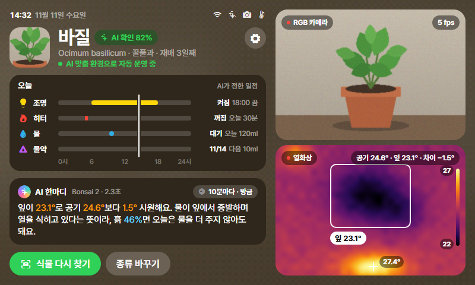

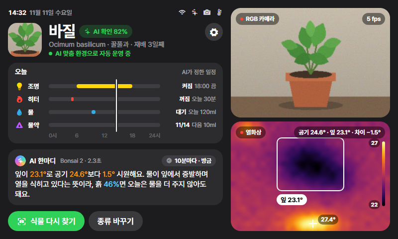

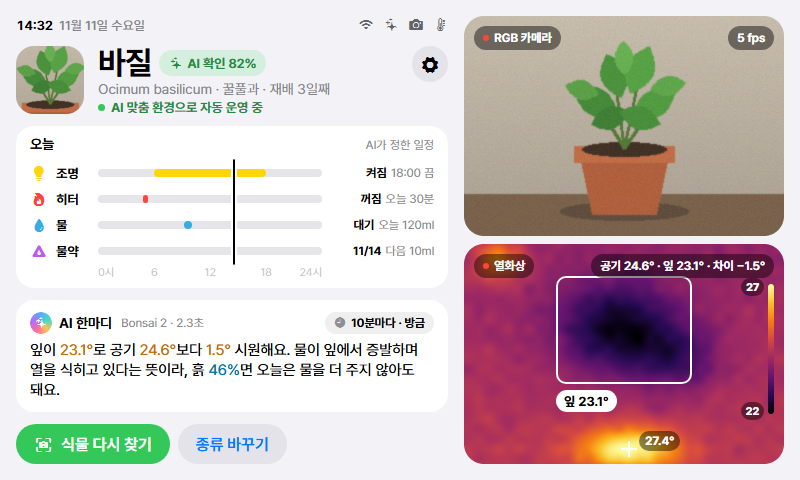

오른쪽은 카메라 타일 둘, 왼쪽은 식물과 AI가 운영하는 모습입니다. 센서 값(공기 온도, 습도, 잎 온도, 흙 수분, EC, pH)은 OLED 5개에 늘 떠 있어서 메인에는 넣지 않습니다. 메인은 핵심 흐름의 결과를 보여 줍니다: 무슨 식물인지(식물), AI가 정한 환경으로 오늘 장치를 어떻게 돌리는지(일정), AI의 설명(AI 한마디). CAM /frame과 보간한 열화상이 둘 다 320×240이라 확대 없이 1:1로 그리고, 320×220 타일에 맞춰 위아래 10px만 잘라 프레임 속도를 잃지 않습니다.

| 영역 | 내용 |
| --- | --- |
| 상태 줄 | 시각, 날짜, 연결 아이콘(Wi-Fi, AI 서버, 카메라, 센서 노드. 끊기면 흐리게) |
| 식물 | 식물 확인 때 찍은 사진(68, 둥근 모서리), 한국어 이름(LLM), "AI 확인 82%" 캡슐(PlantNet 점수), 학명·과·재배 날수, 운영 상태 줄. 오른쪽 위 원형 설정 버튼 |
| 운영 상태 줄 | 평소에는 초록 점과 "AI 맞춤 환경으로 자동 운영 중"(기본 프로필이면 "기본 환경으로 자동 운영 중"). 센서 값이 목표를 벗어나면 주황으로 바뀌고 무엇을 하는지 적는다(예: "흙이 말라서 물 주는 중", "추워서 히터 켜는 중") |
| 오늘 일정 | 장치 4줄(조명, 히터, 물, 물약). 줄마다 24시간 막대에 오늘 켜진 구간이나 준 시각을 장치 색으로 그리고, 오른쪽에 지금 상태(켜짐·꺼짐·대기·다음 날짜)와 오늘 합계나 다음 예정을 적는다. 지금 시각은 네 줄을 가로지르는 세로선 하나 |
| AI 한마디 | 일이 생기면 바로 LLM이 쓰는 1~3문장(6.3). 왜 말했는지 말풍선, 쓴 모델과 걸린 시간, 한 글자씩 나오는 글, 단위별 숫자 색 |
| 버튼 | 식물 다시 찾기(초록 강조), 종류 바꾸기(PlantNet 2~5위 후보와 최근 식물) |
| RGB 카메라 | CAM /frame, 초당 2~5장 |
| 열화상 | MLX90640 32×24를 320×240으로 보간, inferno 색. 식물 상자(이 상자 안 중앙값이 잎 온도), 최고 온도 십자, 색 막대, 공기·잎·차이 태그 |

- 영상을 누르면 그 영상만 화면 전체로 커지고, 다시 누르면 돌아온다.
- 식물 상자는 열화상 기준 가운데 고정으로 시작하고 설정의 카메라에서 옮길 수 있다. RGB와 열화상은 보는 범위가 달라서 RGB 기준으로 정하지 않는다.
- 설정 버튼은 한 번 누르면 열린다.
- 일정 막대는 devkit /state의 최근 동작 기록과 프로필 시간표로 그린다. 히터 구간과 물 준 시각은 이미 일어난 것만, 조명은 시간표 전체를 그린다.

## 3. 식물 확인

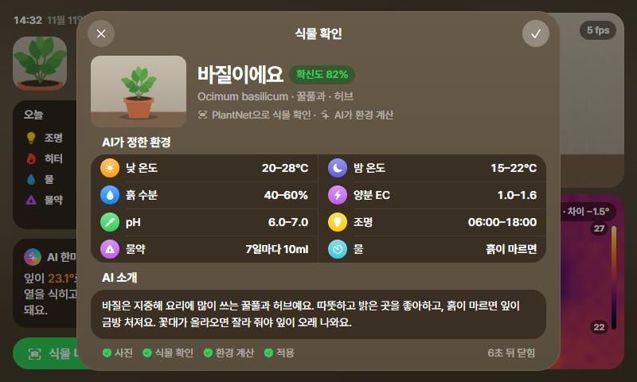

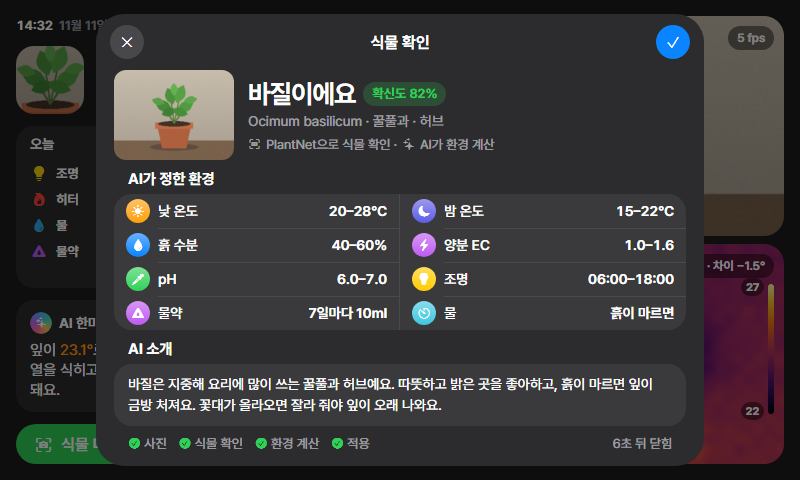

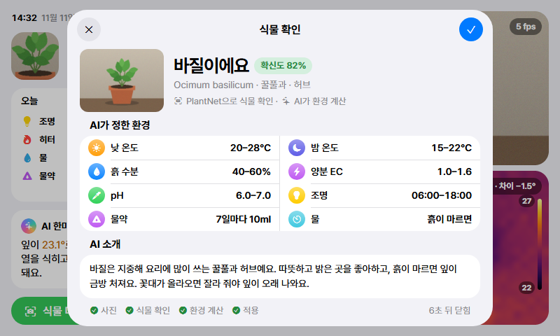

1. "식물 다시 찾기"를 누르면 RGB 타일에 3, 2, 1과 함께 조명이 흰색으로 바뀐다.
2. 시트가 열리고(뒤 화면은 한 번 어둡게 하고 영상은 멈춘다) 단계를 하나씩 체크한다: 사진 → 식물 확인 → 환경 계산 → 적용.
3. 결과: 찍은 사진, 이름, 확신도, 학명, AI가 정한 환경 8개(2열 목록), AI 소개. 10초 뒤 저절로 닫히고, 오른쪽 위 완료(강조 원)나 왼쪽 위 닫기로 바로 닫을 수도 있다.

문구는 확신도에 따라 바꿉니다: 높음 "바질이에요", 중간 "바질로 보여요", 낮음 "허브 종류로 보여요", PlantNet이 안 되면 "관엽식물로 보여요". 프로필을 먼저 적용하고 AI 소개는 이어서 받으므로, 소개 칸은 잠깐 "소개를 쓰는 중…"이었다가 채워집니다. 소개가 안 오면 그룹 설명 문장을 씁니다.

## 4. 설정 화면 (visionOS 설정)

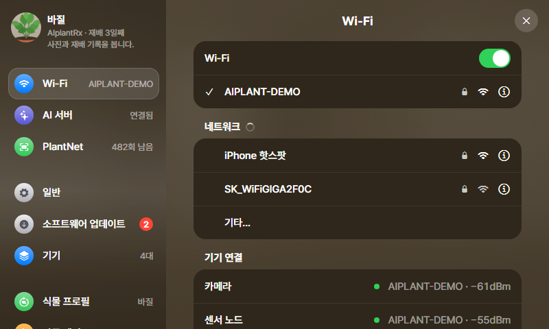

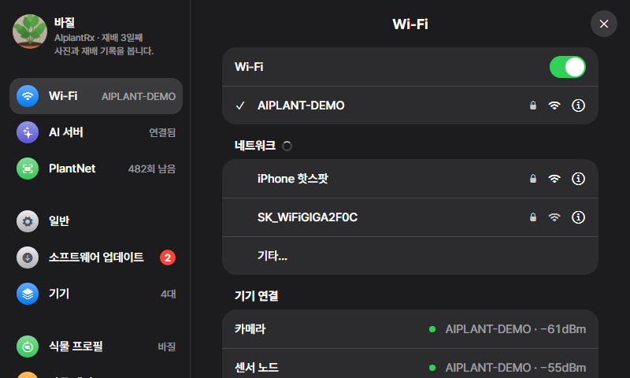

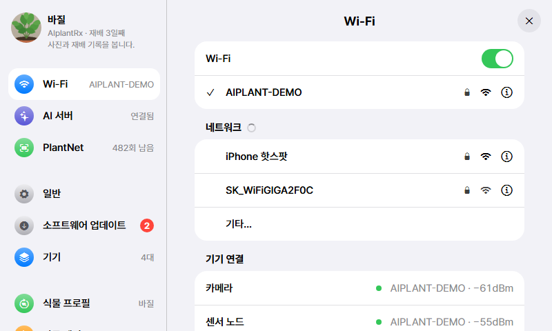

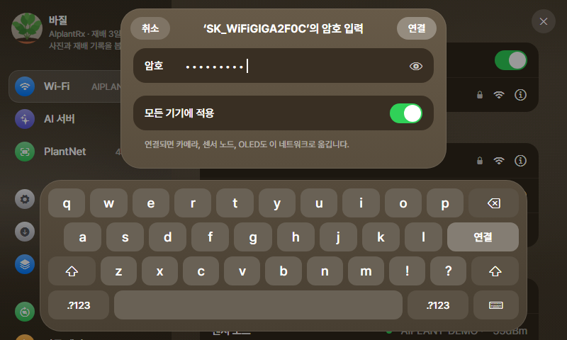

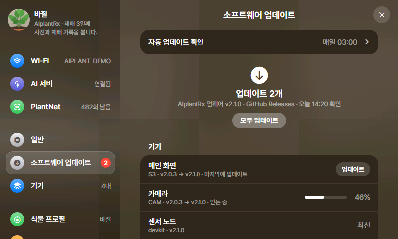

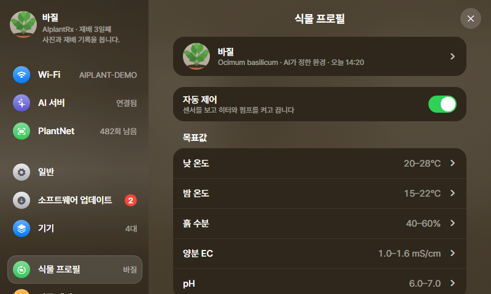

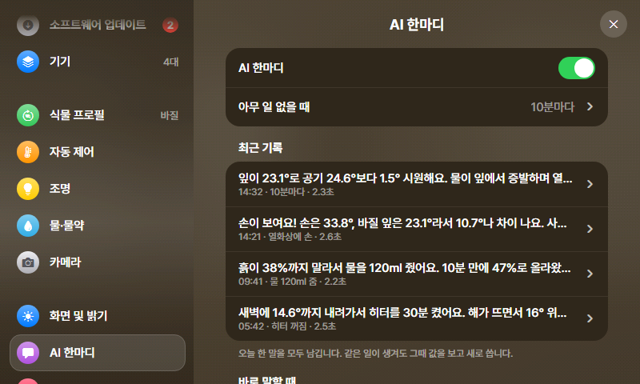

사이드바:

| 묶음 | 항목 (아이콘 색, 오른쪽 값) |
| --- | --- |
| 계정 머리 | 지금 식물 사진(원), 굵은 이름, 회색 두 줄 설명 (visionOS의 Apple 계정 자리. 검색창은 뺌) |
| 연결 | Wi-Fi(파랑, 네트워크 이름), AI 서버(남색, 연결됨), PlantNet(초록, 오늘 남은 횟수) |
| 일반 | 일반(회색), 소프트웨어 업데이트(회색, 빨간 배지 = 업데이트 수), 기기(파랑, 연결된 기기 수) |
| 재배 | 식물 프로필(초록, 식물 이름), 자동 제어(주황), 조명(노랑), 물·물약(하늘), 카메라(회색) |
| 화면·기타 | 화면 및 밝기(파랑), AI 한마디(보라), 시연 모드(분홍), 정보(회색) |

상세 화면:

| 항목 | 내용 |
| --- | --- |
| Wi-Fi | Wi-Fi 토글, 연결된 네트워크(체크, 자물쇠, 신호, ⓘ), 네트워크(찾는 중 표시), 기타..., 기기 연결(카메라·센서 노드·OLED의 네트워크와 신호), 설정 모드 안내 (7장) |
| 암호 입력 | 유리 시트(취소·연결 캡슐), 떠 있는 유리 키보드(LVGL lv_keyboard를 visionOS 키보드 모양으로), "모든 기기에 적용" 토글. 뒤의 창은 어둡게 |
| 소프트웨어 업데이트 | 자동 확인, 가운데 상태(업데이트 수, 버전, 모두 업데이트), 기기별 행(버전, 업데이트 버튼, 진행률, 최신), AI 서버 연결 시험 (8장) |
| 기기 | 기기별 주소, 신호, 가동 시간, 다시 시작 |
| 식물 프로필 | 식물 행(사진, 학명, AI가 정한 시각), 자동 제어 토글, 목표값 5개, 시간표 2개. 아래로 출처(AI 모델과 시각), "AI에게 다시 묻기", "기본 프로필로 되돌리기" |
| 자동 제어, 조명, 물·물약 | 수동 켜기, 장치 시험(5초), 안전 한도(최대 가동 시간, 하루 최대 물 양), 펌프 ml/s 보정 |
| 카메라 | 열화상 식물 상자 위치, 색 막대 범위 |
| AI 서버, PlantNet | 주소와 키, 연결 시험, 응답 시간 / 키, 오늘 남은 횟수 |
| 화면 및 밝기 | 테마(유리·다크·라이트), S3 밝기, OLED 밝기, 화면 꺼짐(시연 때는 끔), 시간대 |
| AI 한마디 | 켜기, 조용할 때 주기, 최근 기록(오늘 한 말 전부와 시각·계기·걸린 시간, 누르면 전체 글), 바로 말할 때 3가지 켜고 끄기 |
| 시연 모드 | 하루를 1분으로, 다음 물약 바로 하기 |
| 정보 | 기기 이름, 펌웨어 버전, 주소, 가동 시간 |

- 글자 입력은 영문 키보드만 쓴다(SSID, 비밀번호, 키). 한글 입력은 넣지 않는다.
- 설정은 S3 NVS에 저장한다. 다른 기기에 필요한 설정(WiFi)은 S3가 전달한다.
- 상세 화면은 길면 위아래로 밀어서 본다. 목업은 맨 위만 보인다.
- 상세 제목 줄 오른쪽의 닫기(×) 원 버튼을 누르면 설정을 닫고 메인으로 돌아간다. 상세 화면에서 한 단계 더 들어가면 왼쪽에 뒤로 버튼이 생기므로 닫기는 오른쪽에 둔다.
- 상세 목록의 행에는 아이콘을 두지 않는다(visionOS 스크린샷과 같음). 아이콘은 사이드바에만 둔다.

## 5. OLED 5개 (1비트, 3번만 노랑/파랑 2색)

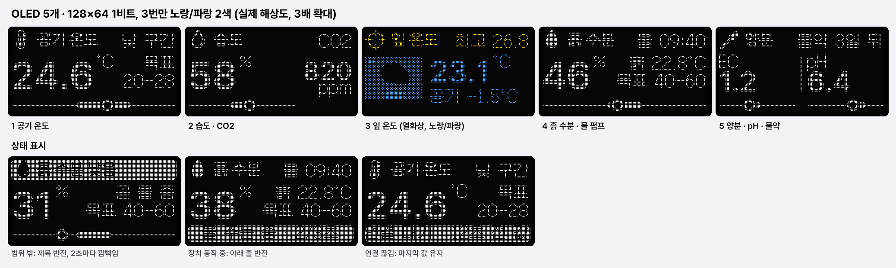

| 위치 | 제목 줄 | 큰 숫자 | 작은 정보 | 목표 막대 |
| --- | --- | --- | --- | --- |
| 1 | 공기 온도 · 지금 구간(낮/밤) | 공기 온도 | 지금 구간(낮/밤)의 목표 | 10~35°C |
| 2 | 습도 · CO2 | 습도 | CO2 ppm | 0~100% |
| 3 | 잎 온도 · 최고 온도 | 잎 온도 | 열화상 썸네일 44×33, 공기와 차이 | 없음 |
| 4 | 흙 수분 · 마지막 물 준 시각 | 흙 수분 | 흙 온도, 목표 | 0~100% |
| 5 | 양분 · 다음 물약 | EC, pH | | EC, pH 각각 |

- 측정값 8개(공기 온도, 습도, CO2, 잎 온도, 흙 수분, 흙 온도, EC, pH)가 모두 들어가고, OLED 하나가 장치 하나와 짝이다(4 물 펌프, 5 양액·pH 펌프).
- 목표 막대: 가는 선 위의 굵은 구간이 AI가 정한 범위이고, 과녁 모양 점이 지금 값이다. 숫자를 읽지 않아도 "범위 안에 유지되고 있다"가 보인다.
- 열화상 썸네일은 3단계(차가운 곳 검정, 실온 체크 무늬, 따뜻한 곳 흰색)로 그려 1비트에서도 식물 모양이 보인다.
- 2색 OLED: 3번(TCA 채널 4)은 위 16줄이 노랑, 아래 48줄이 파랑인 모듈이다(나머지 4개는 흰색). 모든 칸에서 제목 줄(반전 막대 포함)은 0~15줄 안에만, 나머지는 18줄부터 그린다. 그러면 3번은 제목이 노랑, 값이 파랑으로 나뉘어 보이고 다섯 칸의 배치가 같다(2026-11-21 실물 확인).

상태 표시:

- 목표 범위 밖: 제목 줄을 반전하고 2초마다 깜빡인다("흙 수분 낮음").
- 장치 동작 중: 아래 줄을 반전해 "물 주는 중 · 2/3초"처럼 보여 준다.
- 연결 끊김: 마지막 값을 그대로 두고 아래 줄에 "연결 대기 · 12초 전 값".

글꼴과 아이콘:

| 쓰는 곳 | 글꼴 |
| --- | --- |
| 제목 | Pretendard SemiBold 13px |
| 큰 숫자 | Pretendard SemiBold 30px(1, 2, 4), 24px(3), 22px(5) |
| 작은 글자 | Galmuri11 12px(픽셀 폰트) |
| 아이콘 | Framework7 Icons 16px |

Pretendard는 1비트에서 12px 이하가 되면 "흙", "물약"처럼 획이 많은 글자가 뭉개지고, 아이콘도 12px에서는 깨집니다(시험해 보고 정함). 그래서 작은 글자만 픽셀 폰트 Galmuri를 씁니다. u8g2 폰트는 otf2bdf로 크기별 BDF를 만든 뒤 bdfconv로 쓰는 글자만 넣어 만듭니다(OLED 전체 약 100자와 숫자·기호, 아이콘 10개 안팎).

구현:

- 데이터: C3가 devkit GET /state(목표값, 장치 상태, 잎 온도 포함)를 2초마다, GET /thermal을 4초마다 직접 가져온다. S3를 거치지 않으므로 S3가 업데이트나 재시작 중이어도 OLED는 계속 나온다. PLAN의 C3 POST /screens는 없앤다.
- 번인 방지: 1분마다 화면 전체를 1픽셀씩 옆으로 옮긴다(0, +1, 0, −1). 위아래로 옮기면 3번의 제목 줄이 노랑/파랑 경계를 넘으므로 가로로만 옮긴다.
- 시험판: firmware/c3_hwtest가 이 다섯 칸을 예시 값(바질, 천천히 변함)으로 그린다. 4번은 90초마다 "흙 수분 낮음"(제목 반전 깜빡임)과 "물 주는 중"을 거친다. 글꼴은 tools/gen_oled_assets.py가 목업과 같은 방식(PIL 1비트)으로 비트맵을 만든다. C3가 S3 업로드를 중계하는 동안에는 "S3 업데이트 · 펌웨어 받는 중" 화면을 띄운다.

## 6. LLM 확대 적용

### 6.1 쓸 수 있는 범위

| 항목 | 값 |
| --- | --- |
| 컨텍스트 | 8,192토큰, 슬롯 1개(한 번에 요청 하나) |
| 읽기 속도 | 약 900토큰/초 |
| 쓰기 속도 | 약 55~59토큰/초 |
| 실측 | 프로필과 시간표 172토큰 출력에 약 4초 |

규칙:

- 요청마다 새로 묻고 대화 기록은 쌓지 않는다. 입력 1,500토큰 이하, 출력 200토큰 이하로 잡아 한 건이 1~5초 안에 끝나게 한다. 컨텍스트 8,192의 1/4도 쓰지 않는다.
- S3가 한 번에 하나만 보내고 우선순위로 줄을 세운다. 바쁘면 낮은 순위 요청은 건너뛴다.
- 프로필·시간표(1번)와 식물 소개(2번)는 JSON 스키마와 글자 수 제한(maxLength)으로 받는다. 화면에 바로 쓰는 문장(3~5번)은 줄 형식을 grammar로 강제하고 스트리밍으로 받는다(6.3).
- 형식이 틀리거나 시간이 넘으면 1번은 기본 프로필, 2번은 그룹 설명 문장을 쓴다. 3~5번은 미리 만든 문장으로 채우지 않는다. 같은 틀의 문장이 되풀이되면 하드코딩처럼 보이기 때문이고, 대신 마지막으로 LLM이 쓴 말을 그대로 둔다.
- 프롬프트는 S3 펌웨어의 prompts.h 한 파일에 모은다. 고치면 OTA로 S3만 다시 올린다.

### 6.2 기능

| 순위 | 기능 | 언제 | 입력 | 출력 | 시간 | 표시 | LLM이 안 될 때 |
| --- | --- | --- | --- | --- | --- | --- | --- |
| 1 | 프로필·시간표 | 식별 직후 | 식물 이름 약 300토큰 | 목표값·시간표 약 180토큰 | 약 4초 | 제어, 결과 시트 | 기본 프로필 |
| 2 | 식물 소개 | 프로필 적용 직후 | 식물 이름 약 200토큰 | 소개 3문장 약 150토큰 | 약 3초 | 결과 시트 | 그룹 설명 문장 |
| 3 | 이상 알림 | 규칙이 감지할 때 | 4번 입력 + 규칙 이름과 관련 값 약 700토큰 | 원인 추정과 할 일 약 80토큰 | 약 2초 | AI 한마디 카드(주의 색 말풍선), 운영 상태 줄 | 운영 상태 줄의 규칙 문장만 |
| 4 | AI 한마디 | 일이 생길 때(6.3), 조용하면 10분마다 | 계기, 프로필, 현재 값, 잎-공기 차이, 최근 동작 3개, 최근 한 말 3개 약 700토큰 | 1~3문장 약 80토큰 | 약 2초 | AI 한마디 카드 | 마지막 말을 둠 |
| 5 | 오늘의 기록 | 매시 정각, 버튼 | 시간별 요약 24줄 약 1,200토큰 | 3문장 약 150토큰 | 약 4초 | AI 한마디 카드 | 숨김 |
| 6 | 사진 건강 보기(선택) | 하루 몇 번 | RGB 사진 | 잎 색, 시듦 | 실측 필요 | AI 한마디 카드 | 숨김 |

말과 말 사이를 20초 띄우므로 GPU를 쓰는 시간은 1분에 많아야 7초 안팎입니다. 6번은 이미지 입력(mmproj 0.59GB)이 필요한데 지금 남은 그래픽 메모리가 약 1.4GB라 실측 뒤 정합니다.

### 6.3 AI 한마디 (4번)

정해진 말이 돌아가며 나오면 관람객은 미리 써 놓은 문장이라고 의심합니다. 그래서 AI 한마디는 시간마다 말하지 않고, 무슨 일이 생기면 그 일과 그때 값을 보고 바로 씁니다. 같은 일이 다시 생겨도 값과 표현이 달라지고, 의심하는 사람이 직접 일을 만들어 확인할 수 있습니다. 관람객이 누르는 질문 기능은 두지 않습니다.

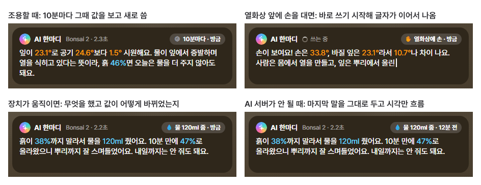

말하는 때 (위가 먼저. 한 번에 하나만 쓰고, 말한 뒤 20초는 쉰다):

| 계기 | 조건 | 카드 오른쪽 말풍선 |
| --- | --- | --- |
| 새 식물 | 식물 확인과 프로필 적용이 끝남 | 새 식물 · 방금 |
| 손 | 열화상 최고 온도가 30°C를 넘고 1분 평균보다 4°C 넘게 오름 | 열화상에 손 · 방금 |
| 장치 | 물 줌, 히터·조명 켜고 끔, 물약 | 물 120ml 줌 · 방금 |
| 값 변화 | 목표 밖으로 나가거나 돌아옴, 이상 감지 규칙(6.4) | 흙이 말랐어요 · 방금 (주의 색) |
| 조용할 때 | 10분 동안 위의 일이 없음 | 10분마다 · 방금 |

시연에서 "열화상 카메라 앞에 손을 대 보세요"라고 하면 2~3초 안에 손 온도와 잎 온도를 비교하는 말이 한 글자씩 나옵니다. 손 온도는 그때마다 달라서 미리 써 둘 수 없는 문장이고, 열화상 영상에도 손이 같이 보입니다. 다른 식물로 "식물 다시 찾기"를 해도 바로 그 식물 이야기로 바뀝니다.

카드에 보이는 것:

- 제목 옆에 쓴 모델과 걸린 시간(Bonsai 2 · 2.3초). 쓰는 동안은 돌아가는 표시와 "쓰는 중".
- 오른쪽 말풍선에 왜 말했는지와 언제인지.
- 글은 llama-server 스트리밍(stream: true)으로 받는 대로 붙이고, 끝날 때까지 커서를 둔다. 3줄(100자)까지. 첫 글자는 요청 뒤 약 1초에 나온다(입력 700토큰을 약 900토큰/초로 읽음).
- 글 안의 숫자는 S3가 단위를 보고 색을 칠한다: °는 온도, %와 ml은 물·흙, EC와 pH 값은 양분(1.2의 색). LVGL 라벨 recolor로 칠한다. OLED에 떠 있는 숫자와 같아서 바로 맞춰 볼 수 있다.
- 지난 말은 설정 > AI 한마디의 최근 기록에 오늘 것이 모두 남는다. 의심하는 사람에게 같은 일에도 매번 다르게 쓴 기록을 보여 줄 수 있다.

S3가 보내는 입력 예(손 계기):

~~~json
{"trigger": {"kind": "hand", "hand_c": 33.8, "hand_minus_leaf": 10.7},
 "plant": "바질", "time": "14:21", "phase": "day",
 "air_c": 24.6, "rh": 58, "co2": 820, "leaf_c": 23.1, "leaf_minus_air": -1.5,
 "soil_pct": 46, "ec": 1.2, "ph": 6.4,
 "targets": {"temp_day_c": [20, 28], "soil_moisture_pct": [40, 60], "soil_ec": [1.0, 1.6], "soil_ph": [6.0, 7.0]},
 "recent": ["09:40 물 120ml", "05:10 히터 30분"],
 "said": ["흙이 38%까지 말라서 물을 120ml 줬어요. …", "새벽에 14.6°까지 내려가서 …"]}
~~~

출력은 JSON 없이 글 한 덩어리로 받아 받는 대로 화면에 붙입니다. 길이와 모양은 llama-server의 grammar(GBNF)로 강제해서, 작은 모델도 줄바꿈이나 목록, 100자 넘는 글을 쓸 수 없습니다.

~~~
root ::= [^\n]{12,100}
~~~

- 설정: temperature 0.8, top_p 0.95, max_tokens 120. 프로필(1번)의 0.3보다 높여 표현을 바꾼다.
- 프롬프트 규칙: 존댓말, 첫 문장에서 계기를 말하기, 입력에 있는 숫자와 그 차이만 1~3개 쓰기, said와 같은 말이나 같은 시작을 쓰지 않기, 없는 장치(가습기, 냉방)는 말하지 않기, 권하는 일은 사람이 할 수 있는 것만.
- 숫자 검사: 다 받은 뒤 S3가 글 안의 숫자를 입력 값과 차이에 맞춰 본다(±0.1). 맞지 않는 숫자가 있으면 한 번 다시 써서 카드를 바꾼다. 다시 써도 틀리면 그 숫자에만 색을 칠하지 않는다.

LLM이 안 될 때(4초 안에 첫 글자가 안 오거나 연결이 안 되면):

- 새 말을 지어내지 않는다. 마지막 말을 그대로 두고 말풍선의 시각만 흘러간다("12분 전").
- 상태 줄의 AI 아이콘만 흐리게 한다(2장). "실패", "오류" 같은 말은 쓰지 않는다.
- 처음 켜서 아직 한 말이 없으면 "식물을 찾으면 AI가 말을 걸어요"를 회색으로 둔다. AI가 쓴 말처럼 보이지 않게 모델·시간과 말풍선을 붙이지 않는다.

잎-공기 온도 차이는 열화상과 SCD41로 S3가 계산합니다. 잎이 공기보다 시원하면 잎이 물을 내보내는 중(물 충분), 더 따뜻하면 물이 부족하거나 스트레스일 수 있습니다. LLM이 이 숫자를 말로 풀어 주므로 열화상 카메라가 시연에서 장식이 아니라 근거로 쓰입니다.

### 6.4 이상 감지 규칙 (3번)

감지는 규칙이 하고 LLM은 설명 문장만 씁니다.

| 규칙 | 조건 |
| --- | --- |
| 히터가 효과 없음 | 히터를 20분 켰는데 온도가 0.5°C도 안 오름 |
| 물이 안 들어감 | 물을 준 뒤 10분이 지나도 흙 수분 변화가 2%p 미만(물통 빔, 센서 위치) |
| 잎이 뜨거움 | 잎이 공기보다 2°C 넘게 따뜻한 상태가 10분 넘게 |
| 환기 필요 | CO2 1,500ppm 넘음 |
| 센서 끊김 | 센서 값이 1분 넘게 안 옴 |

## 7. WiFi 설정

- 모든 기기가 같은 WiFi를 쓰고, 정보는 기기마다 NVS에 저장한다.
- 네트워크 바꾸기: S3 설정에서 고르고 "S3 연결"로 먼저 확인한 뒤 "모든 기기에 적용"을 누른다. S3가 지금 네트워크로 각 기기에 POST /wifi(새 SSID·비밀번호)를 보내고, 기기는 저장한 뒤 새 네트워크로 옮긴다. 마지막에 S3도 옮긴다.
- 처음 설치하거나 연결이 끊긴 기기: 2분 넘게 접속하지 못하면 설정 모드 AP(AIPLANT-기기이름, WPA2 고정 비밀번호)로 바뀐다. S3의 "설정 모드 기기 찾기"가 이 AP에 붙어 WiFi 정보를 넣어 준다. 휴대폰으로 할 일은 없다.
- 주소: 고정 IP 대신 DHCP와 기기 알림을 쓴다. 각 기기가 5초마다 UDP 브로드캐스트(포트 4210, 이름·IP·버전·상태)를 보내고 S3와 C3가 듣고 표를 만든다. 네트워크를 바꿔도 IP를 다시 정할 필요가 없다. PLAN 3장의 "보드마다 고정 IP"를 이 방식으로 바꾼다.

## 8. OTA (모든 기기)

| 구분 | 방법 |
| --- | --- |
| 개발 중 | PlatformIO espota. 같은 WiFi에서 PC가 기기 IP로 바로 올린다(env마다 upload_protocol = espota) |
| 시연·현장 | S3 설정의 "업데이트 확인"이 GitHub Releases의 manifest.json(기기별 버전, 주소, SHA-256, 크기)을 받아 기기별 버전과 비교한다. "업데이트"를 누르면 S3가 기기에 POST /ota {url, sha256, size}를 보내고, 기기가 직접 HTTPS로 받아 검증한 뒤 재시작한다 |
| 복구 | OTA 칸 두 개와 롤백. 새 펌웨어는 부팅 후 60초 안에 자기 점검(WiFi 연결, 주요 장치 응답)을 통과해야 확정되고, 아니면 이전 버전으로 돌아간다 |
| 마지막 수단 | C3 USB(C3와 S3), CAM과 devkit은 USB-UART |

- S3: 16MB 플래시. "모두 업데이트"에서 자기 자신은 마지막에 한다.
- CAM: 4MB 플래시라 min_spiffs 파티션(앱 칸 약 1.9MB × 2). 받는 동안 카메라를 멈춰 메모리를 비운다.
- devkit: 받기 전에 히터·펌프를 끄고, 받는 동안에도 센서 읽기와 안전 감시는 계속한다.
- C3: OTA 중 OLED에 "업데이트 중 46%"를 보여 준다.
- smartfarm의 sensor_node/src/nodeota.cpp(매니페스트 확인, 크기·해시 검사, 받기 전에 거부하기)를 공통 모듈로 가져온다.
- 매니페스트 주소는 `https://github.com/KimMgyo/AIplantRx/releases/latest/download/manifest.json`처럼 늘 같은 주소로 둔다. 펌웨어에는 키를 넣지 않으므로(키는 NVS) 공개 저장소에 올려도 된다.

## 9. 인터페이스 변경 요약

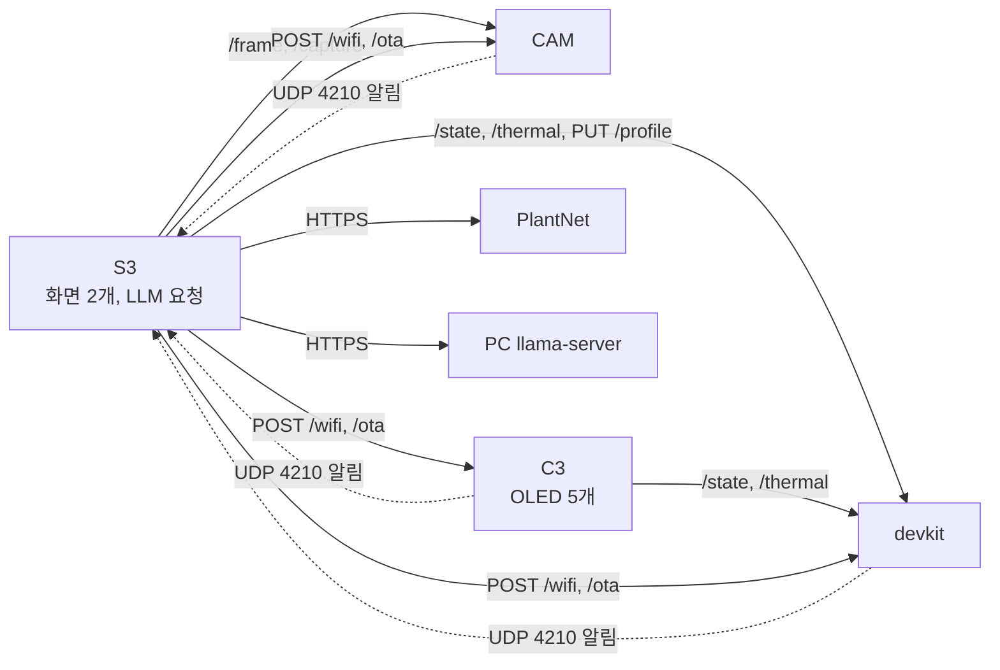

- devkit GET /state에 잎 온도와 열화상 최고·최저, 장치 상태(히터, 물, 양액, pH, 조명), 최근 동작, 프로필 등급을 더한다. S3와 C3가 같이 쓴다.
- 모든 기기: GET /info(이름, 버전, 가동 시간), POST /wifi, POST /ota, UDP 4210 알림.
- C3 POST /screens는 없앤다.

## 10. 작업 순서

1. 모든 기기 공통 모듈: WiFi(NVS, 설정 모드 AP), UDP 알림, /info, /wifi, /ota와 롤백. 이것부터 만들면 이후 펌웨어는 무선으로 올린다.
2. devkit /state 확장과 C3 OLED 5칸.
3. S3 메인 화면: 영상 2개, 식물, 오늘 일정, 운영 상태 줄(LLM 없이).
4. S3 식물 확인 흐름과 결과 시트(LLM 1·2번).
5. S3 설정 화면.
6. LLM 3~5번.
7. (선택) LLM 6번 사진 건강 보기.

진행: 3번과 5번의 S3 쪽은 firmware/s3로 올렸습니다(2026-11-12). 메인·설정 화면, 테마 셋, Wi-Fi, NTP, 기기 찾기, OTA, AI 서버 연결 시험이 보드에서 동작합니다. 영상·열화상·센서 값은 CAM과 센서 노드의 새 펌웨어가 firmware/s3/README.md의 인터페이스로 응답하면 나옵니다.

## 11. 정할 것

- 열화상 식물 상자를 가운데 고정으로 둘지, 설정에서 옮기게 할지
- 테마 셋을 모두 남겨 설정에서 고르게 할지, 하나만 남길지(셋 다 남겨도 펌웨어에 더해지는 것은 색표 두 벌뿐)
