# 메인 디스플레이 케이스 v2 (모듈형 · 베젤리스)

v1(../main-display)과 같은 부품(Waveshare ESP32-S3-Touch-LCD-7, GME12864 0.96" OLED 5개, TCA9548A, TENSTAR ESP32-C3 SuperMini)을 담되, 큰 부품을 작은 모듈로 나눠 한 번에 뽑는 시간을 줄이고 베젤을 없앤 버전입니다. 7" 유리 앞면이 그대로 정면이 되고, 벽은 유리보다 0.55 mm만 앞으로 나와 둘레를 감쌉니다. 화면 아래에는 OLED 모듈 5개가 벽에서 벽까지 꽉 차고(창 위치는 v1과 같이 7" 표시영역 폭에 맞춤), 양 끝 모듈이 유리 아래 둥근 모서리 틈까지 앞면에서 메웁니다. 외부로 나가는 선은 C3 SuperMini의 USB-C 하나뿐이고, 스탠드 다리 사이로 곧게 뒤를 향합니다.

깊이는 S3의 7번(UART2) 단자와 10번(I2C) 단자가 있는 좌우만 깊게(유리 앞면에서 뒤판 안쪽까지 25.55 mm, 플러그+선 25 mm 확보), 커넥터가 없는 가운데는 얕게(16.1 mm) 만들었습니다. 그 얕은 홈을 두꺼운 스파인이 채우는데, 이 스파인이 케이스 가운데 뒷판이자 스탠드의 등판이라 스탠드를 끼워도 두께가 늘지 않습니다(전체 두께 28.4 mm). 겉으로 보이는 파팅라인은 모두 좌우 대칭입니다: 벽은 가운데(x = 0)에서 위아래로 나뉘고, 뒤판·스파인 경계는 ±40 mm, OLED 모듈 경계는 ±16.6 / ±49.9 mm, 통풍구와 뒷면 나사 구멍도 좌우 거울 배치입니다. 단, 7" 모듈 자체의 황동 스탠드오프가 -61.6 / +64.6 mm로 3 mm 비대칭이라 그 4개 구멍만 그만큼 어긋나 있습니다.

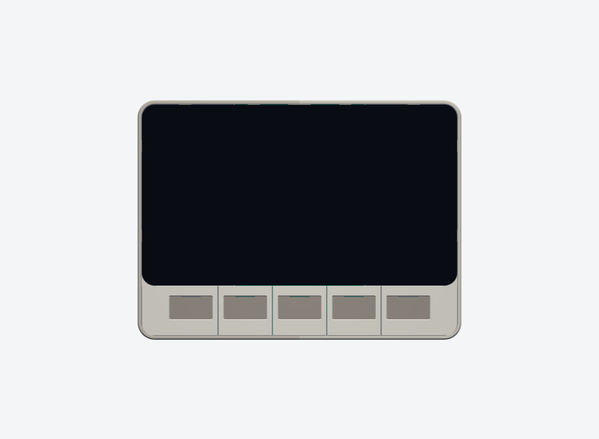
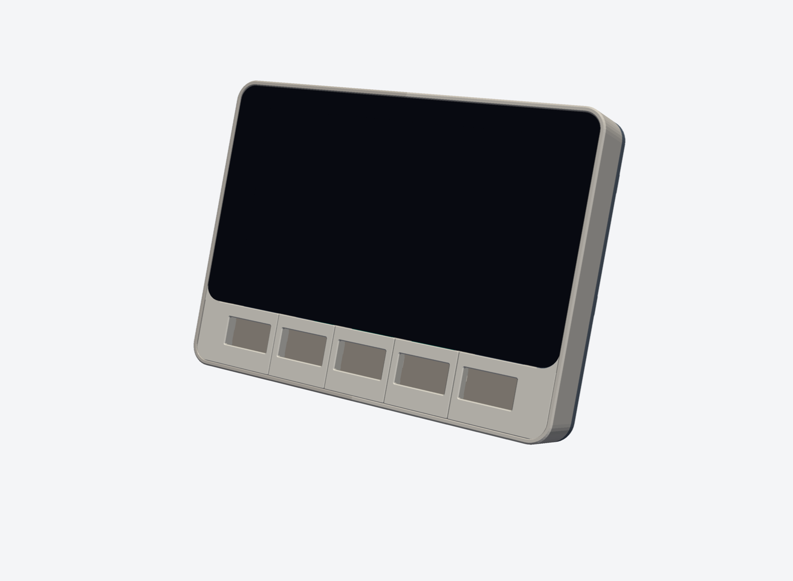
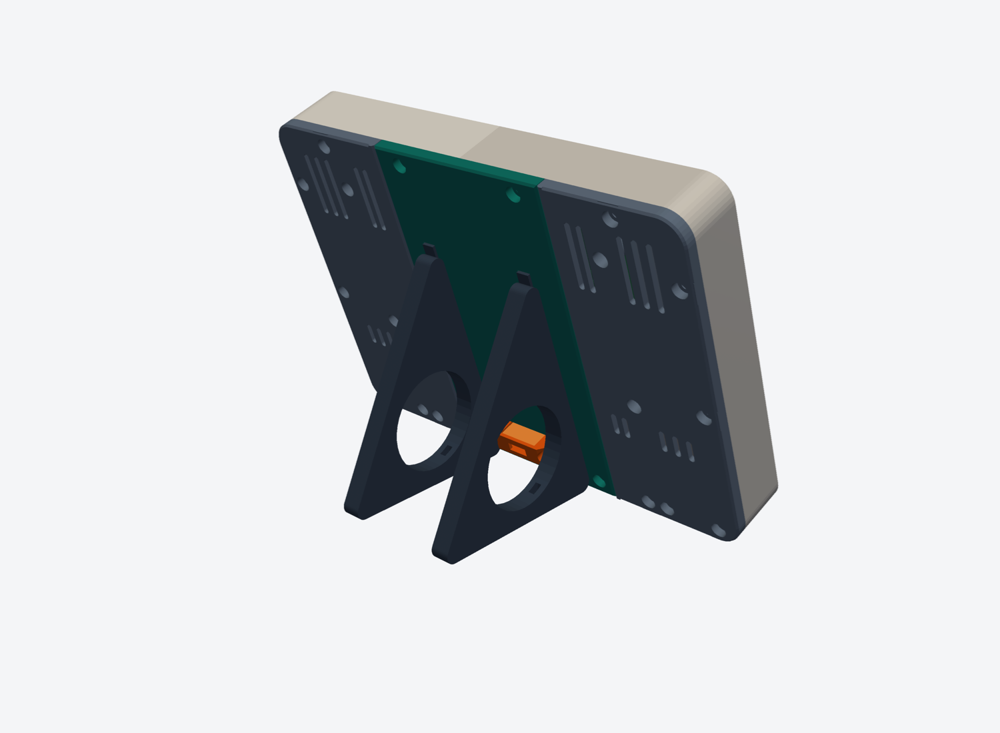
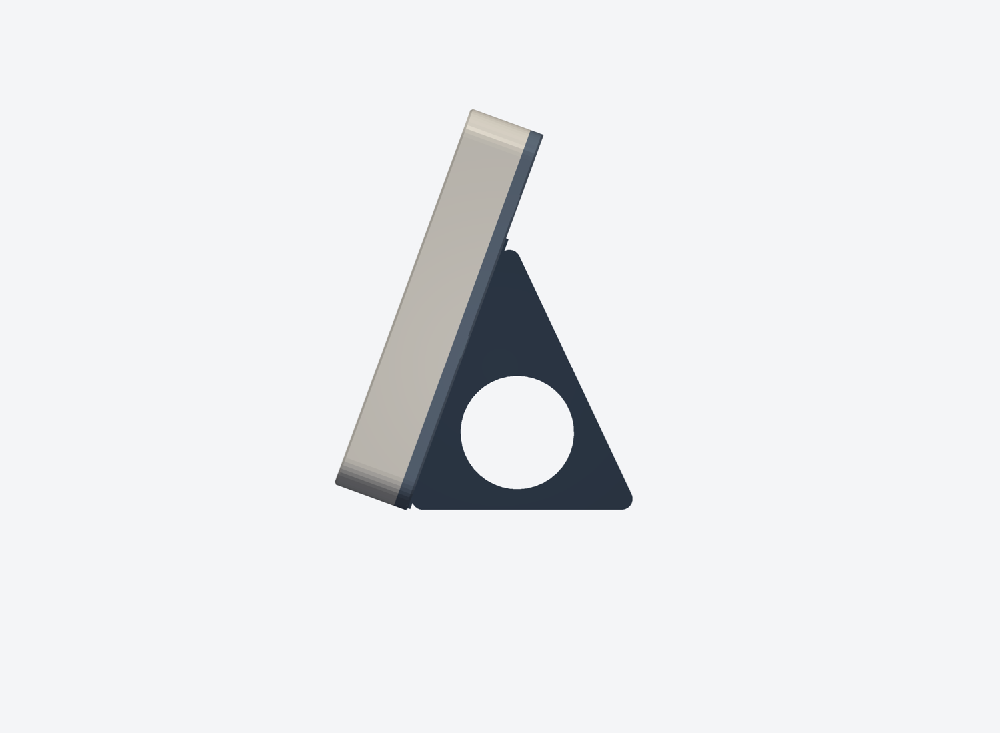
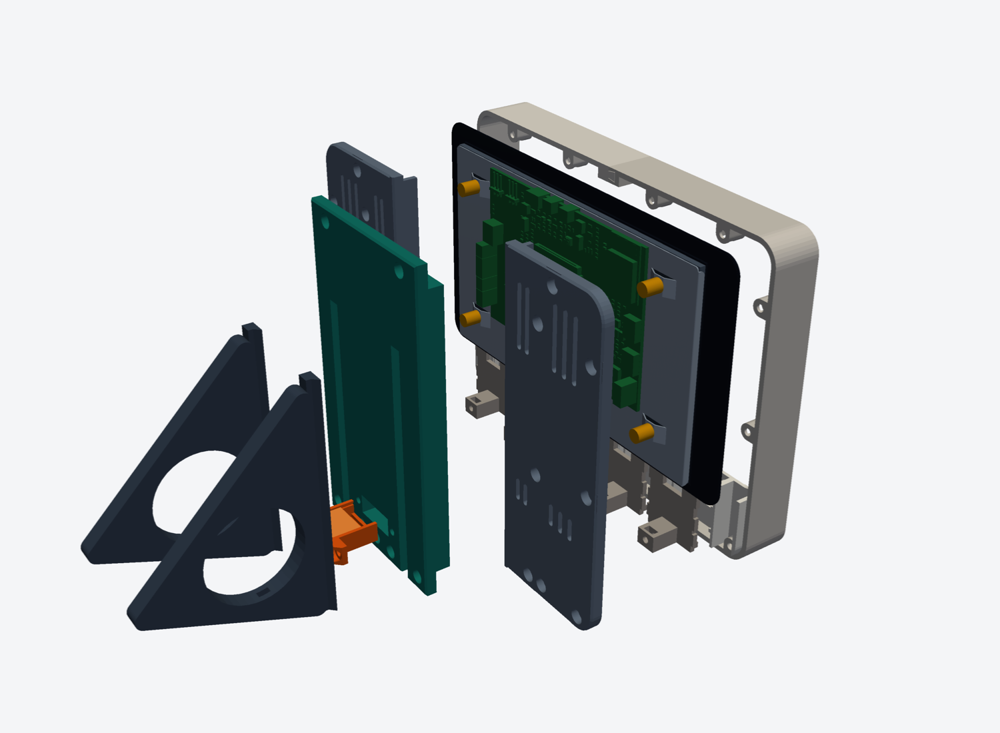
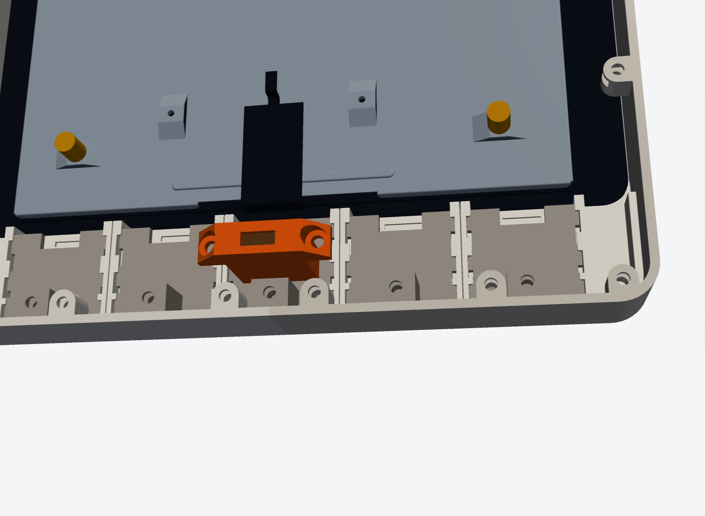
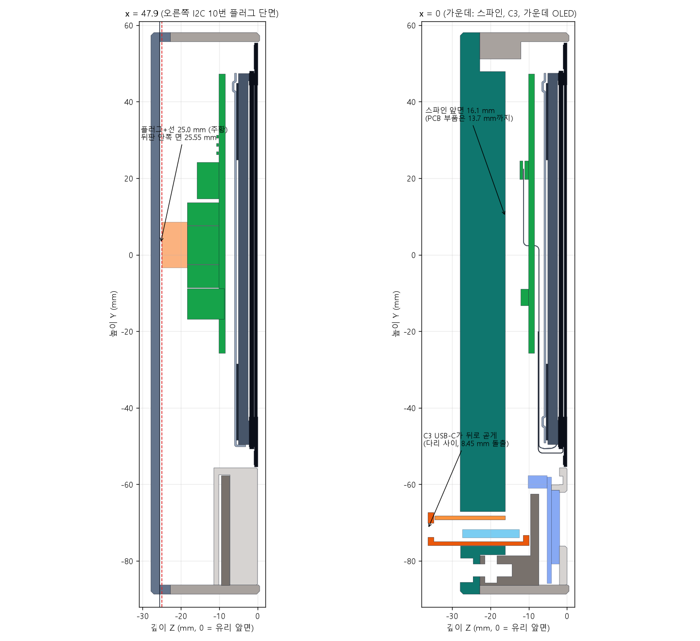

## 모듈과 체결

| 모듈 | 무엇 | 다른 모듈과 붙는 방법 |
|---|---|---|
| 01 / 02 뒤판 좌·우 | 깊은 뒤판(안쪽 면 25.55 mm). 7" 모듈 황동 스탠드오프 4개를 받음. 왼쪽 뒤판 턱 쪽에 TCA9548A 기둥 2개 | 스탠드오프에 M3 × 10 4개(머리는 Ø6.4 카운터보어 안) |
| 03 스파인 | 가운데 뒷판 겸 스탠드 등판(11.75 mm 두께, 안쪽은 리브). 다리 도브테일 홈 2개, C3 카트리지 구멍 | 벽 위·아래 보스에 M3 4개, 양옆은 뒤판 단차벽 사이에 끼워짐 |
| 04 / 05 벽 좌·우 | 바깥 벽만(베젤 없음). 세워서 출력 | 뒤판 테두리·스파인 끝 띠 위에 얹고 뒤에서 M3 14개(너트는 벽 보스 옆 홈에). 위쪽 가운데 이음매는 도브테일 |
| 06 OLED 몸체 ×5 (가운데 3 + 양 끝 2) | 창, PCB 뒤로 1.6 mm 나오는 긴 Ø1.7 위치 핀(v1 테스트에서 가장 잘 잡던 길이), 뚜껑 홈과 홈 턱의 입구 홈 3쌍. 양 끝은 벽까지 넓고 유리 모서리 틈을 메움 | 뚜껑을 2.5 mm 낮게 뒤에서 곧게 넣어 날개 3쌍이 입구 홈을 지나게 한 뒤, 2.5 mm 밀어 올리면 날개가 홈 턱 밑에 물림(퍼즐) |
| 07 OLED 뚜껑 ×5 (모두 같음) | 위가 열린 U자 기둥 4개(밀어 올릴 때 긴 핀이 기둥 속으로 들어가고, OLED를 0.2 mm 뒤에서 받침), 헤더 선 빠지는 홈, 발 | 발을 뒤에서 M3 1개로 당김(가장자리 2개는 뒤판, 가운데 3개는 스파인) |
| 08 / 09 C3 카트리지 + 뚜껑 | 사용자 23mm-case와 같은 안쪽 치수(18.15 × 23.35, 바닥 1.0, USB 구멍 9.0 × 3.7). 케이스 안에서는 세워져 USB-C가 뒤로. 출력은 바닥이 베드에 닿게 눕혀서(2026-11-20, 높이 8.6 = 25층): 층 경계 때문에 바닥 0.9, 뚜껑 홈 1.4(설계 1.2, 뚜껑 0.9가 0.5 여유로 들어감), USB 구멍 아래쪽 0.15 넓게 나옴 | 뚜껑은 홈에 밀어 넣음. 카트리지는 스파인 뒤에서 끼우고 M3 2개 |
| 10 다리 ×2 (같은 부품) | 납작한 삼각형, 둥근 창, 케이블타이 구멍 2개 | 스파인 뒤 도브테일 홈에 밑에서 밀어 올림(퍼즐) |

필요한 체결 부품은 M3 × 10 나사 27개와, M3 너트(5.5 × 2.4) 또는 F-3mm 황동 서포트 23개입니다(스탠드오프 4곳은 너트 없음). 모든 너트 자리는 두 가지가 다 들어가고, 나사를 조이면 너트가 플라스틱 쪽으로 당겨지게 놓였습니다. 뒷면 나사 머리는 모두 카운터보어 안으로 들어갑니다.

## 출력

Prusa i3 MK2S, 순정 0.4 노즐, PrusaSlicer "0.35mm FAST", Generic PLA. 모든 부품이 서포트 없이 뽑히고(떠 있는 섬 0, 가장 긴 미지지 구간은 양쪽이 받쳐진 브릿지), 높이 기준은 0.2 + 0.35n 층 경계입니다.

| G-code (out/sd_card) | 내용 | 시간 | 필라멘트 |
|---|---|---|---|
| v2_00_fit_test_52m | 조립 테스트 (아래 참고, 선택) | 52m47s | 14.8 g |
| v2_01_pod_left_1h18m | 왼쪽 뒤판 | 1h18m29s | 29.9 g |
| v2_02_pod_right_1h15m | 오른쪽 뒤판 | 1h15m54s | 29.6 g |
| v2_03_spine_2h13m | 스파인 | 2h13m37s | 51.6 g |
| v2_04_wall_left_1h2m | 왼쪽 벽 | 1h02m03s | 22.8 g |
| v2_05_wall_right_1h1m | 오른쪽 벽 | 1h01m13s | 23.0 g |
| v2_06_07_oled_cells_x5_1h38m | OLED 몸체 5(끝 2 포함) + 뚜껑 5 | 1h38m05s | 32.5 g |
| v2_06_07_oled_cell_x1_22m | 가운데 OLED 1칸(몸체 + 뚜껑) | 22m04s | 6.0 g |
| v2_08_09_c3_cartridge_9m | C3 카트리지(눕혀서) + 뚜껑 | 9m59s | 2.6 g |
| v2_10_legs_x2_1h19m | 다리 2개 | 1h19m26s | 32.2 g |
| v2_10_leg_x1_39m | 다리 1개 | 39m58s | 16.2 g |

| 한 세트 (조립 테스트 제외) | 시간 | 필라멘트 |
|---|---|---|
| 공통 부품: 뒤판 2 + 스파인 + 벽 2 + C3 + 다리 2 | 8h20m41s | 191.7 g |
| 공통 + OLED 5칸 버전 | 9h58m46s | 224.2 g |
| 공통 + OLED 통짜 버전 | 9h57m14s | 224.3 g |
| 공통 + OLED 통짜 등간격 버전 | 10h00m07s | 225.5 g |

조립 테스트까지 뽑으면 53분이 더해져 약 10h52m입니다. 시간은 PrusaSlicer 예상치(normal mode)입니다. 가장 긴 한 판은 스파인 2h14m이고, 스파인 시간은 넓은 바닥면의 솔리드 층이 정하는 값이라 포켓을 더 파도 줄지 않았습니다.

브림과 마우스이어는 모든 부품에서 뺐습니다(브림 폭 0). 그 대신 세워서 뽑는 부품이 있는 판(OLED 칸·뚜껑, 조립 테스트)에서는 슬라이서가 "바닥 접착이 약할 수 있음" 경고를 냅니다. PEI를 IPA로 닦고 베드 60 °C로 뽑고, 그래도 넘어지면 그 판만 딱풀을 얇게 바르세요.

## OLED 통짜 버전 (선택)

OLED 5칸을 나누지 않고 한 번에 뽑는 버전입니다. 위의 5칸 버전은 그대로 두었고, 둘 중 하나를 골라 쓰면 됩니다. 케이스의 다른 부품과 나사 위치는 같습니다.

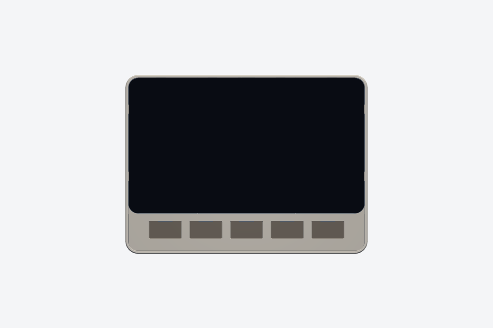
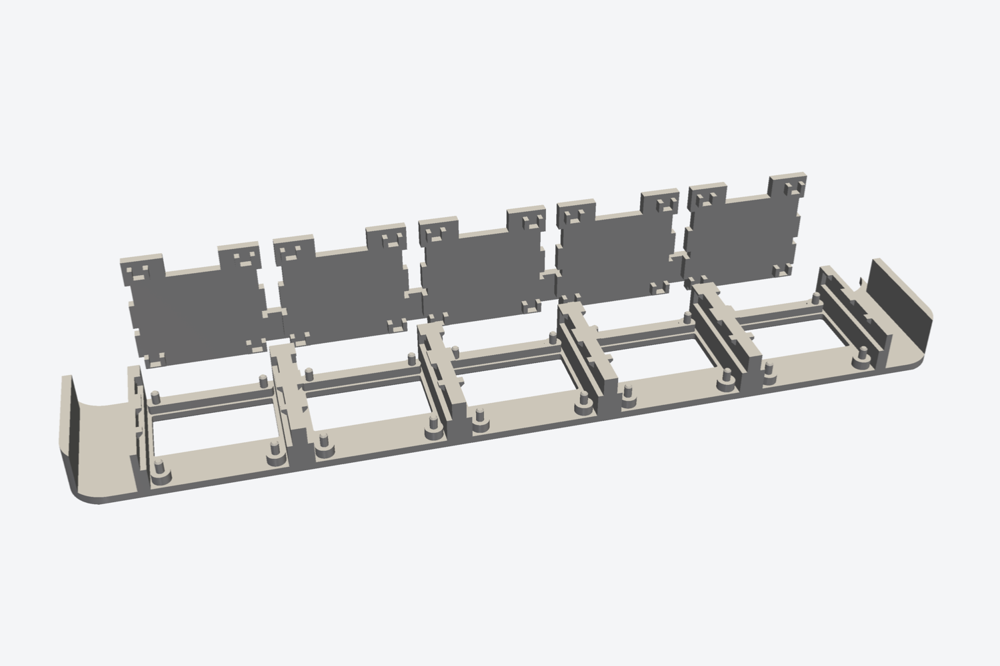

| G-code | 내용 | 시간 | 필라멘트 |
|---|---|---|---|
| v2_06_07c_oled_onepiece_1h36m | 몸체 + 뚜껑 한 판 | 1h36m33s | 32.6 g |
| v2_06c_oled_chin_onepiece_53m | 몸체만 (193.3 × 37.2, 앞면을 베드에) | 53m46s | 17.2 g |
| v2_07c_oled_lid_onepiece_43m | 뚜껑만 (5장을 발 쪽 막대로 연결, 세워서) | 43m31s | 15.6 g |

- 몸체: 벽에서 벽까지 이음매 없는 한 면에 창 5개입니다. 칸 구조(핀, 기둥, 뚜껑 홈)는 5칸 버전과 같아서, 5칸 버전의 낱개 뚜껑도 그대로 끼워집니다.
- 뚜껑: 5장을 발 높이의 막대(두께 2.2 mm, 몸체 레일 뒤 0.3 mm, 벽 보스 앞 0.25 mm)로 이었습니다. 2.5 mm 낮게 뒤에서 곧게 넣고 2.5 mm 밀어 올리면 홈 10개에 한꺼번에 물립니다.
- 고정: 5칸 버전과 같이 발 5개를 뒤에서 M3 5개로 당깁니다(양 끝은 뒤판, 가운데 3개는 스파인).
- 조립: OLED 5개를 몸체 핀에 모두 끼운 뒤 뚜껑을 끼우고, 통째로 앞에서 턱 자리에 넣어 뒤에서 나사를 조입니다.
- 검사: 7" 모듈, 보드·플러그·선 영역, 다른 부품과 간섭 0. 뚜껑이 들어가는 길(뒤에서 8 mm → 0, 그다음 위로 2.5 mm) 전체에서 몸체·OLED 보드·뒷면 부품에 걸리지 않음. 뚜껑 낀 턱을 앞에서 30 mm 밖부터 밀어 넣어도 뒤판·스파인·벽·C3에 걸리지 않음. OLED를 0.35 mm 뒤로 밀면 기둥에 닿아 고정됨.
- 대신 한 칸이 잘못 나오면 몸체 전체(53분)를 다시 뽑아야 합니다.

## OLED 통짜 등간격 버전 (선택)

통짜 버전과 같은 구조에서 OLED 배치만 바꿨습니다. 벽 안쪽 면 → 창 → 창 → … → 창 → 벽 안쪽 면, 여섯 간격이 모두 9.76 mm로 같습니다(창은 앞면 기준 27 × 15 mm, OLED 중심 간격 33.28 → 36.76 mm, 중심 위치 0 / ±36.76 / ±73.52 mm). 가운데 OLED와 그 뒤 C3는 움직이지 않았습니다.

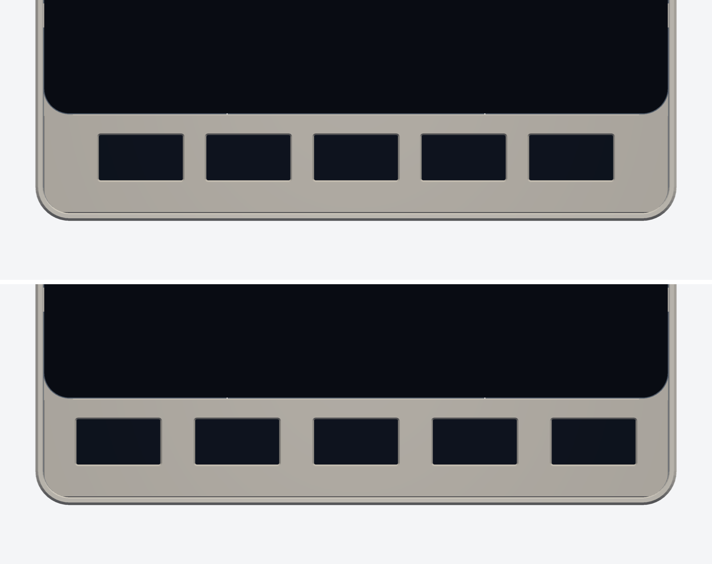
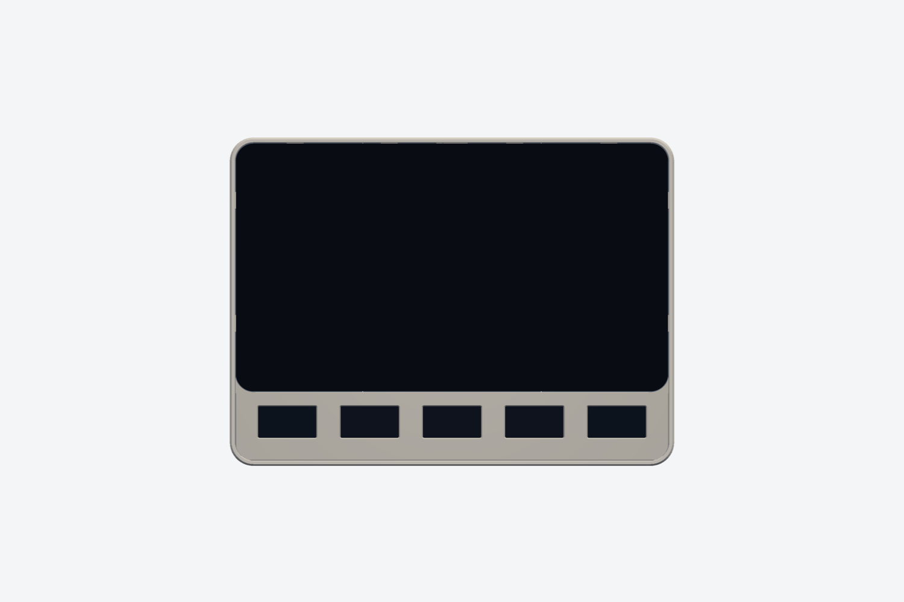
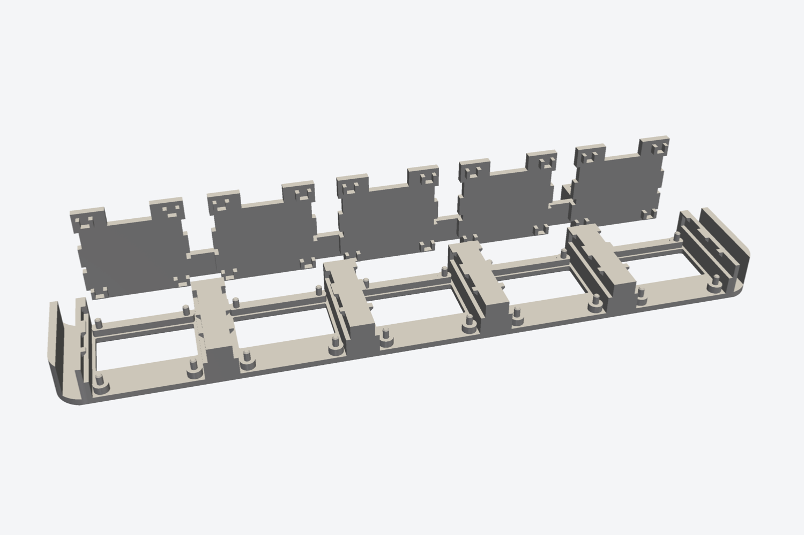

| G-code | 내용 | 시간 | 필라멘트 |
|---|---|---|---|
| v2_06_07e_oled_even_1h39m | 몸체 + 뚜껑 한 판 | 1h39m26s | 33.8 g |
| v2_06e_oled_chin_even_56m | 몸체만 (193.3 × 37.2, 앞면을 베드에) | 56m27s | 18.4 g |
| v2_07e_oled_lid_even_43m | 뚜껑만 (세워서) | 43m41s | 15.6 g |

- 다른 부품은 그대로: 뚜껑의 나사 발 5개를 원래 나사 자리(0 / ±33.28 / ±66.57 mm)에 남겨 두어서, 뒤판·스파인·벽·C3는 다시 뽑지 않고 이 몸체와 뚜껑만 바꿔 끼우면 됩니다. 발은 각 칸 뚜껑판 안쪽(가운데에서 최대 6 mm 옆)에 붙어 있습니다.
- 칸 사이가 넓어진 만큼 이웃한 레일을 하나로 이어 붙여 앞판을 받칩니다.
- 낱개 뚜껑(5칸 버전)은 발 위치가 달라 이 몸체에는 쓰지 않습니다. 등간격 뚜껑과 함께 쓰세요.
- 양 끝 OLED가 바깥으로 6 mm씩 옮겨 가서, 양 끝 화소 영역이 7" 표시영역 끝선보다 약 7 mm 바깥까지 나갑니다(기존 버전은 이 끝선에 맞춰 둠).
- 검사: 위 통짜 버전과 같은 항목 모두 통과(간섭 0, 뚜껑 경로·앞에서 끼우는 경로 걸림 0, 다섯 칸 모두 기둥 고정, 나사 구멍 일치, 떠 있는 섬 0).

## 조립 테스트 (v2_00_fit_test, 53분)

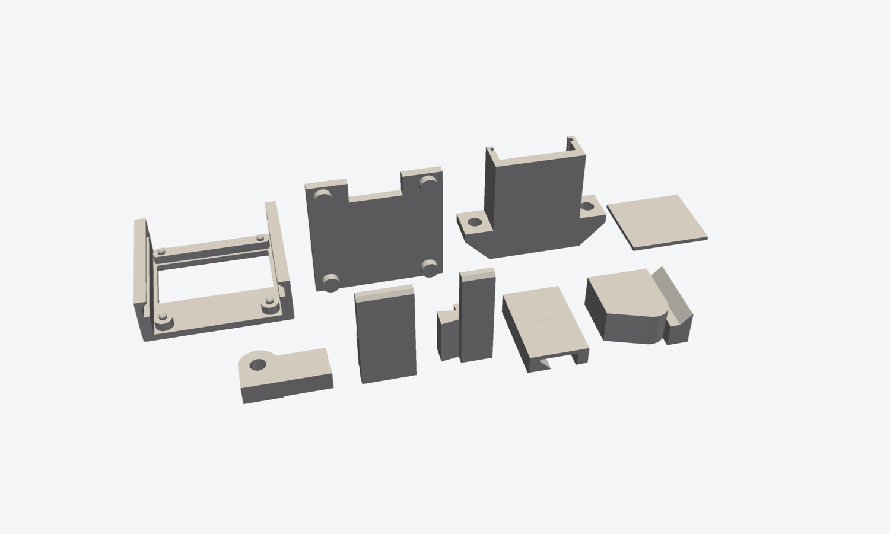

모든 조각은 실제 부품에서 그대로 잘라낸 것이라 맞으면 본 부품도 맞습니다.

1. OLED 칸: OLED를 핀에 끼우고 뚜껑을 2.5 mm 낮게 뒤에서 넣은 뒤 밀어 올렸을 때 끝까지 들어가는지, 앞에서 눌러도 화면이 들뜨지 않는지.
2. C3 카트리지: 보드를 USB 쪽부터 비스듬히 넣어 바닥에 눕히고 뚜껑이 홈에 들어가는지, USB-C 케이블이 끝까지 꽂히는지.
3. 벽 이음 3조각(스파인 끝 띠 + 왼쪽 벽 + 오른쪽 벽): 너트(또는 F-3mm 서포트)를 벽 보스 옆 홈에 밀어 넣고 띠 뒤에서 M3 × 10으로 조였을 때 머리가 카운터보어 안에 들어가는지, 위쪽 가운데 도브테일이 위에서 눌러 끼워지는지.
4. 다리 도브테일 2조각: 다리 혀가 스파인 홈에 밀려 들어가고, 뒤로 당겨도 빠지지 않는지.

## 조립 순서

1. 벽 두 쪽을 앞면이 아래로 가게 놓고 가운데 도브테일을 맞춘 뒤, 뒤판 두 장을 테두리 위에 얹어 M3로 조입니다. 너트는 벽 보스 옆 홈에 미리 넣습니다.
2. 스파인을 뒤에서 홈에 넣고 위·아래 끝 띠를 M3 4개로 조입니다.
3. 앞쪽에서 TCA9548A를 왼쪽 뒤판 기둥에 M3 2개로 고정합니다(부품면이 앞, 선은 뒤로).
4. OLED에 선을 납땜하고 몸체 핀에 끼운 뒤, 뚜껑을 2.5 mm 낮게 뒤에서 곧게 넣고(날개가 홈 턱의 입구 홈을 지나게) 2.5 mm 밀어 올려 한 칸을 완성합니다. 앞에서 턱 자리에 넣고 뒤에서 M3 1개씩 조입니다. 통짜 버전은 다섯 칸을 한 번에 같은 방식으로 합니다.
5. C3에 선을 납땜해 카트리지에 넣고 뚜껑을 밀어 닫은 뒤, 선을 스파인 구멍으로 먼저 넣고 카트리지를 뒤에서 끼워 M3 2개로 고정합니다. C3 앞쪽 6 mm는 위가 열려 있어 선이 위로 빠집니다.
6. S3의 7번(UART2)과 10번(I2C) 플러그를 꽂고 선을 턱 쪽으로 내린 뒤, 7" 모듈을 앞에서 넣고 뒤판 카운터보어로 M3 4개를 스탠드오프에 조입니다.
7. 다리 두 개를 스파인 아래에서 밀어 올립니다.

## 배선 메모

배선도: [out/wiring.html](out/wiring.html)(브라우저), [out/wiring.svg](out/wiring.svg)(인쇄). wiring.py로 다시 만듭니다. TCA 채널 2~6 = OLED 1~5(앞에서 볼 때 왼쪽부터)로 배선했습니다(2026-11-21). 가운데 OLED 3(채널 4)은 노랑/파랑 2색 모듈입니다.

C3 USB-C가 유일한 입력입니다. C3 5V/GND → S3 10번 단자 VCC/GND, C3 TX/RX ↔ S3 7번(UART2) 단자 RXD/TXD(S3의 15번 스위치를 UART2로), C3 I2C → TCA9548A → OLED 5개. 7번 단자에는 5V가 없고 3V3만 있어서 전원은 10번 단자로 받습니다. 10번 단자의 VCC는 보드의 18번 저항으로 3V3/5V가 정해지므로, 5V를 넣기 전에 18번이 5V 쪽인지 확인하세요. S3의 USB-C와 BOOT/RESET 버튼은 쓰지 않는 전제라 옆 구멍과 윗면 핀 구멍은 없습니다.

## 파일

| 경로 | 내용 |
|---|---|
| build_v2.py | 생성 스크립트. 치수 파라미터는 파일 위쪽 |
| verify_v2.py | 공식 STEP 모듈, 플러그·선·OLED·TCA·C3 보드 영역과의 간섭, 부품끼리 간섭, 나사 길이, 25 mm 선 공간, 스탠드 무게중심 검사 + 렌더용 조립 STL |
| wiring.py | 화면부 배선도(out/wiring.html, out/wiring.svg): C3 ↔ S3 ⑩·⑦ 단자, C3 → TCA9548A → OLED 5개 |
| plates_v2.py | 출력 판, 조립 테스트 조각, PrusaSlicer 슬라이싱 |
| out/stl | 출력 방향 부품 STL |
| out/plates, out/gcode | 출력 판 STL과 G-code |
| out/sd_card | SD 카드에 그대로 복사할 G-code(이름에 시간 표시) |
| out/fit_test | 테스트 조각 STL |
| out/verify_v2.json, out/support_check.json, out/support_check_even.json, out/plates_info.json | 마지막 검증, 서포트 검사, 슬라이싱 결과 |
| out/v2_assembly.step | 조립체 STEP |

마지막 검증 결과: 7" 모듈과의 간섭 0(뒤판 보스가 스탠드오프를 0.05 mm 미리 누르는 것만 의도적), 보드·플러그·선 영역과 간섭 0, 부품끼리 간섭 0, 무게중심이 앞 접지선보다 12 mm 뒤·다리 끝보다 73 mm 앞(약 460 g).

