# 메인 디스플레이 스탠드 케이스

Waveshare ESP32-S3-Touch-LCD-7 1개, 0.96" I2C OLED(뒷면에 GME12864-11-12-13이라고 적힌 SSD1306 모듈) 5개, TCA9548A 1개, ESP32-C3 SuperMini(TENSTAR) 1개를 담는 스탠드 케이스입니다. 7인치 화면 아래 턱에 OLED 5개를 나란히 두었습니다. TCA9548A와 C3 SuperMini는 7" 모듈 아래쪽 황동 스탠드오프 두 개에 얹는 거치대(04_tca_bracket)의 뒷면(뒷판 쪽)에 위아래로 나란히 붙습니다. 두 보드 모두 부품면이 거치대를 향하게 뒤집어 놓아서, 뒷판을 열면 두 보드의 뒷면이 보이고 배선도 뒤에서 납땜할 수 있습니다. C3는 TCA 바로 위에 가로로 놓이고, USB-C는 7" 모듈의 USB-C와 같은 쪽(앞에서 볼 때 왼쪽)을 향합니다. I2C 배선이 모두 앞쪽 조립체에 붙어 있어서, 뒷판은 선이 하나도 연결되지 않은 덮개입니다.

본체는 위아래가 평행한 상자 모양이고, 20° 뒤로 기울어 뒷판 쪽 아래 모서리가 바닥에 닿습니다. 스탠드는 뒷판에 나사로 붙는 단순한 삼각 프레임이라 앞에서는 보이지 않습니다. 전원을 포함한 USB-C 케이블과 다른 배선은 모두 케이스 안쪽으로 돌아 뒷판 아래 가운데의 큰 구멍으로 나가고, 스탠드를 지나 아래나 뒤로 빠집니다. USB-C를 옆으로 빼고 싶을 때를 위해 정면 기준 왼쪽 벽에 포트와 일직선인 녹아웃 홀도 만들어 두었습니다(아래 "측면 USB-C 홀").

모든 체결은 M3 × 10 나사 하나로 통일했습니다. 나사는 출력물에 끼운 M3 육각너트(대변 5.5 × 두께 2.4) 또는 F-3mm 황동 PCB 서포트(대변 5.5 × 길이 3.0)에 체결합니다. 너트 자리는 두 가지가 다 들어가는 크기이고, 나사를 조이면 너트가 항상 플라스틱 쪽으로 당겨지는 방향으로 놓았습니다. 뒷판 바깥에 보이는 나사 머리 10개는 모두 Ø6.4 카운터보어 안으로 들어가서 뒷판 바깥면이 평평합니다.

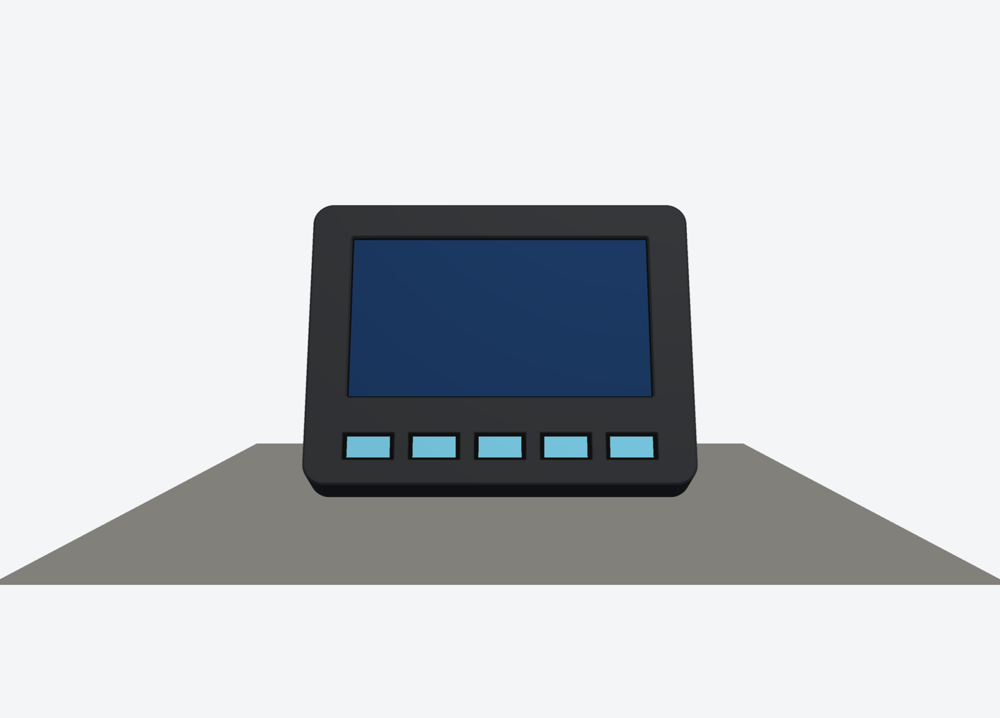
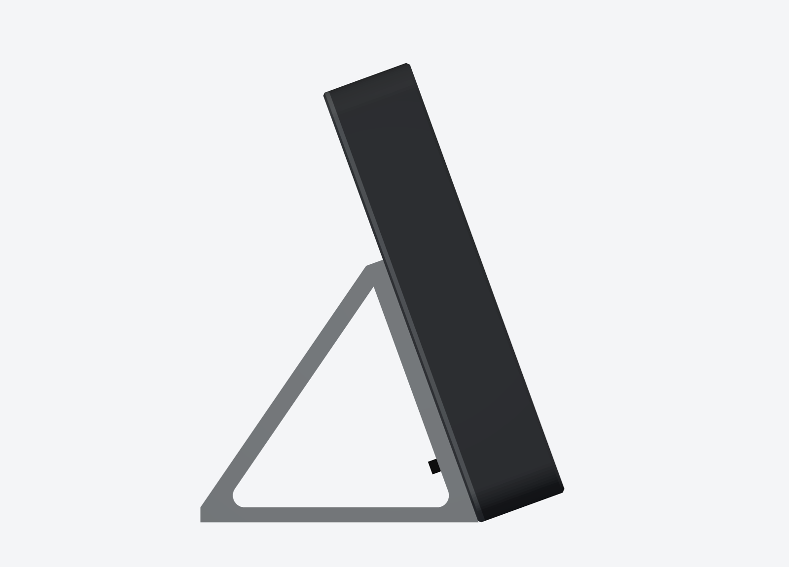
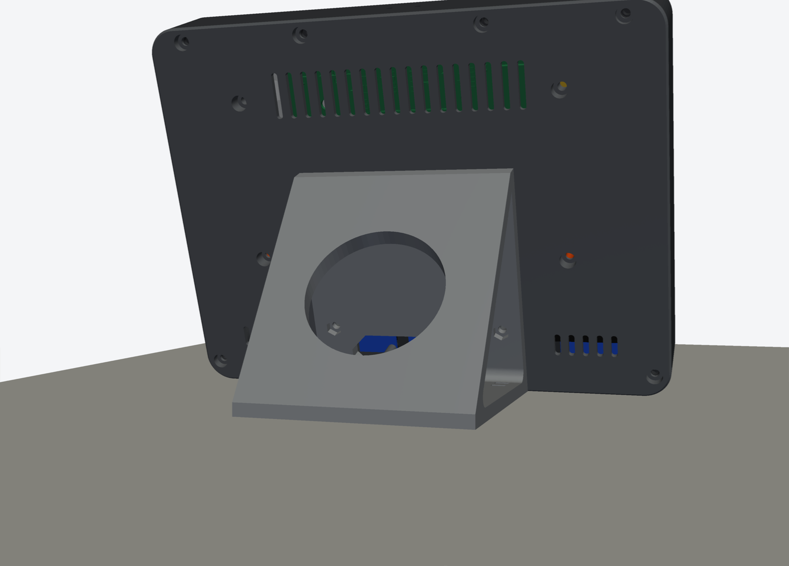
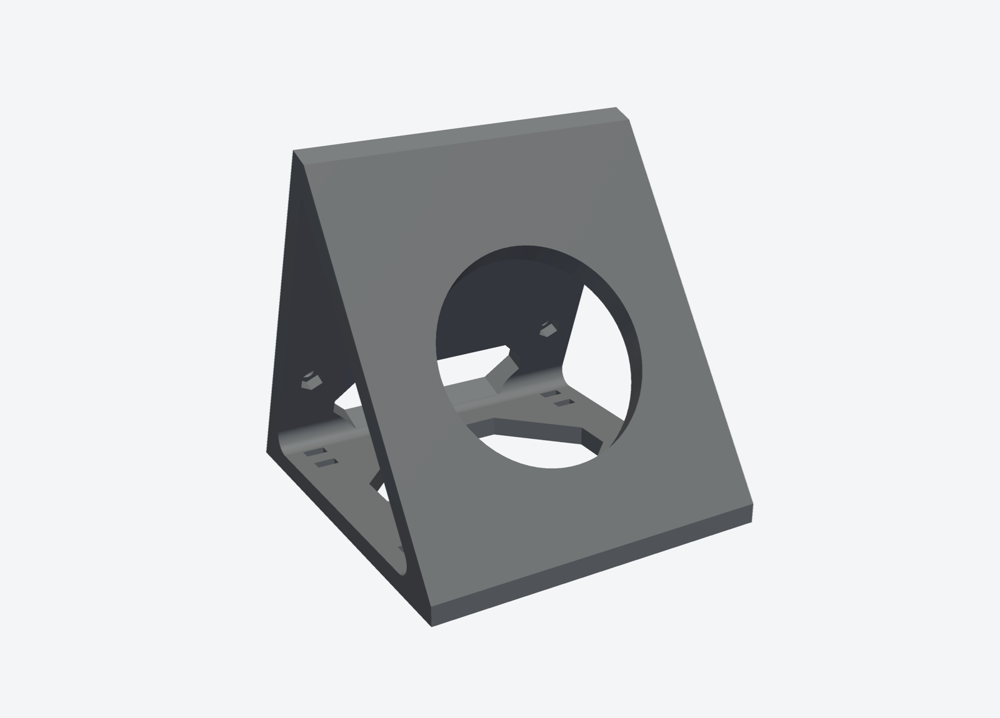
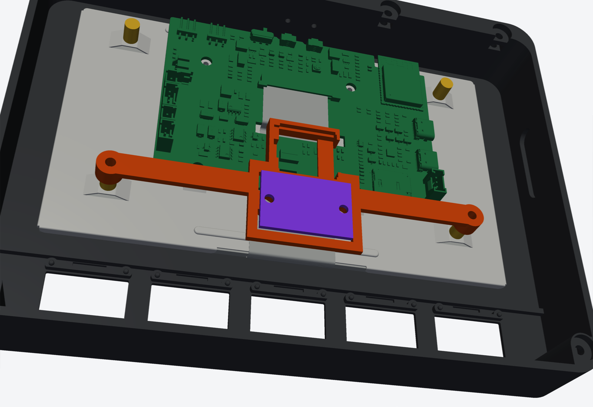
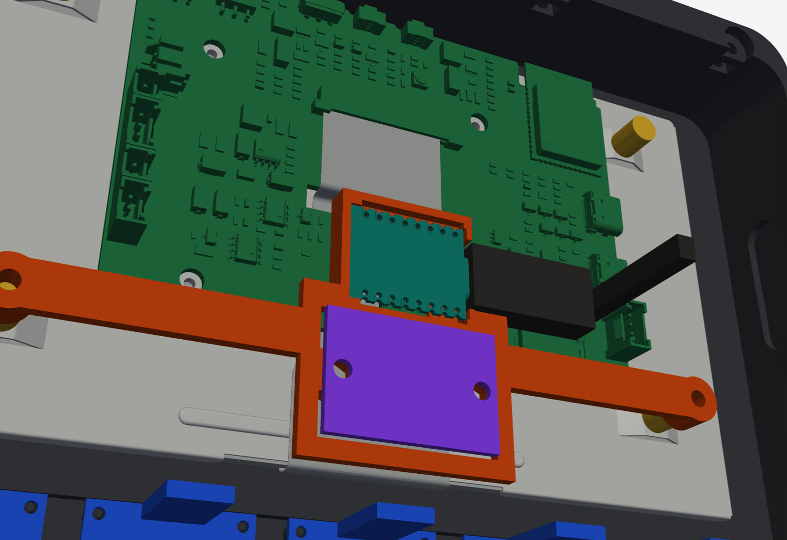
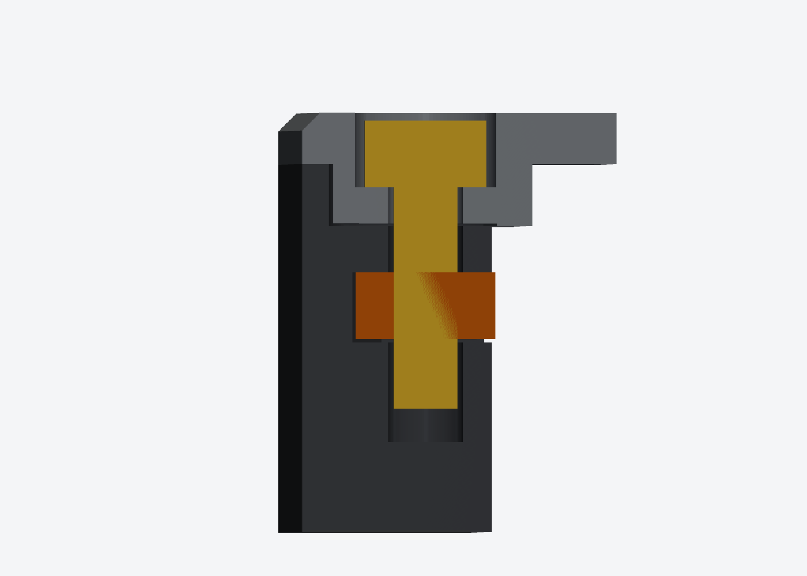

## 파일

| 경로 | 내용 |
|---|---|
| build_case.py | build123d 0.13 생성 스크립트. 모든 치수 파라미터가 파일 위쪽에 있습니다 |
| verify_case.py | Waveshare 공식 STEP을 케이스 좌표로 불러와 간섭, 조립 경로, 체결부, 배선 경로, 책상 접지, 넘어짐을 검사하고 렌더를 만듭니다 |
| fit_test.py | 본 출력 전에 뽑는 조립 테스트 조각과 게이지를 만듭니다 |
| check_print.py | 출력 방향 STL의 45° 초과 오버행과 G-code 시간·무게를 집계합니다 (check_print.py out, check_print.py out\fit_test) |
| out/stl, out/step | 출력 방향으로 놓인 부품 4개, 책상 위 조립체 00_assembly_on_desk.step |
| out/gcode | MK2S · 0.35mm FAST · Generic PLA 로 슬라이싱한 G-code와 3MF 프로젝트 |
| out/fit_test | 조립 테스트용 STL, G-code, 3MF |
| out/sd_card | SD 카드에 그대로 복사할 G-code 8개(본 부품 4개 + 조립 테스트 4개), 이름에 출력 시간이 붙어 있습니다 |
| out/preview | 렌더 (정면, 측면, 후면, 내부, 단면, 분해도, 스탠드, 측면 USB-C 홀) |
| out/verify_report.json | 마지막 검증 결과 |
| research | 근거 자료: Waveshare 공식 STEP/DXF/PDF, GME12864 OLED 고정부를 잰 MakerWorld 2703510 3MF·사진(research/gme12864), TCA9548A 사진, ESP32-C3 SuperMini STEP(research/c3_supermini) |

## 출력

Original Prusa i3 MK2S, 순정 0.4 mm 노즐, PrusaSlicer 2.9.2 시스템 프리셋 "0.35mm FAST"(첫 층 0.20, 이후 0.35)와 Generic PLA로 슬라이싱했습니다. 서포트는 필요 없습니다. 높이 방향 치수(앞판 1.95, 프레임 28.55, 너트 홈, 보스 높이 등)는 0.2 + 0.35n 층 경계에 맞췄습니다.

| # | 부품 | 출력 방향 | 크기 (mm) | 시간 | 필라멘트 |
|---|---|---|---|---|---|
| 01 | 정면 프레임 | 앞면을 베드에 | 198.8 × 153.2 × 28.55 | 3h 56m | 91.9 g |
| 02 | 뒷판 | 바깥면을 베드에 (OLED 기둥 20개, C3 기둥 2개가 위로) | 198.8 × 153.2 × 25.4 | 3h 52m | 88.9 g |
| 03 | 스탠드 | 옆면(삼각형)을 베드에 눕혀서, 둘레 3겹 | 93.2 × 88.0 × 86.0 | 3h 17m | 74.2 g |
| 04 | TCA·C3 거치대 | 뒷면(TCA 자리, C3 홈)을 베드에, 컵과 TCA 너트 자리가 위로 | 135.2 × 49.1 × 6.5 | 0h 17m | 5.6 g |

합계 약 11시간 22분, 261 g입니다. 사용자 프리셋 "0.35mm FAST - 복사"는 채움 100%라 시간과 무게가 크게 늘어나니, 이 케이스에는 순정 15~20% 채움을 권장합니다.

스탠드는 옆으로 눕혀 출력합니다. 층이 삼각 프레임 단면을 따라 쌓여서 판·바닥·경사판이 층 사이로 갈라질 방향의 힘을 받지 않습니다. STL과 G-code가 이미 눕힌 방향이라 그대로 올리면 됩니다.

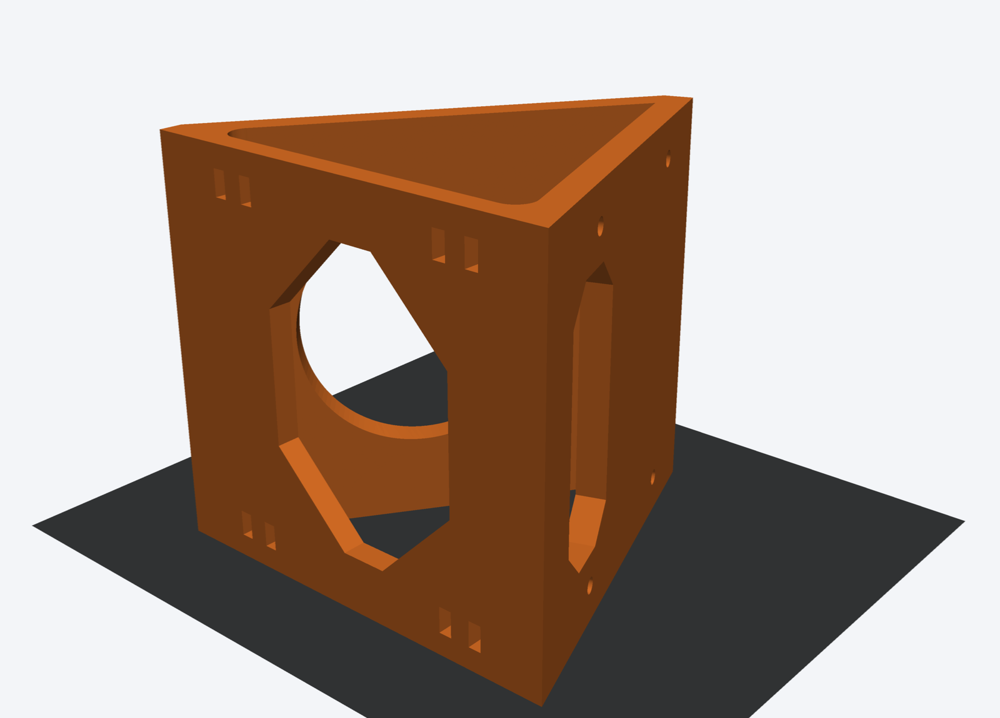

책상 위 크기는 폭 198.8, 높이 153.9, 깊이 121.9 mm(앞 모서리부터 스탠드 뒤끝까지)입니다.

## 먼저 조립 테스트

본 출력 전에 out/fit_test의 두 판을 뽑아 부품이 맞는지 확인하세요. 조각은 실제 부품에서 그대로 잘라낸 것이고, 정면 프레임 조각은 본 출력과 층 경계가 같은 높이에서 잘랐습니다. 그래서 조각이 맞으면 본 부품도 맞습니다.

| 판 | 내용 | 시간 | 필라멘트 |
|---|---|---|---|
| plate_A_fit_test | 7" 베젤 게이지 + 조각 6개 (이미 출력해서 확인함) | 0h 52m | 14.2 g |
| plate_B_screw_gauge | 모듈 나사 구멍 게이지 | 0h 24m | 7.0 g |
| fit_02_oled_cell (단독) | OLED 칸 하나: 창, 받침, 위치 핀 | 0h 08m | 2.3 g |
| plate_C_oled_assembly | 실제 깊이의 OLED 칸 + 뒷판 기둥 (fit_13 + fit_14) | 1h 05m | 21.7 g |
| plate_E_tca_bracket | TCA·C3 거치대(본 부품 04 그대로) + 뒷판의 아래쪽 스탠드오프 조각 fit_15 | 0h 20m | 6.3 g |

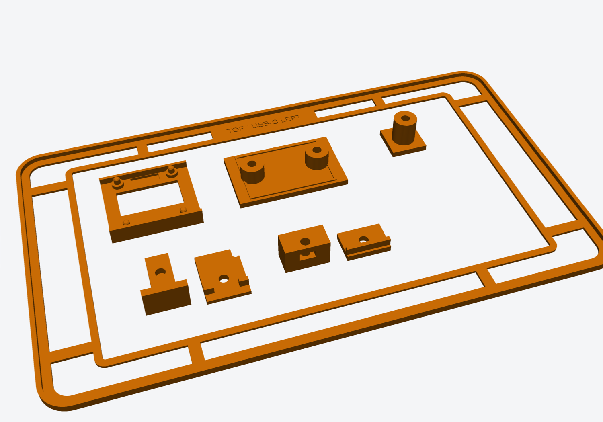

| 조각 | 확인할 것 |
|---|---|
| fit_01 베젤 게이지 | 7" 모듈을 유리면이 아래로 가게 넣었을 때 유리가 억지 없이 외곽 벽 안에 들어가는지(한쪽 0.3 mm 여유). 화면을 켜고 앞에서 볼 때 창 가장자리가 보이는 영역보다 0.75 mm 바깥에 고르게 있는지. "TOP / USB-C LEFT"가 PCB 쪽(11 mm 베젤)이고, 앞에서 볼 때 USB-C가 왼쪽입니다 |
| fit_02 OLED 칸 | GME12864 OLED를 헤더가 위("TOP" 방향, 창이 치우친 쪽)로 가게 해서 Ø1.7 핀 4개에 곧게 끼웠을 때 억지 없이 들어가고 보스 4개에 평평하게 앉는지, 앞면 헤더 납땜이 띠에 걸리지 않는지, 화면이 창 가운데에 오는지 확인합니다. 받침과 창은 MakerWorld 2703510 설계를 잰 값이고, 클립 테스트(이전 판 D)에서 이미 맞았습니다 |
| fit_03 + fit_04 | 아래 오른쪽 모서리 블록의 홈에 너트(또는 서포트)를 위에서 밀어 넣고, 뒷판 조각을 턱이 안쪽으로 가게 얹어 뒷판 보스가 프레임 조각의 원형 홈에 들어가는지 봅니다. 그다음 M3 × 10을 조여 끝까지 잠기는지, 너트가 헛돌지 않는지, 머리가 뒷판 바깥면보다 들어가는지 확인합니다 |
| fit_05 + fit_06 | 윗벽 홈으로 같은 확인 |
| 04 거치대 + TCA (판 E) | 거치대의 컵이 있는 면 육각 자리 2곳에 너트를 넣고, 거치대를 뒤집어 TCA9548A를 부품면이 아래(거치대 쪽)로 가게 구멍 둘레 자리에 얹습니다. TCA 뒷면에서 M3 × 10 두 개를 조여 끝까지 물리는지, 칩·부품·핀 납땜이 창 안으로 들어가 기판이 두 자리에 평평하게 닿는지 확인합니다 |
| 04 거치대 + fit_15 (판 E) | 거치대 양쪽 컵이 7" 모듈 아래쪽 스탠드오프 두 개 끝에 동시에 들어가는지 봅니다. 그다음 fit_15(뒷판 조각)를 거치대 한쪽 끝에 얹고 바깥에서 M3 × 10을 넣어, 거치대를 지나 스탠드오프에 끝까지 물리는지 확인합니다 |
| 04 거치대 + C3 (판 E) | 거치대를 뒷면(TCA 자리)이 위로 오게 놓고, C3 SuperMini를 부품면이 아래, USB-C가 트인 쪽으로 가게 TCA 위 홈에 넣습니다. USB-C 껍데기가 홈 끝의 받침대에, 안테나 쪽 두 모서리가 받침에 평평하게 앉는지 봅니다. 그다음 자를 거치대 뒷면에 걸쳐 C3 위로 지나가게 놓습니다. C3 뒷면이 자에 닿지 않아야 합니다(설계상 0.25~0.35 mm 아래). 뒷판 기둥은 거치대 뒷면 높이에서 끝나므로, 자에 닿지 않으면 기둥이 C3를 누르지 않습니다. C3가 자를 들어 올리면 기판이 두꺼운 것이니, 뒷판을 뽑기 전에 알려 주세요. 마지막으로 일자 USB-C 케이블을 트인 쪽에서 끝까지 꽂아 봅니다 |
| fit_08 | 모듈 스탠드오프 하나에 얹고 M3 × 10을 넣어 보스가 평평하게 닿은 채로 물리는지(약 3.4 mm) |
| fit_09 나사 구멍 게이지 | 모듈을 유리면이 아래로 가게 놓고 게이지를 스탠드오프 4개 위에 얹습니다. 두 탭은 유리의 USB-C 쪽 가장자리와 아래(OLED 쪽, 13 mm 베젤) 가장자리에 닿게 합니다. 이 상태에서 구멍 4개가 모두 스탠드오프 나사 구멍과 맞아야 합니다 |
| fit_13 + fit_14 (판 C) | 맨 오른쪽 OLED 칸과 아래 오른쪽 모서리 나사 자리를 실제 프레임·뒷판에서 높이 그대로 잘라낸 짝입니다. 잘린 왼쪽과 위쪽에는 뒷판 조각이 실제 깊이에 앉도록 테스트용 벽을 세웠습니다. 프레임 조각의 모서리 홈에 너트를 넣고, OLED를 핀에 꽂은 뒤 뒷판 조각을 덮어 M3 × 10 하나로 조입니다. 뒷판 조각이 테두리에 틈 없이 닿는지(기둥이 길면 뜹니다), 핀 끝이 기둥 홈에 들어가는지, 창으로 화면을 눌러도 기판이 빠지지 않고 기둥에 걸려 멈추는지, 흔들 때 기판이 덜그럭거리는 정도(설계 유격 0.2 mm)를 확인합니다 |

맞지 않는 곳이 있으면 build_case.py의 해당 파라미터(아래 표)를 고치고 다시 생성하세요.

## 준비물

| 수량 | 품목 | 용도 |
|---|---|---|
| 16 | M3 × 10 렌치볼트(DIN 912, 머리 Ø5.5 × 3.0) 또는 머리 Ø6.0 × 2.4 이하 냄비머리 | 정면 프레임 6, TCA9548A 2, 7" 모듈 스탠드오프 4, 스탠드 4 |
| 12 | M3 육각너트(5.5 × 2.4) 또는 F-3mm 황동 서포트(5.5 × 3.0) | 정면 프레임 6, TCA9548A 2, 스탠드 4 |
| 필요 시 | 폭 5 mm, 두께 2.5 mm 이하 케이블타이 | 스탠드 바닥 슬롯으로 고정하거나 케이블 정리 |
| 5 | 4핀 듀폰 F-F 케이블 10~15 cm | OLED → TCA9548A |
| 1 | HY2.0 4핀 케이블 | ESP32 I2C 헤더 → TCA9548A |
| 2 | USB-C 케이블(한쪽 ㄱ자 아닌 일자 플러그, 굵기 4.5 mm 이하) | USB / UART, 그중 하나가 전원 |
| 1 | ESP32-C3 SuperMini (TENSTAR, 18 × 22.52~22.8 mm, 기판 두께 1.0 mm 이하) | 거치대의 TCA 위 홈, 전원은 5V/GND 선 |

7" 모듈 쪽은 모듈에 원래 달린 M3 황동 스탠드오프 4개를 그대로 씁니다. 뒷판 카운터보어를 깊게 파서 M3 × 10이 스탠드오프에 3.4 mm 들어갑니다.

뒷판 가장자리 6곳과 스탠드오프 4곳은 모두 Ø6.4 카운터보어라, 나사 머리가 뒷판 바깥면보다 렌치볼트는 0.35 mm, 냄비머리는 0.95 mm 아래에 앉습니다. 머리를 묻은 만큼 나사가 짧아지지 않도록 가장자리 6곳에는 뒷판 안쪽으로 2.45 mm 솟은 보스(Ø8.4)를 두었고, 이 보스가 정면 프레임 가장자리의 원형 홈(Ø8.8, 깊이 2.8)에 들어갑니다. 보스 끝은 홈 바닥에서 0.35 mm 떨어져 있어서, 뒷판은 보스가 아니라 테두리에 앉습니다. 스탠드 나사 4개는 머리가 케이스 안쪽에 있어 바깥에서는 너트 자리만 보이고, TCA9548A 나사 2개는 거치대에 있어 바깥에 드러나지 않습니다.

## 너트 자리

| 위치 | 수 | 넣는 방법 |
|---|---|---|
| 정면 프레임 윗벽 | 4 | 케이스 안쪽에서 윗벽 아래면의 홈으로 옆으로 밀어 넣습니다. 홈 끝이 V자라 너트가 나사 축에 맞춰 멈춥니다 |
| 정면 프레임 아래 양쪽 모서리 블록 | 2 | 블록 위쪽(화면 쪽)에서 홈으로 밀어 내립니다. OLED 사이 간격이 5.8 mm라 OLED 사이에는 나사가 없고, 가운데는 뒷판에 나사로 붙는 스탠드 판이 받쳐 줍니다 |
| TCA 거치대의 컵이 있는 면(모듈 쪽) | 2 | TCA를 달기 전에 육각 자리에 넣습니다. TCA 뒷면에서 나사를 조이면 너트가 자리 바닥으로 당겨집니다. 자리가 너트보다 0.25 mm 커서 나사를 완전히 빼면 너트가 빠질 수 있으니, TCA를 뗄 때는 거치대를 꺼내서 풉니다 |
| 스탠드 판 뒷면(삼각 통로 안) | 4 | 통로 옆으로 손을 넣어 육각 자리에 넣습니다 |

정면 프레임 홈은 프레임을 뒤집을 때 너트가 빠질 수 있으니, 헐거우면 순간접착제를 한 방울 찍거나 테이프로 잠시 막아 두세요.

## 조립

1. OLED는 4핀 헤더가 뒷면으로 곧게 나온 상태(기본 납땜 상태)로 씁니다. 화면 보호필름은 떼어냅니다.
2. TCA9548A는 부품면이 거치대를 향하게 붙으므로, 전선은 부품이 없는 뒷면 쪽에서 납땜하거나 ㄱ자(90°) 핀헤더를 뒷면 쪽에 답니다. 부품면 쪽으로 곧은 헤더를 세우면 거치대에 걸립니다. 뒤집어 붙이면 부품면의 핀 이름이 가려지니, 납땜 전에 어느 구멍이 어느 핀인지 표시해 두세요.
3. 정면 프레임의 너트 홈 6곳에 너트(또는 서포트)를 넣습니다.
4. 정면 프레임을 앞면이 아래로 가게 놓고, 7" 모듈을 유리면이 아래로 가게 넣습니다. PCB가 붙은 쪽(11.00 mm 베젤 쪽)이 두꺼운 윗벽으로 갑니다. 이 방향이면 USB-C 두 개가 정면 기준 왼쪽에 옵니다.
5. OLED 5개를 헤더가 위(7" 화면 쪽)를 향하게 해서 턱의 위치 핀 4개에 곧게 끼웁니다. 나사도 열코킹도 없습니다. 기판은 핀 위에 얹혀 있기만 하고, 10번에서 뒷판을 덮으면 뒷판의 기둥 20개가 기판 네 모서리 0.2 mm 뒤에서 막아 줍니다. 핀은 기판 구멍 안(두께 1.2 mm 중 1.05 mm)에서 끝나서 기둥에 닿지 않습니다. 앞에서 화면을 눌러 기판이 0.2 mm 밀려 기둥에 닿아도 핀에서 빠지지 않습니다.
6. TCA 거치대의 컵이 있는 면 육각 자리 2곳에 너트를 넣습니다. 거치대를 뒤집어 뒷면이 위로 오게 놓고, TCA9548A를 부품면이 아래(거치대 쪽)로 가게 구멍 둘레 자리에 얹은 뒤, TCA 뒷면에서 M3 × 10 두 개를 조입니다. 칩과 핀 납땜은 거치대 창 안으로 들어갑니다. 그다음 거치대를 그대로(뒷면이 위로) 들어 양쪽 컵을 7" 모듈 아래쪽 스탠드오프 두 개 끝에 얹습니다. 정면 프레임이 앞면을 아래로 놓여 있는 동안에는 거치대가 컵에 얹힌 채로 있고 TCA 뒷면이 위로 보이니, 이 상태에서 OLED와 ESP32 배선을 납땜하거나 꽂습니다.
7. C3 SuperMini에 5V·GND 선과 필요한 신호선을 미리 납땜합니다. 선은 기판 뒷면(부품이 없고 글자가 있는 면)으로 나오게 합니다. C3를 부품면이 아래(거치대 쪽), USB-C가 홈의 트인 쪽(7" 모듈의 USB-C와 같은 쪽)을 향하게 해서 TCA 바로 위 홈에 가로로 넣습니다. USB-C 껍데기가 홈 끝의 받침대에, 안테나 쪽 두 모서리가 받침에 앉고, 뒷면은 거치대 뒷면보다 조금 안쪽에 들어갑니다.
8. 스탠드 판 뒷면 4곳에 너트를 넣고, 스탠드를 뒷판 바깥 가운데에 맞춘 뒤(스탠드 앞 끝이 뒷판 아래 모서리와 맞닿음) 뒷판 안쪽에서 M3 × 10 네 개를 박습니다.
9. USB-C 두 개를 꽂고, 케이블을 플러그 끝에서 뒤로 꺾어 모듈 옆(정면 기준 왼쪽 벽 안쪽)을 타고 내린 뒤, OLED 턱 뒤쪽을 가로질러 뒷판 아래 가운데 구멍으로 뺍니다. I2C 배선도 같은 구멍을 씁니다. 옆으로 뺄 케이블은 왼쪽 벽 녹아웃을 연 뒤 바깥에서 홀로 밀어 넣어 꽂습니다(아래 "측면 USB-C 홀").
10. 뒷판을 덮을 때 안쪽 가장자리 보스 6개가 정면 프레임의 원형 홈에 들어가게 맞춥니다. OLED 기둥 끝의 홈에 핀 끝이 들어가므로 따로 맞출 것은 없습니다. 카운터보어를 통해 가장자리 M3 × 10 여섯 개를 프레임 너트에, 네 개를 모듈 스탠드오프에 조입니다. 아래쪽 두 개는 TCA 거치대를 지나 스탠드오프에 들어가서 거치대를 함께 고정합니다. 위쪽 두 보스는 스탠드오프 끝을 0.05 mm 눌러 유리를 앞판에 붙여 줍니다. 아래쪽은 나사가 모듈을 거치대 컵 바닥까지 0.1 mm 당겨 단단히 물립니다. 뒷판 가운데의 기둥 두 개는 C3 뒷면 0.25~0.35 mm 뒤에 와서 C3가 홈에서 빠지지 않게 막습니다.

BOOT/RESET 버튼은 윗벽의 Ø2.2 구멍 두 개(정면 기준 왼쪽 RESET, 오른쪽 BOOT)로 클립을 넣어 누를 수 있습니다. microSD 슬롯은 PCB 아래쪽 가장자리에 있어 카드를 바꾸려면 뒷판을 열어야 합니다. 흡기구는 뒷판 아래쪽 양옆(스탠드 바깥)에, 배기구는 뒷판 위쪽에 있습니다.

## 배선 통로

1. 뒷판 아래 가운데 구멍(56 × 16.7 mm, OLED 누름 기둥 두 줄 사이)으로 케이스 밖으로 나옵니다.
2. 스탠드 판의 같은 위치 구멍(같은 56 × 16.7 mm, 네 모서리를 45°로 깎음)을 지나 스탠드 안 삼각 통로로 들어갑니다.
3. 통로에서 바닥 구멍(62 × 44 mm, 양 끝을 45°로 좁힌 팔각형)으로 아래로 빼거나, 뒷면 경사판의 원형 창(Ø52)으로 뒤로 빼거나, 트인 옆면으로 뺍니다.

스탠드 바닥의 2.8 × 5.5 mm 슬롯 네 쌍(쌍 간격 7 mm)은 케이블타이로 스탠드를 아래 면에 묶거나 케이블을 정리할 때 씁니다.

## 측면 USB-C 홀 (선택)

정면 기준 왼쪽 벽에 USB-C 두 포트와 같은 높이로 일직선인 32.1 × 9 mm 장원형 홀이 있습니다. 벽 두께 2.6 mm 중 안쪽 2.0 mm만 파내고 바깥에 0.6 mm 살을 남긴 녹아웃이라, 쓰지 않으면 바깥면은 평평하게 막혀 있습니다. 위치는 케이스 윗면에서 43~75 mm 아래, 앞면에서 9~18 mm 뒤입니다.

쓸 때는 케이스 안쪽에서 커터 칼날을 파낸 홈의 벽에 대고 한 바퀴 돌려 0.6 mm 살을 잘라 내고, 가장자리를 줄이나 사포로 다듬습니다. 그다음 일자 USB-C 플러그를 바깥에서 홀로 밀어 넣으면 벽 바깥면에서 44 mm 안쪽의 포트까지 곧게 들어갑니다. 플러그 몸체(12.5 × 6.5 mm 기준)는 홀 안에서 좌우 끝 모서리에 0.86 mm, 위아래에 1.25 mm 여유가 있어 조금 더 두꺼운 플러그도 들어갑니다. 뒷판을 덮기 전에 꽂으면 포트를 보면서 맞출 수 있습니다. 두 케이블 중 하나만 옆으로 빼고 나머지는 기존처럼 뒷판 가운데 구멍으로 빼도 됩니다.

처음부터 열린 홀로 뽑고 싶으면 build_case.py의 SIDE_USB_SKIN을 0으로 바꿔 다시 생성합니다.

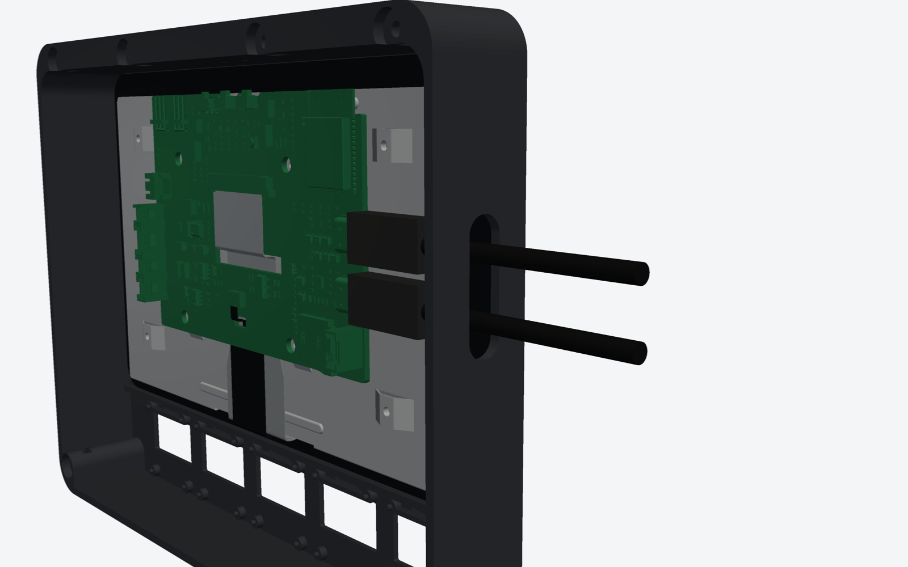
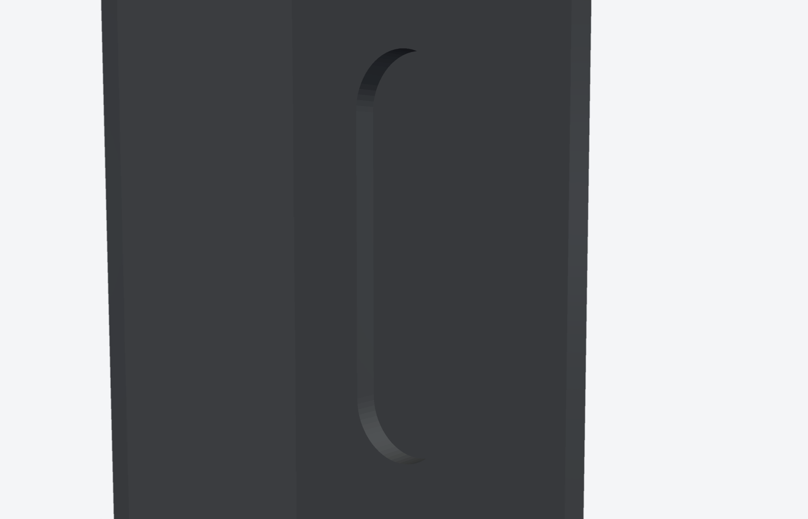

미끄럼 방지 시트를 쓸 때는 뒷판 아래 모서리와 스탠드 바닥에 같은 두께(1 mm 이하)로 붙이세요. 한쪽만 두꺼우면 기울기가 바뀌고 흔들립니다.

## 배선

| ESP32 보드 I2C 헤더 (HY2.0, VCC GND SDA SCL) | TCA9548A |
|---|---|
| VCC | VIN |
| GND | GND |
| SDA | SDA |
| SCL | SCL |

| TCA9548A 채널 | OLED (정면 기준) |
|---|---|
| SD0 / SC0 | 1번 (맨 왼쪽) |
| SD1 / SC1 | 2번 |
| SD2 / SC2 | 3번 (가운데) |
| SD3 / SC3 | 4번 |
| SD4 / SC4 | 5번 (맨 오른쪽) |

OLED의 VCC/GND는 TCA9548A의 VIN/GND에 함께 묶습니다. OLED는 모두 0x3C이고, TCA9548A는 A0~A2를 GND로 두면 0x70입니다. 클론 TCA9548A 보드는 SDA/SCL이 VIN으로 풀업되는 경우가 많으므로, Waveshare 보드 사진의 ⑱번 I2C 전원 선택이 3V3인지 확인하세요(research/waveshare/ESP32-S3-Touch-LCD-7-onboard-resources_Rev1.2.webp).

## ESP32-C3 SuperMini

C3 SuperMini는 나사 구멍이 없어서 OLED와 같은 방식으로 고정합니다. 거치대 뒷면(뒷판 쪽)에서 TCA 바로 위에 가로로 눕힌 홈이 있고, 보드를 뒤집어 부품면이 거치대를 향하게 넣습니다. 보드는 USB-C 금속 껍데기와 안테나 쪽 두 모서리(실크 글자만 있는 자리)로 앉습니다. 껍데기 아래에는 홈을 가로지르는 5.8 mm 폭 받침대가 있고, 그 사이 바닥은 TCA 자리처럼 뚫려 있습니다. 부품이 없는 뒷면은 뒷판을 향하고, 뒷판의 기둥 두 개가 그 뒷면 가운데를 0.25~0.35 mm 뒤에서 막아 줍니다. 핀 줄 양옆에는 납땜이 부풀어도 닿지 않게 여유 홈이 있습니다. 뒷면으로 나온 USB-C 고정 다리 납땜과 선은 뒷판 쪽 4.9 mm 공간에 놓입니다.

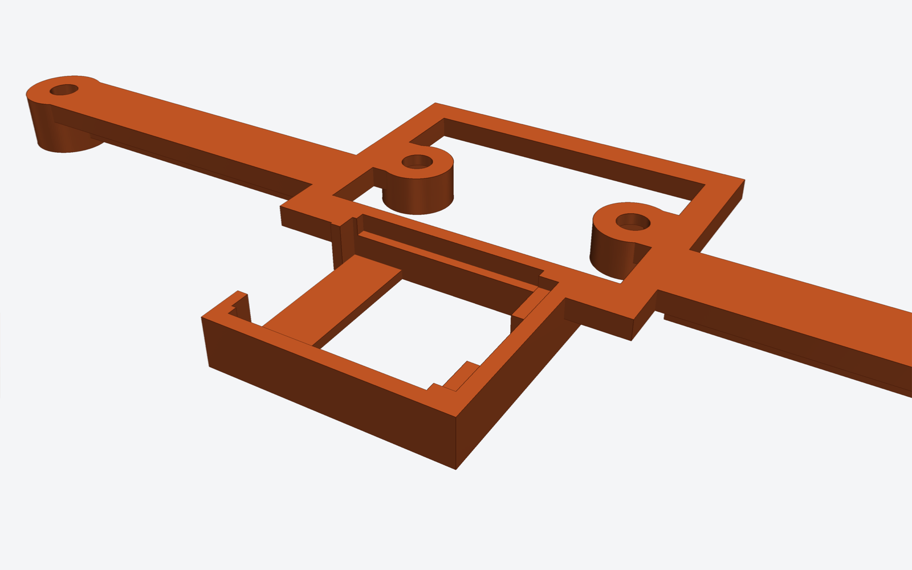
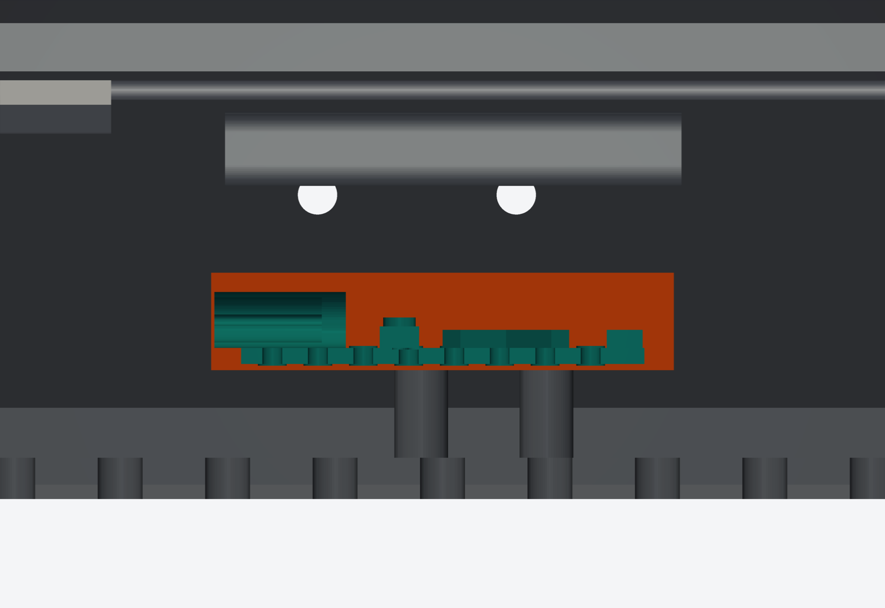

펌웨어를 올릴 때는 뒷판을 열면 C3의 USB-C가 7" 모듈의 USB-C와 같은 쪽(앞에서 볼 때 왼쪽, 뒤에서 볼 때 오른쪽)을 향해 드러납니다. 일자 USB-C 케이블을 옆에서 꽂으면 플러그가 S3 기판 뒤 빈 공간에 눕습니다. 플러그 몸통 폭은 14 mm까지 들어갑니다. 홈의 USB-C 쪽 끝은 플러그 몸통이 지나가도록 거치대 두께 전체를 비웠고, 보드는 그 양옆 멈춤턱에 걸립니다. 그래서 보드가 홈 안에서 조금 밀려 있어도 플러그가 끝까지 들어갑니다. USB-C를 반대쪽으로 돌리려면 build_case.py의 C3_USB_DIR을 1로 바꿉니다.

판매처마다 기판 길이(22.52~22.8 mm)와 USB-C 돌출(1.4~2.0 mm)이 달라서 홈은 둘 다 들어가게 만들었습니다. 기판 두께는 0.9~1.0 mm를 기준으로 했습니다. 캘리퍼로 쟀을 때 1.2 mm 이상이면 build_case.py의 C3_POST_TIP을 한 층(0.35 mm)씩 낮춰야 기둥이 기판을 누르지 않습니다. C3 안테나는 S3 기판과 LCD 금속판에서 약 7~10 mm 뒤에 있어서, 탁 트인 곳보다 Wi-Fi·BLE 거리가 줄 수 있습니다. 플라스틱 뒷판 쪽으로는 막는 것이 없습니다.

## 측정 근거

| 항목 | 값 | 출처 |
|---|---|---|
| 7" 유리 외곽 | 192.96 × 110.76, 모서리 R7.88 | 공식 STEP/DXF/PDF |
| 보이는 영역(VA) | 154.88 × 86.72, 베젤 위 11.00 · 아래 13.04 · 좌우 19.04 | 공식 STEP (유리 면 데이터로 위아래 판별) |
| 케이스 고정점 | M3 황동 스탠드오프 4개, 126.20 × 65.65 간격, 끝면이 유리 앞면에서 16.5 mm | 공식 DXF 측면도 (8.50 + 8.00) |
| USB-C 2개 | PCB 왼쪽 가장자리(유리 왼쪽 끝에서 41.4 mm 안쪽)에서 왼쪽으로 열림, 중심 간격 15.1 mm, 깊이 11.7 mm | 공식 STEP |
| 가장 높은 부품 | HY2.0 헤더, 유리 앞면에서 18.4 mm | 공식 STEP |
| OLED (GME12864-11-12-13) | PCB 27.5 × 27.8 × 1.2, Ø2.0 홀 4개 23.2 × 23.5, 창 26 × 14 (기판 중심에서 헤더 쪽으로 2.8 mm), 받침 높이(유리 + 테이프) 2.0~2.1, 발광 영역 21.74 × 10.86 | MakerWorld 2703510 3MF를 잘라 잰 값(research/gme12864)과 GME12864 사양서. 창·받침은 테스트 출력으로 확인 |
| TCA9548A | 약 31 × 21, 홀 2개 Ø3.3, 간격 약 25.6 | vctec은 치수 미공개, 동일 CJMCU 클론의 판매처 수치 |
| ESP32-C3 SuperMini | 18.0 × 22.52(일부 22.8), 기판 0.9~1.0, USB-C 폭 9.0·높이 3.12~3.16·돌출 1.4~2.0, 핀 줄 간격 15.24, 안테나 쪽 끝 2.2 mm에는 부품 없음, 뒷면 부품 없음 | nologo 치수도, GitHub mrtnvgr/KiCad_ESP32-C3-SuperMini STEP, Printables 1360390 STEP, TENSTAR 판매 사진 |
| M3 너트 / F-3mm 서포트 | 대변 5.5, 두께 2.4 / 길이 3.0 | DIN 934, 사용자 확인 |

Waveshare 공식 기구 자료: https://files.waveshare.com/wiki/ESP32-S3-Touch-LCD-7/ESP32-S3-Touch-LCD-7.zip (문서: https://docs.waveshare.com/ESP32-S3-Touch-LCD-7)

참고한 기존 설계: Printables 1898896(layvo, 15° 크래들, 90° USB-C로 후면 배출), MakerWorld 3122535(받침 일체형, 바닥 슬롯으로 케이블 배출), MakerWorld 1858825(얇은 트레이 + M3), MakerWorld 1168015(OLED 3개 + TCA9548A, 핀 열코킹), Printables 1159884(별도 받침 + M3 인서트), MakerWorld 2703510(GME12864 OLED 케이스, OLED 창·받침 치수의 출처).

## 검증 결과

verify_case.py가 공식 STEP 모델, 여유 공간 모형, 실제 크기의 너트·나사 형상을 넣고 검사한 결과입니다.

- 체결부 16곳: 너트 12개(5.5 × 3.0 서포트 기준)가 자리와 겹치지 않고, 넣고 빼는 경로가 막히지 않으며, M3 × 10이 출력물·모듈·케이블 어디도 뚫지 않습니다. 너트 체결부는 모두 2.4 mm 너트일 때 2.4 mm, 3.0 mm 서포트일 때 3.0 mm 전체에 나사산이 물리고, 모듈 스탠드오프는 3.4 mm 물립니다.
- 내부 케이블: USB-C 플러그 두 개와 굵기 4.5 mm 케이블 두 가닥을 실제 경로(플러그 끝에서 뒤로 꺾임 → 왼쪽 벽 안쪽으로 내려감 → OLED 턱 뒤를 가로지름 → 가운데 구멍)로 넣어 보았고, 출력물·모듈·OLED 배선·스탠드 어디와도 겹치지 않습니다.
- TCA 거치대: TCA를 단 거치대를 열린 뒤쪽에서 스탠드오프 위로 내려놓는 경로에 프레임·OLED 배선·USB-C 케이블이 걸리지 않습니다. TCA는 거치대 뒷면의 구멍 둘레 두 자리에만 닿고, 부품과 핀 납땜(1.6 mm)은 거치대 창 안에서 어디에도 닿지 않습니다. TCA 뒷면의 나사 머리(렌치볼트 3.0 mm)는 뒷판에서 1.35 mm, 뒷면에 납땜한 선이나 ㄱ자 헤더·듀폰(2.6 mm)은 1.75 mm 떨어져 있습니다. 이를 위해 뒷판 안쪽 면을 TCA 뒤에서만 1.05 mm 팠습니다. 나사 끝은 모듈 뒷면에서 5.4 mm 떨어져 있고, 2.4 mm 너트와 3.0 mm 서포트 모두 끝까지 물립니다. 아래쪽 스탠드오프 끝은 나사를 조이면 거치대 컵 바닥까지 0.1 mm 당겨집니다. 뒷판 보스와 거치대가 모두 층 경계에 있어서 −16.50에 딱 맞출 수는 없고, 그래서 뒷판을 0.25 mm 들뜨게 하는 대신 모듈을 0.1 mm 당기는 쪽으로 정했습니다.
- 배선 통로: 50 × 14.7 mm 케이블 묶음이 뒷판 구멍을, 44 × 14.7 mm 묶음이 스탠드 판 구멍을, 40 × 30 mm 묶음이 바닥 구멍을, USB-A 플러그(16 × 8)와 Ø44 케이블 묶음이 뒷면 원형 창을 걸림 없이 지납니다.
- 측면 USB-C 홀: 녹아웃을 연 상태에서 12.5 × 6.5 mm 플러그 두 개를 벽 바깥 15 mm에서 포트까지 곧게 밀어 넣는 경로가 프레임·유리·LCD·브래킷·스탠드오프와 겹치지 않습니다. 벽 밖으로 나온 케이블 60 mm도 스탠드에 닿지 않습니다. 홀 둘레 여유는 플러그 모서리 기준 좌우 0.86 mm, 위아래 1.25 mm입니다. 홀 천장은 바깥 0.6 mm 살에 붙은 깊이 2 mm 선반이라 최대 1.85 mm만 건너고, 정면 프레임 G-code도 경고 없이 나옵니다.
- C3 SuperMini: STEP 모델을 홈에 뒤집어 넣었을 때 거치대·뒷판·프레임·모듈·TCA·HY2.0·OLED·USB 케이블과 겹침이 0 mm³입니다. 뒷면과 뒷판 기둥 사이는 0.25 mm(기판 1.0) ~ 0.35 mm(0.9)이고, 0.5 mm 밀리면 기둥에 걸립니다. 홈 아래쪽 벽은 TCA 기판 위 끝에서 0.25 mm 떨어져 있습니다. 뒷판을 연 상태에서 USB-C 플러그(12.5 × 6.5 × 26)와 케이블이 S3 기판 뒤를 지나 어디에도 닿지 않습니다. 보드가 안테나 쪽 벽에 붙어 있어도 USB-C 입구가 멈춤턱보다 0.82 mm 바깥에 있어 플러그가 끝까지 들어갑니다. C3 홈 바닥은 USB-C 껍데기를 받치는 5.8 mm 폭 받침대만 남기고 뚫었고, 껍데기는 보드가 홈 안 어디에 있든 받침대에 5.2 mm 이상 걸칩니다. 이 받침대가 서포트 없이 18 mm를 건너는 브리지라 PrusaSlicer가 "Long bridging extrusions" 알림을 띄웁니다. 받침대에는 USB-C 껍데기만 닿아서 조금 처져도 문제없습니다.
- 간섭: 출력 부품끼리, 그리고 유리·LCD·브래킷·PCB 부품 박스·HY2.0 플러그·OLED 기판·유리·앞면 납땜·FPC·헤더와 듀폰·TCA9548A와의 겹침이 모두 0 mm³입니다. 예외는 위쪽 두 스탠드오프에 의도한 예압 2.3 mm³(0.05 mm)뿐입니다. 스탠드는 나사 머리와도 겹치지 않습니다.
- 나사 머리: 렌치볼트(Ø5.5 × 3.0)와 냄비머리(Ø6.0 × 2.4) 두 가지로 넣어 보았고, 둘 다 뒷판·스탠드와 겹치지 않으며 머리 윗면이 뒷판 바깥면보다 각각 0.35 mm, 0.95 mm 아래에 있습니다. 프레임 원형 홈 바닥과 너트 사이에 2.1 mm, 홈 바깥 윗벽 살은 1.2 mm가 남습니다.
- 층 경계: 뒷판 테두리·턱·보스 끝, 카운터보어 바닥, 너트 홈, OLED 받침·핀·기둥 끝처럼 서로 맞닿는 높이가 모두 0.2 + 0.35n 층 경계에 있습니다. 경계에서 벗어난 윗면은 슬라이서가 한 층 높게 뽑습니다. 그래서 G-code를 따로 확인해 보니, 이전 버전에서는 모서리 나사 보스가 0.1 mm 높게 나와 홈 바닥에 바로 닿았습니다. 지금은 verify_case.py가 이 높이들을 검사합니다.
- 조립 경로: 7" 유리 외곽과 OLED 5개(기판, 유리, 헤더, 아래로 접힌 FPC)를 뒤에서 핀에 곧게 밀어 넣는 경로에 정면 프레임이 걸리지 않습니다.
- OLED 고정: 뒷판 기둥 20개는 기판 뒷면에서 0.2 mm 떨어져 있어 평소에는 닿지 않고, 기판이 0.3 mm 밀리면 기둥에 걸려 멈춥니다. 위치 핀(Ø1.7, 기판 구멍 Ø2.0)은 기판 구멍 안 1.05 mm까지 들어가고, 끝이 기둥 끝면보다 0.35 mm 앞에서 멈춰 기둥에 닿지 않습니다. 기둥은 헤더·듀폰·FPC·USB-C 케이블을 피해 기판 네 모서리 구멍 둘레(원래 설계의 M2 나사 머리 자리)에 섭니다.
- 책상 접지: 뒷판 아래 모서리와 스탠드 바닥이 높이 0에 닿고, 그보다 아래로 내려간 부분은 없습니다. 앞 아래 모서리는 10.3 mm 떠 있습니다. 무게중심은 닿는 모서리보다 18 mm 뒤, 스탠드 뒤끝보다 76 mm 앞에 있습니다.
- 넘어짐: 화면 보이는 영역 위 끝을 수직으로 3.8 N 이상 눌러야 뒤로 넘어갑니다(출력 부품 261 g + 모듈 250 g 가정). 일반적인 터치 힘은 1~2 N입니다.
- 스탠드 강성: 판·바닥·경사판이 닫힌 삼각형을 이루고, 구멍을 낸 뒤에도 판 구멍 양옆에 15 mm, 바닥 구멍 끝 양옆에 12 mm, 경사판 원형 창 양옆에 17 mm 폭의 살이 두께 5~6 mm로 남습니다. 옆으로 눕혀 출력하므로 층이 이 삼각형 단면을 따라 쌓입니다. 스탠드가 받는 힘은 케이스 무게의 일부와 터치 힘 정도라 PLA로 충분합니다.
- 출력성: 45° 넘는 오버행은 너트 홈 천장(폭 5.75 mm 브리지), 카운터보어 천장(지름 6.4 mm) 같은 짧은 브리지뿐입니다. 옆으로 눕힌 스탠드는 구멍마다 한쪽 변이 천장이 됩니다. 바닥 구멍과 판 구멍은 그 끝을 45°로 좁혀서 천장이 10 mm 브리지뿐입니다. 원형 창은 꼭대기 몇 층만 최대 3.4 mm를 건너고, 너트 자리(평평한 면이 위)와 케이블타이 슬롯은 3 mm 안팎의 브리지입니다. 층마다 단면을 잘라 확인했을 때 공중에서 시작하는 부분은 없습니다. PrusaSlicer는 원형 창 꼭대기에 "Collapsing overhang" 경고를 띄웁니다. 이 경고는 Ø20 원형 구멍에서도 뜨는 보수적인 기준이라 서포트를 켜지 않아도 됩니다. 원 꼭대기 안쪽 몇 mm가 약간 거칠게 나올 수 있는데, 세워 두면 원의 왼쪽이나 오른쪽 안쪽 가장자리에 해당합니다. 모든 STL이 닫힌 메시(watertight)이고 PrusaSlicer CLI 슬라이싱이 오류 없이 끝났습니다.

## 실측해서 바꿀 수 있는 값

| 파라미터 | 현재값 | 확인할 것 |
|---|---|---|
| NUT_AF, NUT_T_MAX | 5.5, 3.0 | 너트·서포트 대변과 두께. 자리 크기는 NUT_AF + 0.25, 깊이 3.15 mm입니다 |
| GAP | 0.30 | 유리와 외곽 벽 사이 여유(fit_01로 확인) |
| OLED_STANDOFF, OLED_PIN_D, OLED_POST_GAP | 2.10, 1.7, 0.2 | OLED 받침 높이(유리 + 테이프), 위치 핀 지름, 뒷판 기둥과 기판 사이 틈(fit_02로 확인). 핀이 빡빡하면 OLED_PIN_D를 0.1씩 줄입니다 |
| HEAD_CB_R, RIM_BOSS_R, RIM_POCKET_R | 3.2, 4.2, 4.4 | 나사 머리 카운터보어, 뒷판 보스, 프레임 홈의 반지름. 머리가 더 큰 나사를 쓰면 세 값을 같이 키웁니다 |
| TCA_PITCH | 25.6 | TCA9548A 두 홀의 중심 간격(이전 조립 테스트 fit_07로 확인) |
| TCA_SEAT_R, TCA_SEAT_HW | 4.0, 3.6 | TCA가 거치대에 닿는 구멍 둘레 자리의 반지름과, 자리에서 기판 끝까지 이어지는 띠의 반폭. 이 안에는 TCA 부품이 없어야 합니다 |
| STANDOFFS, STANDOFF_LEN | 공식 STEP 값, 8.0 | 모듈 스탠드오프 위치와 길이(fit_08, fit_09로 확인) |
| BRACE_HOLE, BRACE_HOLE_AXIS | (26, 46), 48° | 스탠드 뒷면 원형 창의 반지름, 경사판 아래 끝에서 중심까지 거리, 구멍 축 각도. 축 각도는 스탠드를 바닥을 대고 출력할 때만 의미가 있고, 옆으로 눕혀 출력할 때는 결과에 영향이 없습니다 |
| TILT | 20° | 화면 기울기. 바꾸면 스탠드 모양이 함께 다시 계산됩니다 |
| SIDE_USB_SLOT, SIDE_USB_SKIN | 포트 ±8.5 × ±4.5, 0.6 | 왼쪽 벽 측면 USB-C 홀의 범위(Y 시작·끝, Z 시작·끝)와 바깥에 남기는 살 두께. 0이면 처음부터 열린 홀입니다 |
| C3_X, C3_WALL_Y, C3_USB_DIR | 0, −27.0, −1 | C3 홈 위치(TCA 가운데 위, 홈 아래쪽 벽이 TCA 기판 바로 위)와 USB-C 방향. −1이면 7" 모듈 USB-C와 같은 쪽(앞에서 볼 때 왼쪽), 1이면 반대쪽입니다 |
| C3_L_MAX, C3_CL, C3_USB_OVER | 22.8, 0.15, 1.4 | 홈이 받아 주는 가장 긴 기판, 둘레 여유, 가장 짧은 USB-C 돌출 |
| C3_POST_TIP | 뒷판 L(20) | C3를 막는 뒷판 기둥 끝 높이. 기판이 1.2 mm 이상이면 L(19), L(18)로 낮춥니다(판 E에서 자로 확인) |

값을 바꾼 뒤에는 아래처럼 다시 생성하고, 슬라이싱한 다음 검사합니다(검사 스크립트는 G-code의 필라멘트 무게로 넘어짐을 계산합니다).

~~~powershell
cd D:\Users\G433m\Documents\aiplantrx\cases\main-display
..\.venv\Scripts\python build_case.py
..\.venv\Scripts\python verify_case.py
..\.venv\Scripts\python fit_test.py
..\.venv\Scripts\python check_print.py out
~~~

가상환경은 cases\.venv(Python 3.13, build123d 0.13.0, pyvista, trimesh)이고, 새로 만들 때는 cases\requirements.txt를 쓰면 됩니다. 처음 verify_case.py를 돌리면 26 MB STEP을 읽느라 50초쯤 걸리고, 이후에는 out\_cache의 BREP를 씁니다(fit_test.py도 이 캐시를 씁니다).
