# 센서 노드 케이스 v1

PC 케이스 상판의 140 mm 팬(라디에이터) 자리에 거꾸로 매달려 식물을 내려다보는 상자입니다. 바닥면(센서면)이 식물을 보고, 위는 통풍 슬롯이 난 뚜껑으로 닫습니다. 네 모서리(140 팬 구멍 간격 124.75)에 M3 너트가 들어가고, 위에서 M3 볼트로 뚜껑과 본체를 조입니다. 볼트 머리는 뚜껑 면과 평평합니다. 같은 구멍으로 긴 M3 볼트를 PC 케이스 상판 팬 구멍 → 뚜껑 → 너트로 박아 설치합니다. 볼트 없이도 뚜껑은 네 변 가운데에서 딸깍 걸려 고정됩니다.

**바깥 연결은 모두 -Y 벽 한 면에 있습니다:** USB-C(전원·업로드), 12V 입력, 펌프 1~3, RS485 토양 센서.

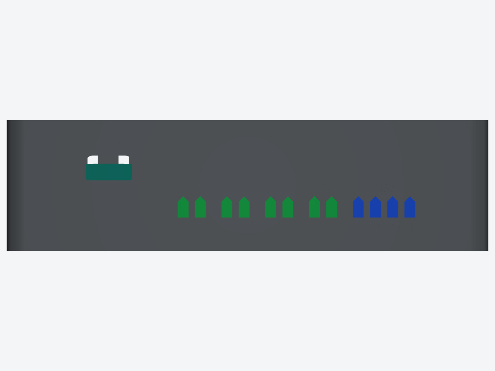

배선도와 devkit 핀 지도: [out/wiring.html](out/wiring.html) (SVG: out/wiring.svg, out/devkit_pins.svg, 생성: wiring.py)
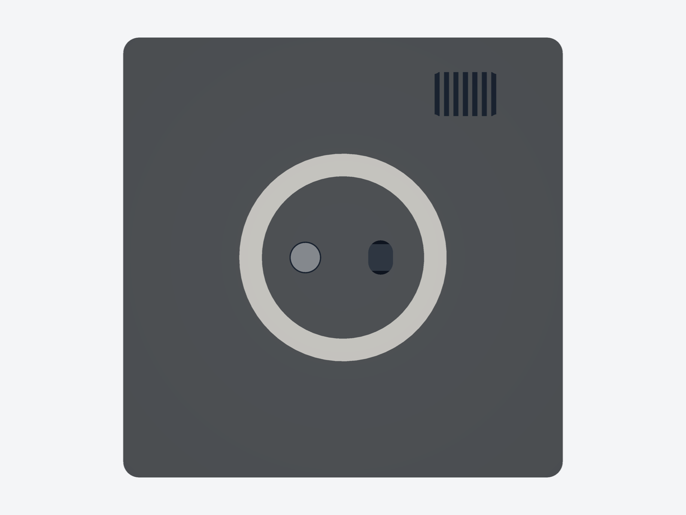
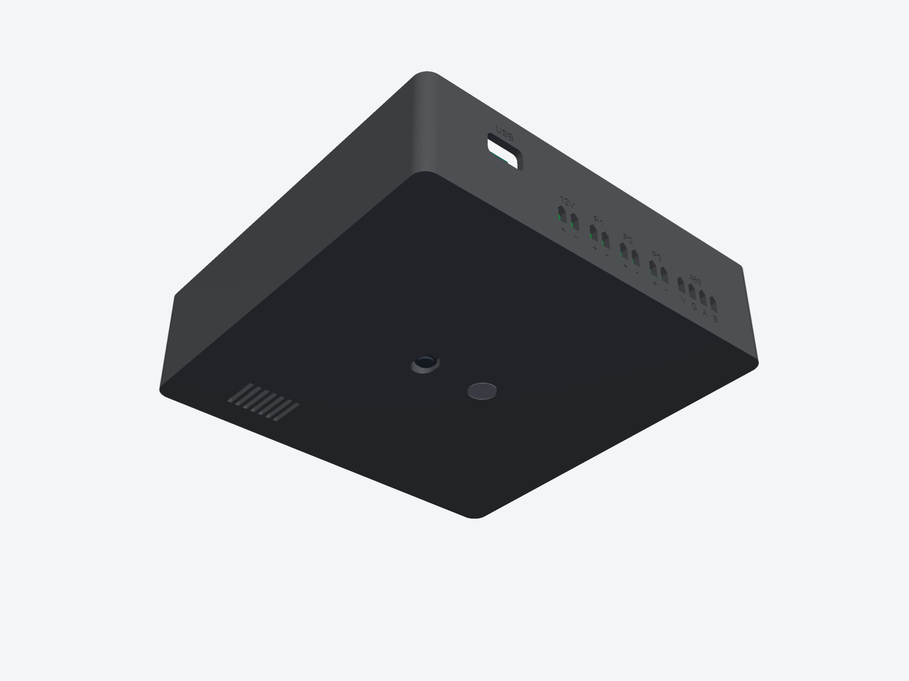
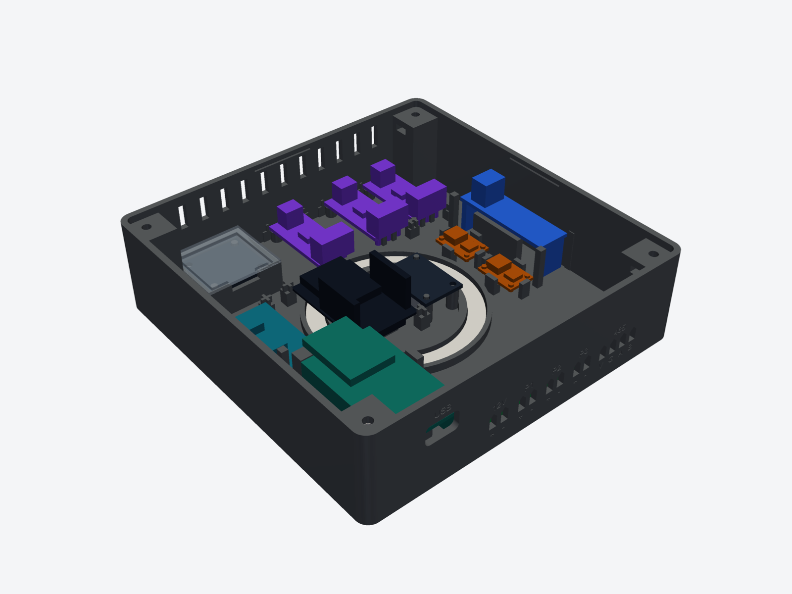
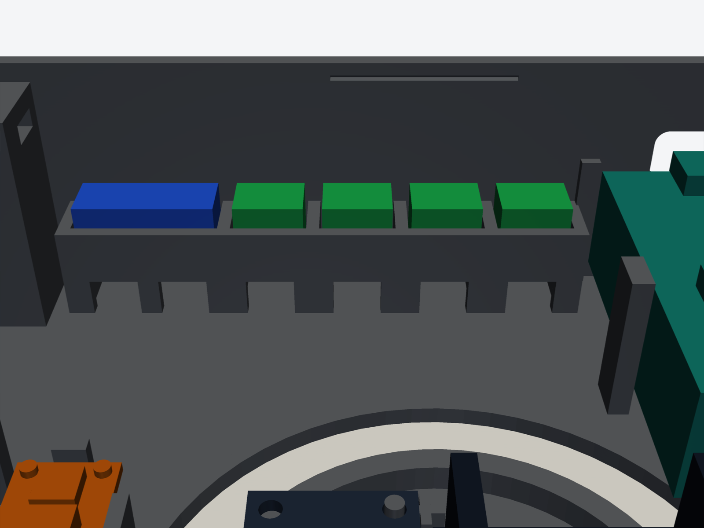
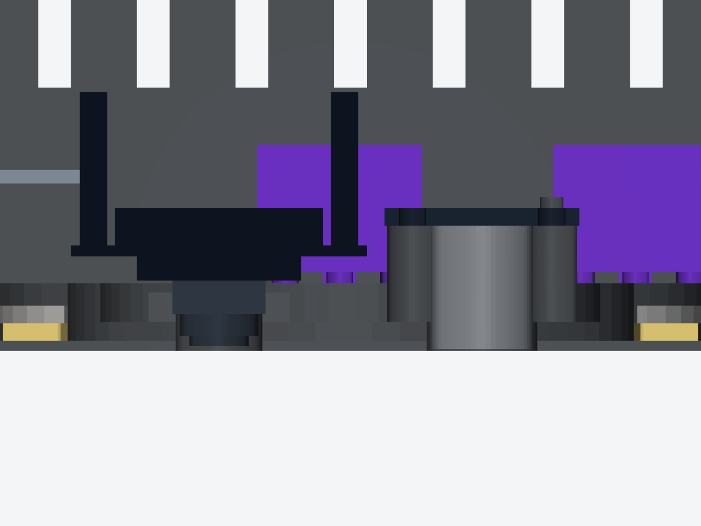
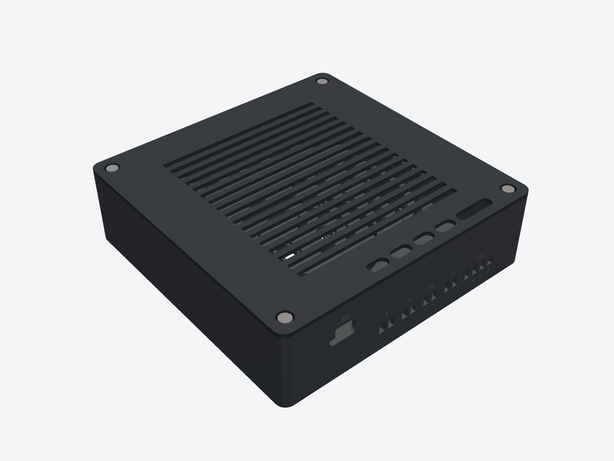
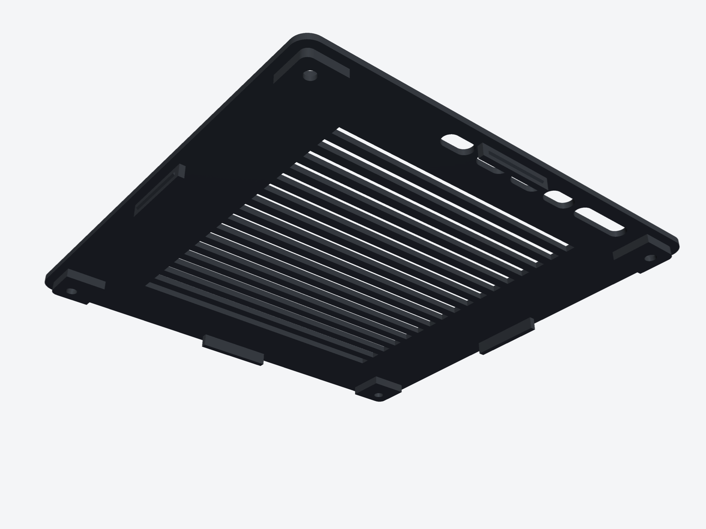
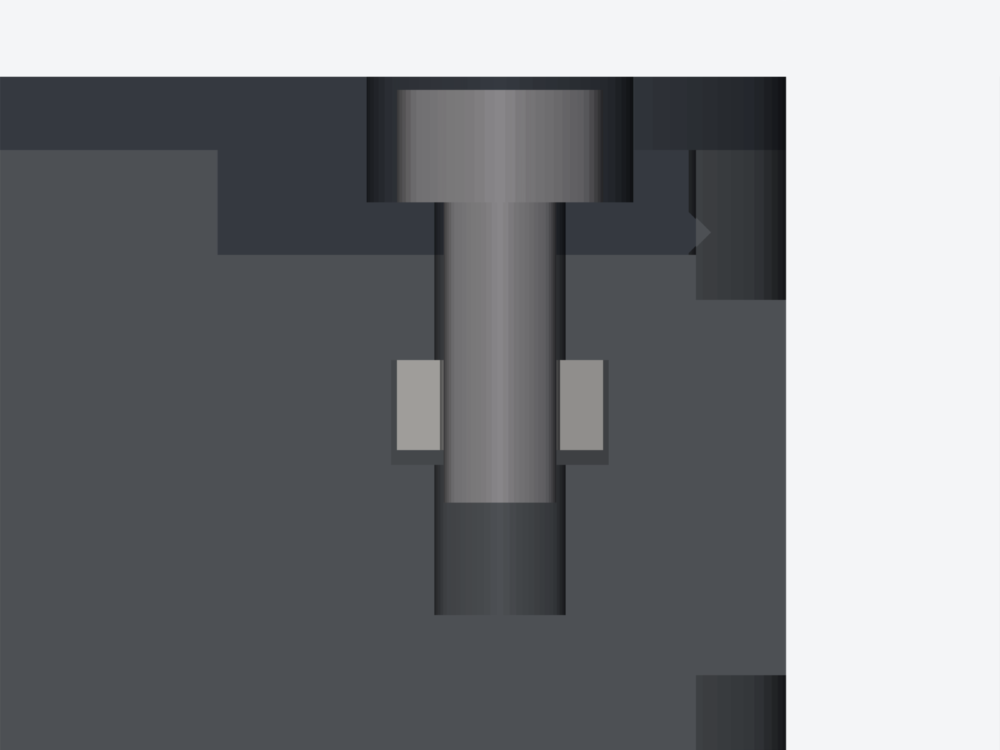

크기 140 × 140 × 40 mm (본체 38 + 뚜껑 1.95). 부품 치수와 출처는 [research/parts_research.md](research/parts_research.md)에 있습니다(Aside 조사 A~E).

## v2: 바닥판 + 옆 프레임 + v1 뚜껑 (2026-11-18)

v1을 뽑아 보니 터미널 블록 말고는 맞지 않았고, 뒤집으면 보드가 다 빠졌습니다. v2는 본체를 바닥판과 옆 프레임 둘로 나누고, 뚜껑은 이미 뽑은 v1 뚜껑을 그대로 씁니다. 부품 치수는 실제 구매 링크를 Ego Lite로 다시 확인했습니다([research/parts_research.md](research/parts_research.md) I절). 생성: `build_node_v2.py`, `slice_node_v2.py`, 결과: `out/v2/`.

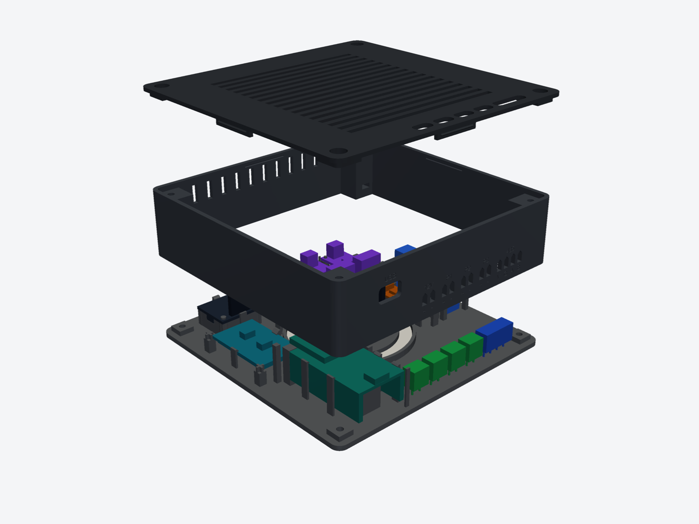
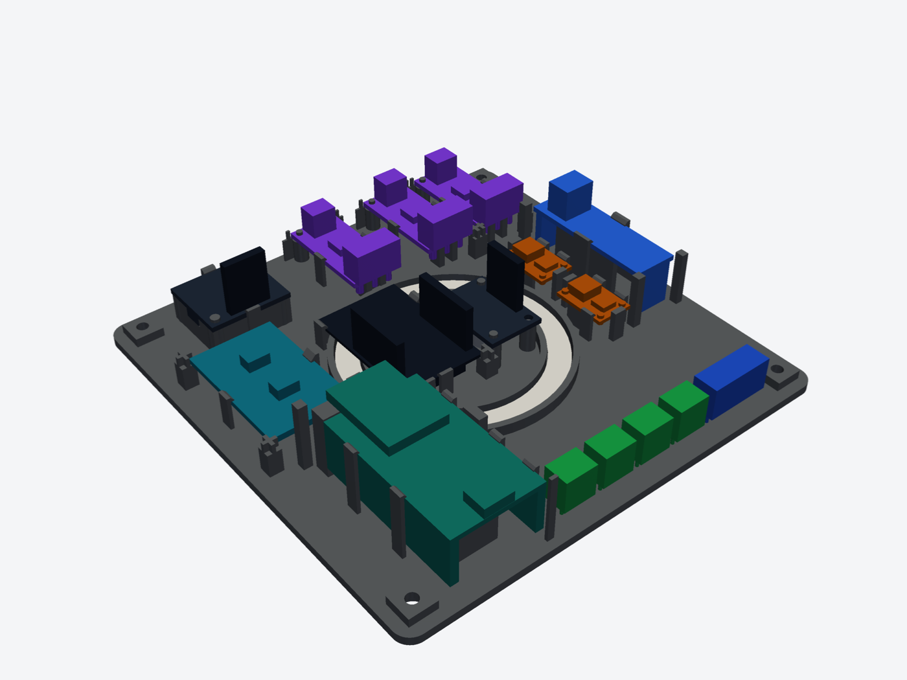
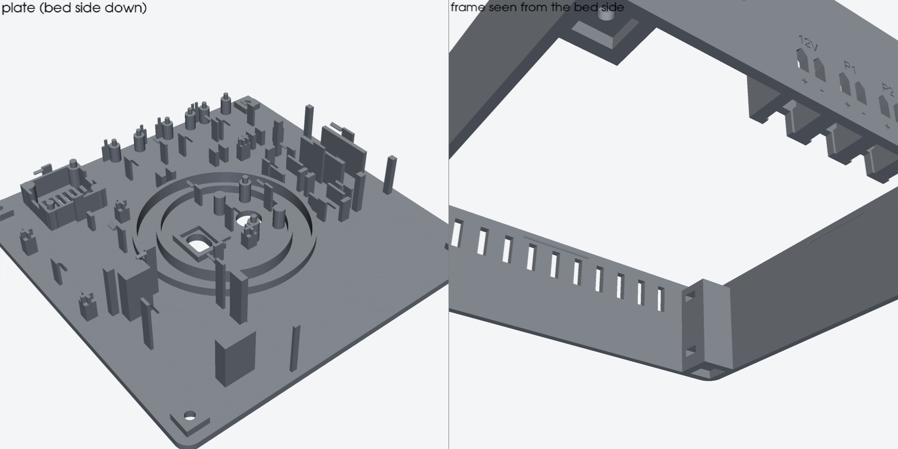
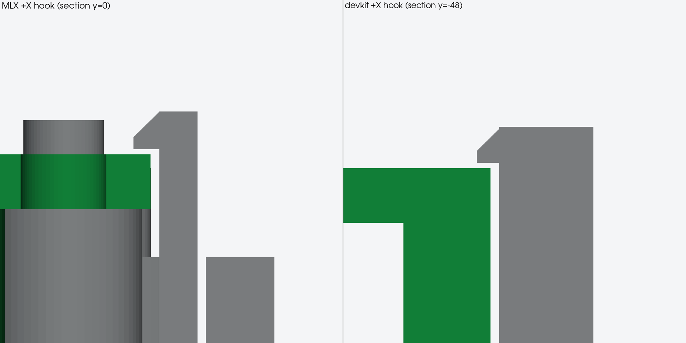

| G-code (out/v2/sd_card) | 내용 | 시간 | 필라멘트 |
|---|---|---|---|
| sn2_01_plate_3h34m | 바닥판 (센서면 + 보드 자리 전부). 전부 흰 PLA, 필라멘트 교체 없음(링 아래 0.9 mm 막이 그대로 디퓨저). 브림 8 mm | 3h34m | 68.2 g |
| sn2_02_frame_3h7m | 옆 프레임 (벽, 모서리 기둥, 단자 포켓, USB/단자 창, 통풍구). 브림 10 mm | 3h7m | 62.2 g |

- 높이 기준: 모든 높이는 0.35mm FAST의 층(첫 층 0.2 + 0.35씩, L(n) = 0.20 + 0.35 n)에 맞춰 잡았습니다. 바닥판은 그대로 맞고, 걸쇠 턱 밑면도 층 경계에 떨어집니다(보드 받침이 L(n)이고 PCB 1.6 + 0.15 = 0.35 × 5). 프레임은 바닥판 윗면(2.65)부터 따로 뽑아서 층 경계가 0.15 어긋나, 높이가 최대 0.15~0.2 달라집니다(맨 위 35.35 → 35.2, 아래 너트 홈 2.8 그대로, 단자 창은 단자 입구를 그대로 덮음). 벽 윗면과 기둥 윗면이 같이 0.15 낮아져 뚜껑 맞춤에는 영향이 없습니다.
- 브림은 모델에 넣지 않고 PrusaSlicer가 만듭니다(outer only, 첫 층만). 간격(brim separation gap) 0.15 mm. 이 프로필(엘리펀트 풋 보정 0.2, 첫 층 선폭 0.42)의 G-code에서 잰 브림 안쪽 선과 바깥 둘레 사이 실제 틈은 0.13 mm입니다(설정 0 → -0.02 맞닿음, 0.1 → 0.08, 0.2 → 0.18).
- 출처마다 0.1~0.2 mm를 붙어 있으면서도 잘 떨어지는 범위로 봅니다. 잘 안 떨어지면 0.2, 출력 중에 브림이 떨어지면 0.1로 바꾸세요. 폭은 Prusa가 3 mm 이상을 권하고 PLA는 보통 5~8 mm입니다. 프레임은 3 mm만 넣어도 PrusaSlicer의 Low bed adhesion 경고가 사라졌지만, 높이 35 mm에 벽이 얇아 모서리가 들리지 않게 10 mm로 키웠습니다(첫 층 전체 164 × 164 mm, MK2S 베드 250 × 210 안). v1에서 모서리가 들렸던 바닥판은 8 mm입니다.
- 출처: Prusa Knowledge Base Skirt and Brim(help.prusa3d.com/article/skirt-and-brim_133969), OrcaSlicer 위키 Brim, fixstl.ai 브림 간격 G-code 측정, UltiMaker 커뮤니티 brim gap 글.

**볼트와 너트: M3 너트 8개, M3 × 8 볼트 8개**
- 바닥판 → 프레임: 센서면 네 모서리의 카운터보어 구멍으로 볼트를 넣어(머리가 면과 평평) 프레임 기둥 아래쪽 너트에 조입니다. 너트는 기둥의 앞뒤(Y) 방향 안쪽 면에 난 아래 홈(높이 7.65)으로 밀어 넣습니다. 처음엔 좌우(X) 방향이었는데 +X 앞 모서리 기둥은 485 단자 포켓에 막혀(입구 앞 2.6 mm) Y 방향으로 돌렸습니다. 위 홈(뚜껑용)은 v1처럼 X 방향이고 단자 포켓보다 높아 막히지 않습니다. 바닥판 모서리 패드(8.5 × 8.5 × 2.75)가 기둥 밑 홈에 들어가 위치를 잡습니다.
- 뚜껑 → 프레임: v1과 같습니다(기둥 위쪽 너트). 케이스 상판에 달 때는 이 4개만 M3 × 12로 바꿉니다.

**보드 고정 (작은 나사 없이, 뒤집어도 안 빠지게)**

| 보드 | 고정 |
|---|---|
| MLX90640 (Adafruit 4407) | 기둥 4개, 대각선 핀 2개 Ø2.35 (구멍 Ø2.5, v1은 Ø2.1), 긴 변 양쪽 걸쇠 |
| SCD41 (Adafruit 5190) | 기판이 센서 칸의 뚜껑 역할(헤더가 위로 나와서 따로 뚜껑 없음). 칸 벽 위에 얹고, 핀 2개 Ø2.85 (구멍 Ø3.0), 긴 변 양쪽 걸쇠. STEMMA QT 소켓 자리는 벽을 따냄 |
| ESP32-CAM | 카메라 홀더 자리 10.0 × 10.3(+ 앞뒤 ±0.5), 렌즈 구멍 Ø9.5: bkgoodman ESP32-CAM 케이스(Printables 75024, 약 1만 4천 다운로드) STEP에서 잰 값(이전 9.2 칼라, Ø7.9 구멍). 받침 여유 0.4, 걸쇠 4개: SD 쪽 끝 2개, +X 긴 변 1개, -X 긴 변 안테나 끝 쪽 1개(링 바깥 벽을 막 지난 자리). -X 긴 변 가운데는 링 위라 걸쇠를 못 세움 |
| devkit | v1 받침 그대로(맞았음), 걸쇠 6개: 긴 변 -X 2개, +X 3개(헤더 납땜 때문에 0.4만 걸쳐서 개수로 보강, USB 끝 -X쪽은 모서리 기둥 자리), 안테나 끝 1개. 프레임을 얹으면 USB-C가 벽 구멍에 들어가 그쪽 끝도 막힘 |
| MAX485 (C25B) | +X 벽에서 2.4 안쪽으로 옮김. 폭 14.3(실측)에 여유 0.3, 긴 변 양쪽 걸쇠(0.7 걸침) |
| LR7843 × 3 | 받침 높이 10.0으로 올림, 구멍 2개(지름 약 2.4, 간격 12.2 실측)에 핀 Ø2.0, 긴 변 양쪽 걸쇠 |
| 만능기판 | 알리에서 산 4 × 6 cm 파란 양면 기판(2026-06-27 주문, FR4 1.6, 2.54 피치, 14 × 20 구멍)을 원래 40 mm 변은 그대로 두고 60 mm 쪽을 약 25.4로 한 번 잘라 씀(24.6~26.4면 됨). 원래 모서리 쪽은 받침 여유 0.4와 걸쇠, 자른 변은 받침 패드와 1.2 걸치는 걸쇠. 가장자리 구멍 한 줄은 부품 없이 비워 둘 것(걸쇠와 받침 자리) |
| 5V 강압 × 2 | 17.5 × 12 × PCB 1.6(실측)에 여유 0.2(v1은 0.4), 받침 높이 9.3, 짧은 변 막이, 걸쇠 3개(링 반대쪽 끝 양쪽 + 링 쪽 끝 +X쪽. 링 쪽 끝 -X쪽은 링 벽이 가까워 못 세움, 모서리는 납땜 선 자리로 비움) |
| 링 | 흰 막 위 포켓에 넣고 핫글루 3점(벽 사이에 걸쇠를 세울 자리가 없음). 설계상 고정 없음 |
| KF301 단자 | 프레임 포켓에 위에서 끼움. 꽉 끼는 정도로만 잡히고, 뚜껑을 덮으면 뚜껑이 위를 막아 갇힘 |

걸쇠는 2줄(1.12) 두께 팔이 보드를 누를 때 바깥으로 휘었다가, PCB 윗면 0.15 위에서 가장자리를 0.4~0.9 덮습니다. 위쪽은 45° 경사라 서포트 없이 뽑힙니다. MLX는 ESP32-CAM보다 먼저 넣으세요(MLX의 -X 걸쇠가 CAM 쪽으로 휩니다).

**v2 조립 순서:** 바닥판에 링 → MLX → ESP32-CAM → SCD41 → devkit → MAX485 → 만능기판 → LR7843 → 강압 모듈. 프레임 기둥 아래 홈에 너트 4개를 넣고 프레임을 바닥판에 얹은 뒤 센서면에서 M3 × 8 네 개로 조입니다. KF301 단자를 프레임 포켓에 넣고 배선한 다음, 기둥 위 홈에 너트 4개를 넣고 뚜껑을 덮습니다.

**실측 반영 (2026-11-18):** 강압 모듈 PCB 1.6, C25B 폭 14.3, HW-532 구멍 간격 12.2. HW-532 구멍 지름 약 2.4(핀은 Ø2.0으로 여유 있게). **아직 추정:** 만능기판 40 mm 변(같은 규격 판매글 기준).

## 커넥터 면 (-Y 벽, 바깥에서 보고 왼쪽부터)

| 표시 | 부품 | 연결 |
|---|---|---|
| USB | devkit USB-C | 13.5 × 8 구멍, 몰드 모양으로 모서리 R2. 케이블 몰드(규격 12.35 × 6.5는 모서리가 각져도, 굵은 13 × 7.4는 모서리 R1.5 이상이면)가 벽을 통과해 끝까지 꽂힘 |
| 12V + − | KF301 2P | 12V 어댑터 |
| P1 + − | KF301 2P | 물 펌프 |
| P2 + − | KF301 2P | 양액 펌프 |
| P3 + − | KF301 2P | pH 펌프 |
| 485 V G A B | KF301 4P | SEN0604: 갈색 V, 검정 G, 노랑 A, 파랑 B |

글자는 벽 바깥에 0.6 mm 음각되어 있습니다.

KF301(DG301 호환) 단자는 패널 부품이 아니라 PCB용 나사 단자입니다. 그래서 벽 안쪽 포켓에 끼웁니다. 앞면(전선 입구)이 벽에 닿고, 입구마다 벽에 창(3.15 × 4.6, 위가 45° 뾰족)이 나 있습니다. 핀은 아래를 보고, 선을 핀에 직접 납땜합니다. 포켓 뒷벽 아래에 선이 나가는 구멍이 있고, 나사는 위에서 조입니다. 안쪽 배선(핀 납땜)은 뚜껑을 덮기 전에 하세요. 바깥 전선(12V, 펌프, RS485)은 뚜껑을 덮은 채로 바꿀 수 있습니다: 뚜껑의 -Y 변 쪽에 단자 블록마다 드라이버 슬롯(폭 5.3, 벽 라벨과 같은 순서)이 있어 위에서 일자 드라이버(3 mm 권장, 3.5는 살짝 기울여서)를 넣으면 약 20 mm 아래 나사에 닿습니다.

## 배치

| 부품 | 자리 | 고정 |
|---|---|---|
| NeoPixel Ring 24 (Adafruit 1586) | 센서면 한가운데, LED가 식물 쪽 | 안쪽에서 포켓에 떨어뜨려 넣음. LED가 디퓨저 막 위에 앉음. 설치하면 무게로 눌림. 들고 다닐 때 빠지지 않게 포켓 벽 위에 핫글루 3점(또는 테이프) |
| 디퓨저 | 본체와 한 몸. 링 아래 센서면이 0.9 mm(3층)만 남은 막 | 따로 뽑지 않음. G-code가 3층 뒤에 필라멘트를 바꿔서(M600) 센서면 전체 0.9 mm가 흰색, 그 위는 원하는 색 |
| ESP32-CAM | 링 안쪽, 중심에서 -X로 12 mm | 카메라 쪽이 아래. 카메라 홀더가 바닥 패드에 닿아 렌즈 위치가 정해짐. 보드는 대각선 모서리 받침 2개 |
| MLX90640 55° (Adafruit 4407) | 링 안쪽, 중심에서 +X로 12 mm (렌즈 간격 24 mm) | 캔이 구멍으로 나와 면에서 0.15 안쪽. 대각선 핀(Ø2.1) 2개에 끼움 |
| SCD41 (Adafruit 5190) | -X/+Y 구석. 링 가장자리에서 칸막이까지 12 mm, 그릴까지 21 mm, 강압 모듈에서 약 85 mm | 센서가 바닥 그릴을 봄. 밀폐된 칸 안(벽이 기판 위까지 올라오고 따로 뽑은 뚜껑으로 닫음)이라 상자 안 더운 공기와 섞이지 않고 그릴로만 바깥 공기를 마심. 선은 -Y 쪽 벽 위 홈(12 × 3)으로. 대각선 핀(Ø2.6) 2개에 끼움 |
| ESP32 38핀 devkit (USB-C) | -X/-Y 구석, USB-C가 -Y 벽 구멍으로 | 받침 위에 얹음. 핀은 아래, 듀폰 꽂을 높이 확보. PCB 끝을 벽에서 1.6 띄움. 하이제니스 보드는 USB-C가 PCB 끝과 같은 면이라 케이블 몰드가 벽 안쪽으로 1.1 들어오고, 그 자리는 비어 있음 |
| MAX485 | +X 벽을 따라 | 옆 받침 위에 얹음. 핀은 아래 |
| LR7843 MOSFET 모듈 × 3 | 안쪽 +Y 벽을 따라. x = -1 (물), +26 (양액), +46 (pH) | 신호단(PWM, GND, 구멍 2개)이 +Y 벽, 파란 터미널이 상자 가운데를 봄. 모서리 받침 + 터미널 아래 받침 2개. 고정 구멍은 안 씀(간격이 판매처마다 달라서). PCB 아래 4.5 mm 비워서 12V 선을 + − 핀에 바로 납땜할 수 있음 |
| KF301 단자 × 5 | -Y 벽 안쪽 포켓 | 위 표 |
| 뚜껑 | 본체 위 | 모서리 패드 4개가 낮춘 모서리 기둥 위에 앉아 자리를 잡음. 네 변 가운데의 짧은 치마(24 mm)에 V 돌기가 있어 벽 안쪽 V 홈에 딸깍 걸림(겹침 0.35, 벽이 휘어 받아 줌, 손으로 당기면 빠짐). 가운데 통풍 슬롯 3 × 88 17줄. -Y 변 쪽에 단자 나사용 드라이버 슬롯 5개(2P는 10.3, 485는 20.3 길이, 폭 5.3) |
| M3 너트 × 4 | 모서리 기둥 속(위에서 2.8 아래) | 기둥 안쪽 면에서 X 방향으로 난 홈으로 밀어 넣음. 볼트가 당기면 홈 천장에 걸림 |
| 만능기판 조각 25 × 35 (PC817C 2개, 1kΩ 4개) | -X 쪽, devkit 안테나 끝과 SCD41 칸 사이 | 모서리 받침 4개(1.25 걸침, 2.8 립). 네 모서리는 부품 없이 비워 둠. 아래 4.5 비어 있어 납땜 꼬리 OK |
| 5V 강압 모듈 × 2 (17.5 × 12, 고정 5V) | +X 쪽, 링과 MAX485 사이 (위: 링 전용, 아래: ESP32-CAM) | 바닥에서 4.2 띄움. 긴 변 가운데의 작은 받침과 네 변 가운데 립만 닿음. 모서리 네 구멍은 IN+ IN− OUT+ OUT− 패드라 비워 둠. 뜨거워지는 부품이라 SCD41과 멀리, 위(뚜껑 통풍 슬롯)로 열이 빠짐 |

통풍 슬롯은 +Y 벽 위쪽에 있습니다. 설치하면 센서면이 아래라서 모든 보드가 무게로 받침에 눌립니다. 그래서 안쪽 보드는 나사가 없습니다. MLX90640과 SCD41은 핀이 위치를 잡고, 나머지는 받침 테두리가 잡습니다. 떼어서 옮길 때 빠지는 게 싫으면 핀 끝을 인두로 살짝 눌러 녹이거나, 받침마다 핫글루를 한 점씩 찍으세요.

## 출력

Prusa i3 MK2S, 순정 0.4 노즐, PrusaSlicer "0.35mm FAST", Generic PLA, 서포트 없음. STL이 출력 방향으로 저장되어 있어 그대로 놓으면 됩니다. 본체는 센서면이, SCD 뚜껑과 상자 뚜껑은 윗면이 베드에 닿습니다. 본체 센서면은 구멍(카메라, MLX, SCD 그릴)만 빼고 한 평면입니다.

| G-code (out/sd_card) | 내용 | 시간 | 필라멘트 |
|---|---|---|---|
| sn_01_body_M600_5h51m | 본체 + 디퓨저 한 몸, 네 모서리에 귀. **흰 PLA로 시작**, 약 1시간 12분(0.9 mm) 뒤 프린터가 멈추면 본체 색으로 바꿈 | 5h51m | 124.6 g (흰색 약 24 g) |
| sn_03_scd_cap_5m | SCD41 칸 뚜껑 (판이 베드 쪽) | 5m | 1.6 g |
| sn_04_lid_1h38m | 상자 뚜껑 (윗면이 베드 쪽) | 1h38m | 37.6 g |

- **필라멘트 교체(M600):** 4번째 층(1.25 mm) 시작에서 프린터가 삐 소리를 내며 멈추고 필라멘트를 뺍니다. 본체 색 필라멘트를 넣고 LCD에서 확인하면 이어서 뽑습니다. 전부 흰색으로 뽑으려면 같은 흰 필라멘트를 다시 넣으면 됩니다. 센서면 전체가 흰색이 되는 이유: MK2S는 노즐이 하나라 층 단위로만 색을 바꿀 수 있어서, 링 자리만 흰색으로 할 수는 없습니다.
- **모서리 귀(마우스 이어):** 본체는 바닥이 꽉 찬 140 × 140 판이고 벽이 38 mm라, 식으면서 모서리가 베드에서 들립니다. 그래서 출력용 STL(node_body.stl)에만 모서리마다 지름 30 mm, 두께 0.55 mm(2층) 원판을 붙였습니다. 다 뽑은 뒤 칼이나 니퍼로 잘라 내고 모서리 아래 가장자리를 줄로 다듬으세요. 테두리 전체를 두르는 브림 대신 귀를 쓴 이유는 손볼 곳이 네 모서리뿐이기 때문입니다. 그래도 들리면 베드(PEI)를 IPA로 닦고 베드 온도를 65°C로 올려 보세요.
- 슬라이서 안정성 경고 없음. 아래로 향한 면은 모두 양쪽이 받쳐진 짧은 브리지입니다: 단자 포켓 전선 구멍 7, USB 구멍 9.5(양 끝은 R2 호), 너트 홈 천장 5.8.
- 링 포켓은 안쪽으로 열려 있고 바닥이 디퓨저 막이라 브리지가 없습니다. 링 패드 납땜이 안에서 보입니다.
- 단자 창 사이 칸막이는 1.85(4줄)입니다. 1.0이나 1.12로 하면 슬라이서가 칸막이를 빼서 창들이 긴 슬롯 하나가 되고, 그 위가 긴 브리지가 됩니다. 창 윗변은 45° 뾰족이라 브리지가 없습니다.
- 벽 두께는 1.12(2줄) 또는 1.83 이상(4줄). 세로 구멍은 +0.3, 베드 쪽 포켓은 엘리펀트 풋 때문에 0.3 여유.

## 필요한 것

| 부품 | 수량 | 쓰는 곳 |
|---|---|---|
| KF301 2P (산 봉지) | 4 | 12V, 펌프 1~3 |
| KF301 4P (같은 봉지) | 1 | RS485 |
| 5V 강압 모듈 (가진 5V판) | 2 | 링 전용, ESP32-CAM |
| USB 5V 충전기 + A-to-C 케이블 | 1 | devkit 전원 (C-to-C로는 안 켜지는 클론이 있음) |
| 퓨즈 3~5A (인라인, 권장) | 1 | 12V 입력 |
| 전해 커패시터 220~470µF 10V (권장) | 1 | 링 5V |
| M3 너트 | 4 | 모서리 기둥 |
| M3 × 8 볼트 (육각렌치·둥근머리 아무거나, 머리 Ø6.5 × 3.3 이하) | 4 | 뚜껑만 조일 때. 머리가 뚜껑 면과 평평 |
| M3 × 12 볼트 (+ 와셔) | 4 | 설치: 케이스 상판까지 같이 조일 때. 상판 구멍이 크면 와셔 |
| 핫글루건 (없으면 테이프) | 1 | 링 3점 고정. 보드 고정용으로도 |
| 다이오드 1N5819 / 1N4007 / 1N4148 (나중에) | 3 | 펌프 플라이백. 지금은 생략(시간 관계). 생략하면 펌프는 켜고 끄기만, PWM 금지 |
| PC817C (가진 것) | 2 | CAM IO0, EN 당기기 |
| 만능기판 조각 25 × 35 | 1 | PC817C와 1kΩ 올리는 판 (아무 만능기판이나 잘라서) |
| 저항 1kΩ | 4 | CAM UART 직렬 2, PC817C LED 2 |
| 얇은 폼 양면테이프 | 조금 | ESP32-CAM 카메라 뒤 (원래 붙어 있으면 그대로) |

## 조립

조립 그림(생성: render_assembly.py, build_node.py 다음에 실행): 단계마다 새로 넣는 부품은 색, 이미 넣은 부품은 연회색입니다. 그림의 빨간 고리는 링 자리를 보이려고 칠한 색이고, 실제 링 기판은 검은색입니다.

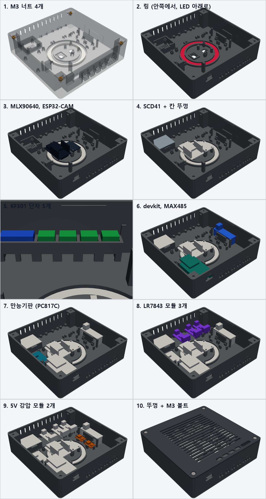
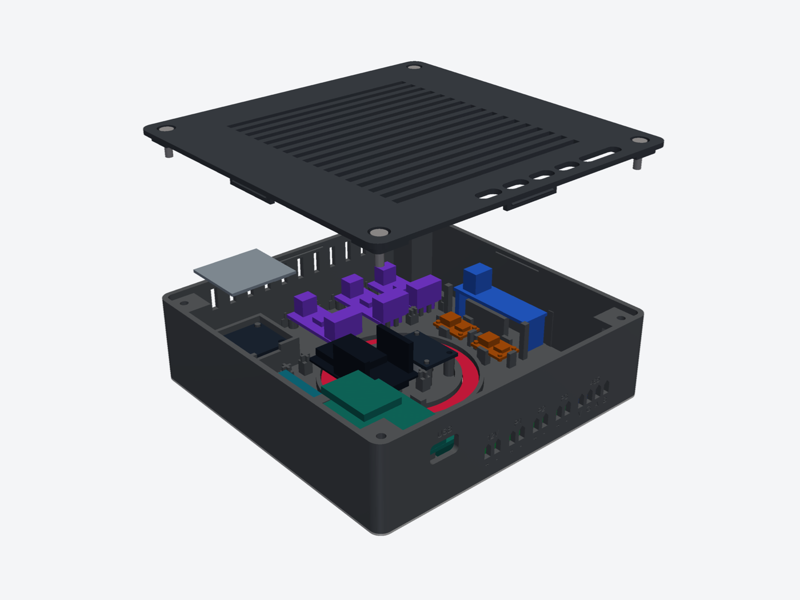
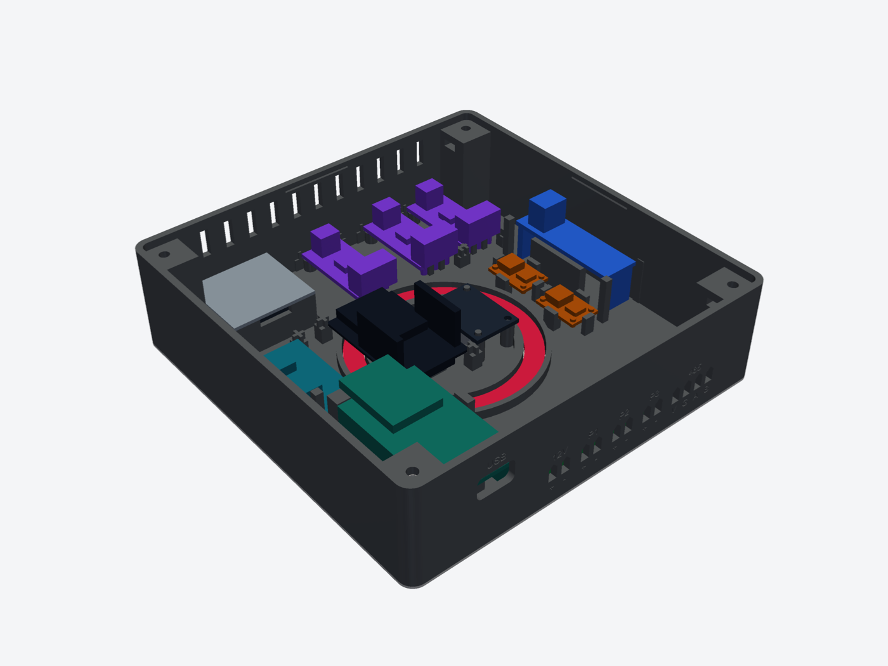
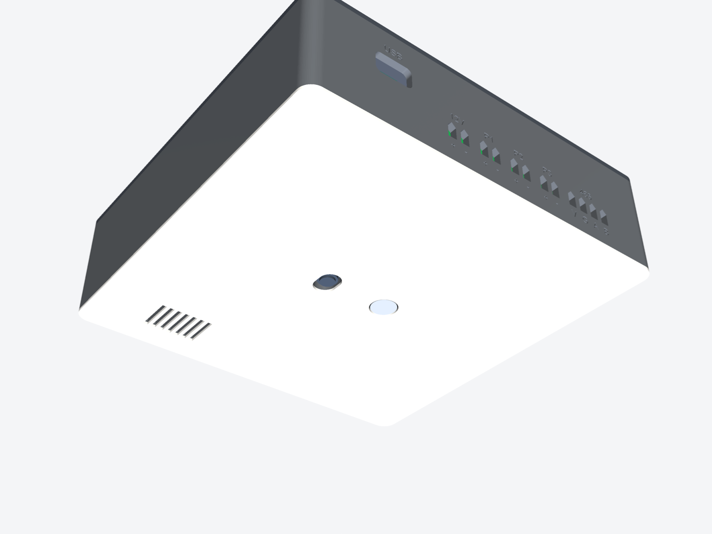
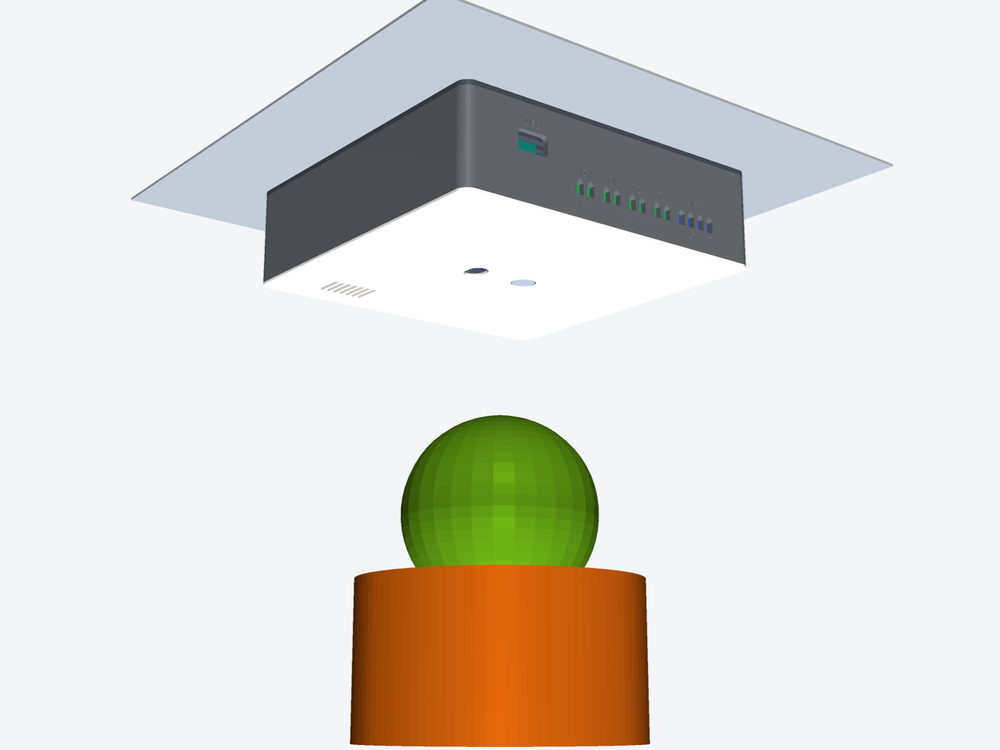

1. **M3 너트:** 네 모서리 기둥 안쪽 면의 홈(높이 29.6~32.4)으로 너트를 밀어 넣습니다. 다른 보드를 넣기 전에 하면 쉽습니다. 헐거우면 마스킹테이프 조각으로 막아 둡니다.
2. **링:** 뒷면 패드 DIN, 5V, GND에 선을 먼저 납땜합니다. 상자 안쪽에서 LED가 아래(센서면)를 보게 포켓에 떨어뜨려 넣으면 디퓨저 막 위에 앉습니다. DIN 패드는 +Y(통풍 슬롯 벽) 쪽으로 둡니다. 포켓 벽 위와 링 가장자리를 핫글루 3점(또는 테이프)으로 잡습니다. 다른 보드를 넣기 전에 해야 손이 닿습니다. 링을 바꿀 때는 ESP32-CAM을 들어내고 글루를 떼면 됩니다.
3. **MLX90640:** 캔을 바닥 구멍에 넣고 대각선 핀 2개에 구멍을 맞춰 얹습니다. 핀 끝이 0.85 나옵니다. 인두로 살짝 녹이거나 핫글루 한 점으로 고정합니다.
4. **ESP32-CAM:** 카메라는 SD 슬롯 위에 붙은 그대로 둡니다. 카메라 쪽을 아래로 해서 홀더를 사각 칼라에 넣습니다. 렌즈 구멍이 앞뒤로 ±1.5 mm 길게 나 있어서 렌즈 위치가 조금 달라도 들어갑니다.
5. **SCD41:** 헤더 없이 기판 윗면(센서 반대쪽) 헤더 구멍에 선을 직접 납땜합니다. 헤더 쪽 긴 변이 -Y(벽 홈 쪽)를 보게 해서 센서가 그릴을 보게 대각선 핀 2개에 끼웁니다. 핀 끝은 인두로 살짝 녹이거나 핫글루 한 점으로 고정합니다. 선을 벽 홈으로 빼고, 뚜껑을 덮은 뒤 홈에 남은 틈은 핫글루나 폼으로 막습니다. STEMMA QT 커넥터는 센서 쪽(아래)에 있어서 이 칸에서는 쓰지 않습니다.
6. **KF301 단자:** 핀에 선을 먼저 납땜하고, 전선 입구가 벽 창을 보게 포켓에 위에서 넣습니다. 선은 포켓 뒷벽 아래 구멍으로 뺍니다.
7. **MAX485, devkit:** 받침에 얹습니다. devkit의 USB-C가 -Y 벽 구멍에 맞습니다.
8. **만능기판:** PC817C 2개와 1kΩ 4개를 납땜하고(배선도 참고, 네 모서리는 비우기) 받침에 얹습니다.
9. **LR7843 모듈:** 신호단이 +Y 벽, 파란 터미널이 가운데를 보게 받침에 얹습니다. 받침 테두리가 위치를 잡아서 나사는 필요 없습니다. 흔들리면 받침에 핫글루 한 점을 찍으세요.
10. **배선:** 핀 배정은 [ARCHITECTURE.md](../../ARCHITECTURE.md) 2.3절에 있습니다.
   - 전원은 두 갈래입니다. **devkit은 USB-C로만** 받고, 나머지는 **12V**에서 받습니다. devkit 5V 핀은 아무 데도 잇지 않습니다(그래서 역류 방지 다이오드가 필요 없습니다).
   - devkit 3.3V 핀 → SCD41, MLX90640, MAX485 VCC. MAX485를 5V로 돌리면 RO 출력 5V가 ESP32 RX를 상하게 합니다.
   - 12V 단자 → 강압 모듈 2개의 IN+/IN−. 강압 1 OUT은 링(5V, GND, 220~470µF)만, 강압 2 OUT은 ESP32-CAM 5V, GND만.
   - CAM 중계 업로드용 4가닥: CAM U0R ← 1kΩ ← devkit 18, CAM U0T → 1kΩ → devkit 19, CAM IO0과 CAM EN은 각각 PC817C로 당깁니다(LED: devkit 25 또는 33 → 1kΩ → LED → GND, 트랜지스터: C → CAM 핀, E → GND). CAM 헤더에는 EN 핀이 없어서 RST 버튼 패드에 선을 납땜합니다.
   - 옵토와 저항을 넣는 이유: 두 보드가 따로 켜지고 꺼지기 때문입니다. 바로 이으면 USB가 빠져 devkit이 꺼졌을 때 그 핀이 CAM EN을 약 0.6V로 붙잡아 CAM이 리셋 상태에 갇힙니다. 이걸로 OTA가 망가져도 상자를 열지 않고 앞면 USB-C로 CAM을 다시 올릴 수 있습니다(12V도 켜 둔 채로).
   - **devkit GND와 12V −를 선 하나로 잇습니다.** 링 데이터(23번)와 RS485 신호의 기준이라 꼭 필요합니다.
   - 신호: devkit GPIO 26(물), 27(양액), 32(pH)를 각 모듈 PWM에, devkit GND를 세 모듈 신호 GND에 연결합니다.
   - 12V: 12V 단자 +, −에서 세 모듈의 +, −로 나눕니다. 모듈 아래 핀에 바로 납땜해도 되고 파란 터미널에 물려도 됩니다.
   - 펌프: 모듈 LOAD를 P단자 −에, 12V +를 P단자 +에 연결합니다. 펌프는 바깥에서 P단자에 물립니다.
   - RS485: 485 단자 V, G를 12V +, −에, A, B를 MAX485 A, B에 연결합니다. SEN0604는 5~30V라 12V로 됩니다.
   - 플라이백 다이오드는 지금은 생략합니다. 그래서 펌프는 켜고 끄기만 하고 PWM은 쓰지 않습니다. 펌프 선은 짧게 꼬아서 I2C, RS485, 링 데이터선과 떨어뜨립니다. 펌프를 끌 때 ESP32가 재부팅되거나 RS485 오류가 나면 펌프 단자에 다이오드(1N5819, 1N4007, 300mA 이하면 1N4148. 줄무늬가 +)를 추가합니다.
11. **뚜껑:** 위에서 눌러 끼우면 네 변 가운데에서 딸깍 걸립니다. 이것만으로도 들고 다닐 수 있습니다. 단단히 하려면 M3 × 8 4개로 조입니다. 머리가 뚜껑 홈에 들어가 면이 평평합니다.
12. **설치:** M3 × 8을 빼고, 상자를 상판 아래에 댄 뒤 위에서 M3 × 12를 상판 팬 구멍 → 뚜껑 → 너트로 조입니다. 상판 구멍이 볼트 머리보다 크면 와셔를 씁니다.

## 주의

- **열 (링 최대 밝기):** 링은 흰색 최대에서 약 7W, 강압 모듈은 약 1W를 내고 70~110°C까지 오를 수 있습니다. 본체가 PLA(55~60°C부터 물러짐)이고 링 아래 면은 0.9 mm라, 처음 켤 때 흰색 최대로 10분 두고 센서면의 링 자리와 모듈을 만져 보세요. 오래 대고 있기 힘들면 밝기를 낮추세요. 촬영 때 몇 초씩 켜는 건 괜찮습니다.
- **12V 2A 어댑터:** 펌프 빼고 약 0.87A를 씁니다. 펌프는 한 번에 하나만 돌리고, 링을 최대로 켠 촬영 중에는 멈춥니다(펌웨어). 펌프는 정격 0.8A 이하로 고르세요.
- **강압 모듈:** 5V판과 3.3V판이 겉모양이 같습니다. 배선 전에 무부하 출력을 재 두세요. 역극성 보호가 없어 보여서 12V를 거꾸로 꽂으면 망가질 수 있습니다.
- **Wi-Fi:** 철판 케이스 안이면 신호가 약할 수 있습니다. 처음 켤 때 RSSI를 확인하세요.
- **열화상 창:** MLX 앞은 뚫린 구멍이어야 합니다. 테이프나 투명판을 붙이면 원적외선이 막힙니다.
- **KF301 토크:** 0.3 N·m 이하로 조이세요(제조사마다 0.29~0.5).

## 실물로 잴 것

모두 판매 도면, 사진, 남의 실측값으로 잡았고 가진 부품으로 잰 값은 아닙니다. 위쪽일수록 틀리면 안 들어갈 수 있습니다.

| 부품 | 잴 곳 | 모델에 넣은 값 | 틀리면 |
|---|---|---|---|
| devkit (하이제니스 HG-ESP32-DEVKIT V4) | USB-C 돌출 (확인만) | 0 (PCB 끝과 같은 면). 제조사 STEP의 다리 구멍 위치와 커넥터 도면(SHOU HAN TYPE-C16PIN)으로 계산 (research/parts_research.md H절). 실측: PCB 1.6, PCB 아랫면에서 USB-C 윗면까지 4.85 (도면과 맞음) | 0~1.5 어느 값이어도 지금 13.5 × 8 구멍으로 끝까지 꽂힘. USB-C 모양으로 꼭 맞는 구멍은 이 보드로는 못 만듦 |
| 강압 모듈 ×2 | 가로 × 세로 | 17.5 × 12 (판매글) → 자리 17.8 × 12.3 | 더 크면 안 들어감 |
| MAX485 | 길이, 터미널·헤더 높이 | 44 × 14.2 (판매자 이미지), 높이 추정 | 더 길면 안 들어감 |
| LR7843 ×3 | 파란 단자 돌출, 단자 피치 | 1.8, 5.0 (3.5일 수도) | 받침 사이 꼬리 자리가 어긋남. 고정 구멍은 안 씀 |
| KF301 | 핀 중심에서 전선 입구 면까지 | 3.1 (Degson) / 3.6 (KEFA) | 창이 0.5 어긋남 (포켓은 둘 다 들어감) |
| KF301 | 전선 입구 면에서 나사 중심까지 | 3.8 (도면 축척 추정) | 벽 쪽으로 더 가 있으면 뚜껑 슬롯에서 드라이버를 2~3° 더 기울여야 함 |
| USB-C 케이블 | 플러그 몸통 | 컷아웃 13.5 × 8, 모서리 R2 | 더 굵거나 13 × 7.4급인데 모서리가 각지면 안 꽂힘 |
| ESP32-CAM | 렌즈 위치, 홀더 높이 | 끝에서 10.8 (출처 10.6~11.5) | 슬롯 ±1.5와 폼 테이프로 흡수 |
| SCD41, MLX90640, 링 | PCB·부품 높이 | PCB 1.6, 링 3.2 | 테이프로 흡수 |
| PC 케이스 상단 | 팬 구멍 간격, 상판 두께 | 124.75, M3 | 레일형 슬롯이면 상관없음. 상판이 1.5 mm보다 두꺼우면 M3 × 14 |
| SEN0604 | 케이블 외경 | 모름 | 단자에 꽂으니 영향 작음 |

## 파일

| 파일 | 내용 |
|---|---|
| build_node.py | 모델, 간섭 검사(부품 더미와 겹치는 부피, 지금 0), 미리보기 |
| slice_node.py | PrusaSlicer로 G-code, out/sd_card에 시간 붙여 복사 |
| out/stl, out/node_v1.step | 출력용 STL, 네 부품 STEP |
| out/build_info.json, out/slice_info.json | 크기·부피·간섭, 출력 시간·무게 |
